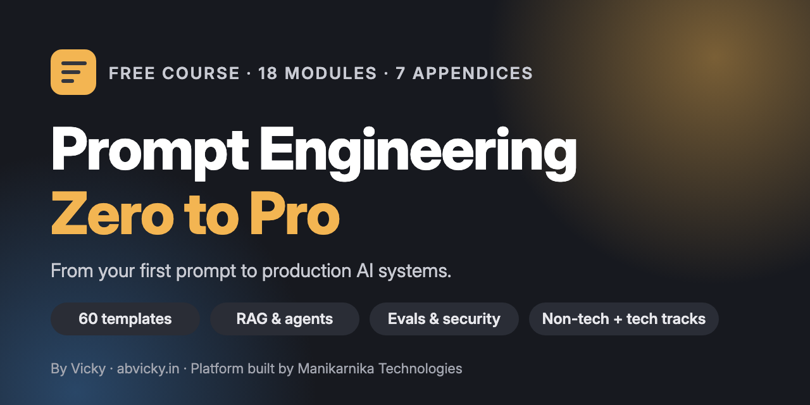
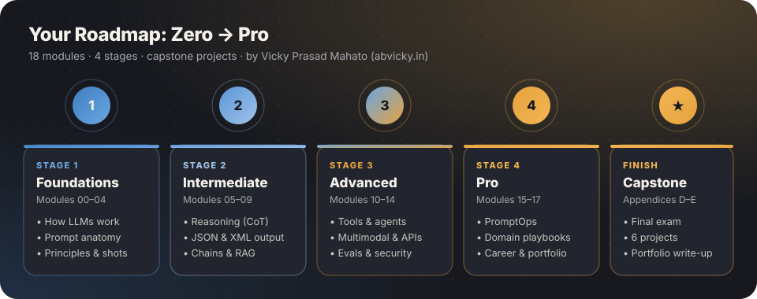

<div align="center">

<a href="https://abvicky.github.io/Prompt-Engineering-by-Vicky/"></a>

# Prompt Engineering: Zero to Pro

**A free, complete prompt engineering course: from your first prompt to production AI systems.**

18 modules · 7 appendices · 60 copy-paste prompt templates · 60+ hands-on exercises · separate Non-Tech and Tech tracks

[](https://abvicky.github.io/Prompt-Engineering-by-Vicky/)
[](https://github.com/ABVicky/Prompt-Engineering-by-Vicky/stargazers)
[](https://abvicky.github.io/Prompt-Engineering-by-Vicky/)

**[Start learning →](https://abvicky.github.io/Prompt-Engineering-by-Vicky/)** &nbsp;·&nbsp; [All lessons](https://abvicky.github.io/Prompt-Engineering-by-Vicky/learn/) &nbsp;·&nbsp; [Cheat sheet](https://abvicky.github.io/Prompt-Engineering-by-Vicky/learn/appendix-a-cheat-sheet.html) &nbsp;·&nbsp; [60 prompt templates](https://abvicky.github.io/Prompt-Engineering-by-Vicky/learn/appendix-b-prompt-library.html)

</div>

---

> ⭐ **If this course helps you, please star the repo.** It's free, and it helps other learners find it.

## Why this course?

Most prompt engineering material is either a list of "magic prompts" that breaks when your task changes, or research papers that never show how to apply them at work. This course sits in between. It explains **why** prompts work (tokens, context, attention, sampling), then turns that into techniques you can use every day, from writing a clear email brief to shipping a tested, secure LLM feature.

- 🧭 **Two tracks, one course.** Switch between **👔 Non-Tech** (ChatGPT, Claude, Gemini, Copilot; no code) and **💻 Tech** (Python SDKs, JSON schemas, tool calling, RAG, evals, CI).
- 🧪 **Learn by doing.** Every module has exercises, before/after prompt rewrites and a quiz, and the course ends with a 40-question final exam and 6 capstone projects.
- 📚 **Nothing else needed.** A cheat sheet, 60 templates, a 90+ term glossary, a troubleshooting guide and a 30-day practice plan are included.
- ⚡ **Fast, private reader.** Search (⌘K), progress tracking, dark mode, keyboard navigation. No sign-up, no tracking, and it works offline.

## Who it's for

| You are… | You'll be able to… |
|---|---|
| A **manager, marketer, writer, founder, analyst or teacher** | Get reliable, on-brand results from AI chat tools, build a team prompt library and set up no-code assistants |
| A **developer, data scientist or ML engineer** | Design structured outputs, tool-using agents and RAG pipelines, then test, secure and ship them to production |
| A **complete beginner** | Understand how large language models actually work, and write clear prompts from day one |

## Curriculum

| Stage | Lessons |
|---|---|
| 🟢 **Foundations** | [00 Welcome](https://abvicky.github.io/Prompt-Engineering-by-Vicky/learn/00-welcome.html) · [01 How LLMs Work](https://abvicky.github.io/Prompt-Engineering-by-Vicky/learn/01-how-llms-work.html) · [02 Anatomy of a Prompt](https://abvicky.github.io/Prompt-Engineering-by-Vicky/learn/02-anatomy-of-a-prompt.html) · [03 Core Principles](https://abvicky.github.io/Prompt-Engineering-by-Vicky/learn/03-core-principles.html) · [04 Zero-Shot, Few-Shot & Roles](https://abvicky.github.io/Prompt-Engineering-by-Vicky/learn/04-zero-few-shot-and-roles.html) |
| 🔵 **Intermediate** | [05 Reasoning & Chain-of-Thought](https://abvicky.github.io/Prompt-Engineering-by-Vicky/learn/05-reasoning-techniques.html) · [06 Structured Output (JSON, XML)](https://abvicky.github.io/Prompt-Engineering-by-Vicky/learn/06-structured-output.html) · [07 System Prompts](https://abvicky.github.io/Prompt-Engineering-by-Vicky/learn/07-system-prompts-and-conversation.html) · [08 Prompt Chaining](https://abvicky.github.io/Prompt-Engineering-by-Vicky/learn/08-prompt-chaining-workflows.html) · [09 Context Engineering & RAG](https://abvicky.github.io/Prompt-Engineering-by-Vicky/learn/09-context-engineering-rag.html) |
| 🟣 **Advanced** | [10 Tool Use & AI Agents](https://abvicky.github.io/Prompt-Engineering-by-Vicky/learn/10-tool-use-and-agents.html) · [11 Multimodal & Image Prompting](https://abvicky.github.io/Prompt-Engineering-by-Vicky/learn/11-multimodal-and-image-prompting.html) · [12 Parameters, APIs & Cost](https://abvicky.github.io/Prompt-Engineering-by-Vicky/learn/12-parameters-apis-and-cost.html) · [13 Evaluation & Testing](https://abvicky.github.io/Prompt-Engineering-by-Vicky/learn/13-evaluation-and-testing.html) · [14 Prompt Injection, Safety & Ethics](https://abvicky.github.io/Prompt-Engineering-by-Vicky/learn/14-safety-security-ethics.html) |
| 🌟 **Pro** | [15 Production PromptOps](https://abvicky.github.io/Prompt-Engineering-by-Vicky/learn/15-production-promptops.html) · [16 Domain Playbooks](https://abvicky.github.io/Prompt-Engineering-by-Vicky/learn/16-domain-playbooks.html) · [17 Becoming a Pro](https://abvicky.github.io/Prompt-Engineering-by-Vicky/learn/17-becoming-a-pro.html) |
| 📚 **Reference** | [A Cheat Sheet](https://abvicky.github.io/Prompt-Engineering-by-Vicky/learn/appendix-a-cheat-sheet.html) · [B 60 Prompt Templates](https://abvicky.github.io/Prompt-Engineering-by-Vicky/learn/appendix-b-prompt-library.html) · [C Glossary](https://abvicky.github.io/Prompt-Engineering-by-Vicky/learn/appendix-c-glossary.html) · [D Final Exam](https://abvicky.github.io/Prompt-Engineering-by-Vicky/learn/appendix-d-final-exam.html) · [E Capstone Projects](https://abvicky.github.io/Prompt-Engineering-by-Vicky/learn/appendix-e-capstone-projects.html) · [F Troubleshooting](https://abvicky.github.io/Prompt-Engineering-by-Vicky/learn/appendix-f-troubleshooting.html) · [G Resources & Papers](https://abvicky.github.io/Prompt-Engineering-by-Vicky/learn/appendix-g-resources.html) |

<p align="center"></p>

## Read it your way

- **Online:** [abvicky.github.io/Prompt-Engineering-by-Vicky](https://abvicky.github.io/Prompt-Engineering-by-Vicky/)
- **Offline:** clone the repo and open `index.html` in any browser. No server or install needed.
  ```bash
  git clone https://github.com/ABVicky/Prompt-Engineering-by-Vicky.git
  ```
- **On GitHub:** every lesson is plain Markdown in [`modules/`](../modules) and [`appendix/`](../appendix).

## Support the course

- ⭐ **Star this repository** so more people can find it.
- 🔗 **Share it** with a colleague, team or study group who is learning to work with AI.
- 🐛 **Found a mistake or have an idea?** [Open an issue](https://github.com/ABVicky/Prompt-Engineering-by-Vicky/issues).

## Author

**Vicky Prasad Mahato**: system architect and software engineer, Kolkata, India · [abvicky.in](https://abvicky.in) · [LinkedIn](https://www.linkedin.com/in/abvicky/) · [GitHub](https://github.com/ABVicky)

Platform built by **[Manikarnika Technologies](https://www.manikarnikatechnologies.in/)**.

## Copyright

© 2026 **[Manikarnika Technologies](https://www.manikarnikatechnologies.in/)**. All rights reserved. This course is provided for personal learning and educational use. Redistribution, commercial resale, republication, or training on these materials without express written authorization is prohibited. See the [full terms](../README.md#7-copyright--terms-of-use).
