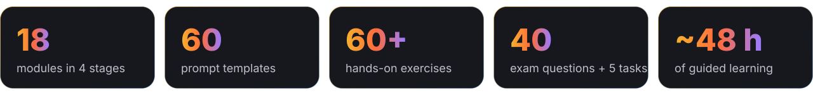
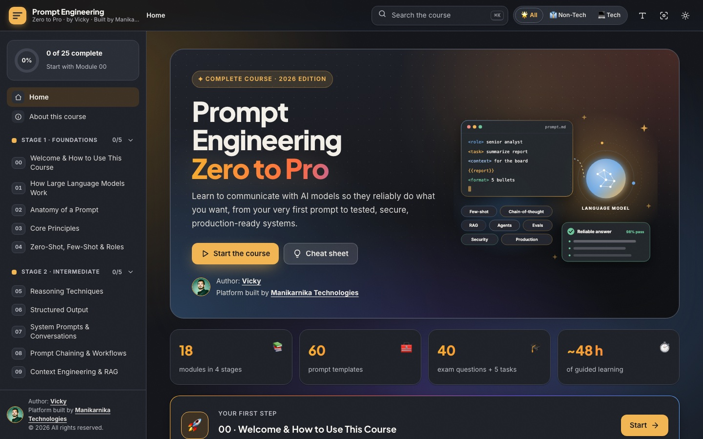
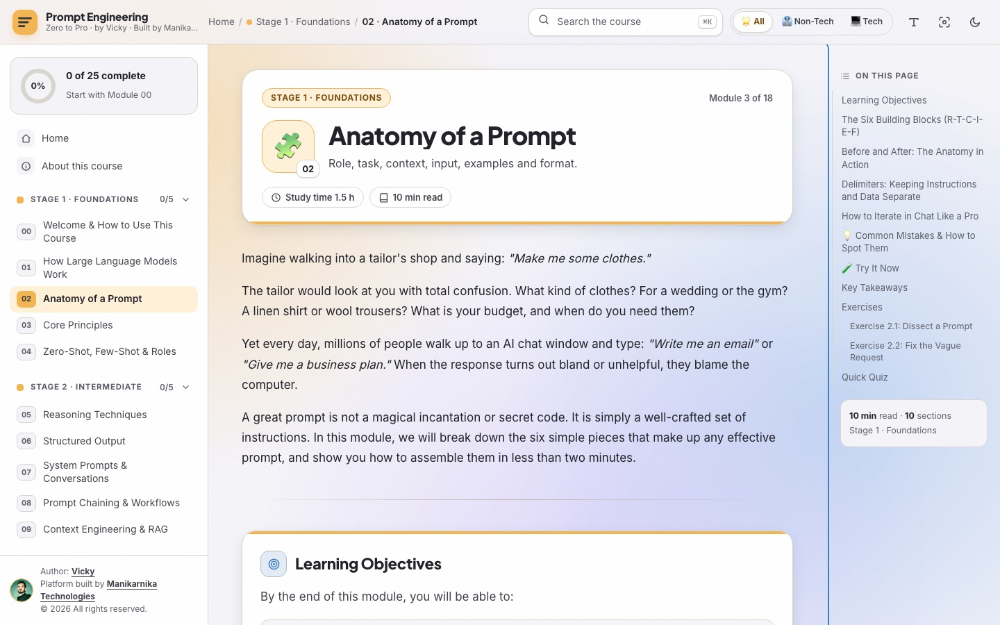

 

<h3>
  <a href="https://abvicky.github.io/Prompt-Engineering-by-Vicky/">🚀 Start learning</a>
   · 
  <a href="https://abvicky.github.io/Prompt-Engineering-by-Vicky/learn/">📖 All lessons</a>
   · 
  <a href="https://abvicky.github.io/Prompt-Engineering-by-Vicky/learn/appendix-a-cheat-sheet.html">📋 Cheat sheet</a>
   · 
  <a href="https://abvicky.github.io/Prompt-Engineering-by-Vicky/learn/appendix-b-prompt-library.html">🧰 60 templates</a>
   · 
  <a href="https://abvicky.github.io/Prompt-Engineering-by-Vicky/learn/appendix-d-final-exam.html">🎓 Final exam</a>
</h3>

<i>A free, complete course that teaches you to talk to AI models so they reliably do what you want, from your very first prompt to tested, secure, production-ready systems.</i>

 

 

> [!TIP]
> **⭐ Star this repo** to save it for later. It's free, and it helps other learners find the course.

## ✨ Why this course

Most prompt engineering material is either a list of "magic prompts" that breaks the moment your task changes, or a research paper that never shows you how to use it at work. This course sits in between: it explains **why** prompts work, then turns that into habits you can use every day.

<table>
<tr>
<td width="33%" valign="top">

### 🧠 Understand, don't memorize
Plain-language explanations of tokens, context windows, attention and sampling, so you know *why* a prompt works and can fix it when it doesn't.

</td>
<td width="33%" valign="top">

### ❌➡️✅ Prompt makeovers
Side-by-side weak and strong prompts in every module, so you see exactly what changed and why the result got better.

</td>
<td width="33%" valign="top">

### 🏋️ Learn by doing
60+ exercises with worked solutions, a quiz per module, a 40-question final exam and 6 portfolio-ready capstone projects.

</td>
</tr>
<tr>
<td width="33%" valign="top">

### 🧭 Two tracks, one course
Switch between **👔 Non-Tech** (chat tools, no code) and **💻 Tech** (SDKs, schemas, agents, evals) with one click.

</td>
<td width="33%" valign="top">

### 🧰 Ready to use at work
A one-page cheat sheet, 60 copy-paste templates, a 90+ term glossary and a symptom → cause → fix troubleshooting guide.

</td>
<td width="33%" valign="top">

### 🔒 Free, private, offline
No sign-up, no paywall, no tracking. Read it online, or clone the repo and open `index.html` without internet.

</td>
</tr>
</table>

## 🖥️ A reader built for learning

<table>
<tr>
<td width="50%"></td>
<td width="50%"></td>
</tr>
<tr>
<td align="center"><b>Home</b>: your progress, learning path and next step</td>
<td align="center"><b>Lessons</b>: clear structure, table of contents, light and dark themes</td>
</tr>
</table>

🔎 **Instant search** (<kbd>⌘</kbd> <kbd>K</kbd>) · 📈 **Progress tracking** · 🌗 **Light & dark themes** · 🎯 **Audience tracks** · 📱 **Works on phones** · ⌨️ **Keyboard navigation** (<kbd>←</kbd> <kbd>→</kbd>)

## 🎯 Who it's for

<table>
<tr>
<th width="50%">👔 Non-Tech Track</th>
<th width="50%">💻 Tech Track</th>
</tr>
<tr>
<td valign="top">

**For** managers, marketers, writers, founders, analysts, teachers and anyone who uses AI at work.

**You'll use** ChatGPT, Claude, Gemini and Microsoft Copilot. No code needed.

**You'll be able to**
- Get reliable, on-brand results on the first try
- Summarize, analyze and draft in minutes
- Build custom assistants and a team prompt library

</td>
<td valign="top">

**For** software engineers, data scientists and ML engineers building with LLMs.

**You'll use** Python / Node SDKs, JSON Schema, Pydantic, tool calling and Git.

**You'll be able to**
- Design structured outputs and tool-using agents
- Build and ground RAG pipelines with citations
- Test, secure and ship prompts to production

</td>
</tr>
</table>

> **New to all of this?** Start with the Non-Tech track. Every concept is explained from zero, and you can switch tracks any time.

## 🗺️ Curriculum

<b>🟢 Stage 1: Foundations</b> · How LLMs work and how to write clear, complete prompts.

 

| | Lesson | What you'll learn | Time |
|:--|:--|:--|:--|
| 🚀 **00** | [Welcome & How to Use This Course](https://abvicky.github.io/Prompt-Engineering-by-Vicky/learn/00-welcome.html) | Roadmap, practice lab setup, study plans and the pro mindset. | 30 min |
| 🧠 **01** | [How Large Language Models Work](https://abvicky.github.io/Prompt-Engineering-by-Vicky/learn/01-how-llms-work.html) | Tokens, context windows, attention, temperature and limits. | 2 h |
| 🧩 **02** | [Anatomy of a Prompt](https://abvicky.github.io/Prompt-Engineering-by-Vicky/learn/02-anatomy-of-a-prompt.html) | Role, task, context, input, examples and format. | 1.5 h |
| 📏 **03** | [Core Principles](https://abvicky.github.io/Prompt-Engineering-by-Vicky/learn/03-core-principles.html) | The 12 principles behind every effective prompt. | 2 h |
| 🎭 **04** | [Zero-Shot, Few-Shot & Roles](https://abvicky.github.io/Prompt-Engineering-by-Vicky/learn/04-zero-few-shot-and-roles.html) | Examples, personas, prefilling and output priming. | 2 h |

<b>🔵 Stage 2: Intermediate</b> · Reasoning, structure, system prompts, chains and context.

 

| | Lesson | What you'll learn | Time |
|:--|:--|:--|:--|
| 🧮 **05** | [Reasoning Techniques](https://abvicky.github.io/Prompt-Engineering-by-Vicky/learn/05-reasoning-techniques.html) | Chain-of-thought, self-consistency, ToT and reasoning models. | 3 h |
| 🧱 **06** | [Structured Output](https://abvicky.github.io/Prompt-Engineering-by-Vicky/learn/06-structured-output.html) | Reliable JSON, schemas, XML tags, tables and validation. | 2 h |
| 🗣️ **07** | [System Prompts & Conversations](https://abvicky.github.io/Prompt-Engineering-by-Vicky/learn/07-system-prompts-and-conversation.html) | Personas, memory, edge cases and escalation. | 2 h |
| 🔗 **08** | [Prompt Chaining & Workflows](https://abvicky.github.io/Prompt-Engineering-by-Vicky/learn/08-prompt-chaining-workflows.html) | Sequential, routing, parallel and evaluator patterns. | 2.5 h |
| 📚 **09** | [Context Engineering & RAG](https://abvicky.github.io/Prompt-Engineering-by-Vicky/learn/09-context-engineering-rag.html) | Long context, retrieval, grounding and citations. | 3 h |

<b>🟣 Stage 3: Advanced</b> · Agents, multimodal, APIs, evaluation and security.

 

| | Lesson | What you'll learn | Time |
|:--|:--|:--|:--|
| 🤖 **10** | [Tool Use & Agents](https://abvicky.github.io/Prompt-Engineering-by-Vicky/learn/10-tool-use-and-agents.html) | Function calling, agent loops, MCP and guardrails. | 3.5 h |
| 🖼️ **11** | [Multimodal & Image Prompting](https://abvicky.github.io/Prompt-Engineering-by-Vicky/learn/11-multimodal-and-image-prompting.html) | Vision, image, audio and video generation prompts. | 2.5 h |
| ⚙️ **12** | [Parameters, APIs & Cost](https://abvicky.github.io/Prompt-Engineering-by-Vicky/learn/12-parameters-apis-and-cost.html) | Sampling settings, SDKs, streaming, cost and latency. | 2.5 h |
| 📊 **13** | [Evaluation & Testing](https://abvicky.github.io/Prompt-Engineering-by-Vicky/learn/13-evaluation-and-testing.html) | Test sets, graders, LLM-as-judge and metrics. | 3 h |
| 🛡️ **14** | [Safety, Security & Ethics](https://abvicky.github.io/Prompt-Engineering-by-Vicky/learn/14-safety-security-ethics.html) | Prompt injection, jailbreaks, hallucinations, responsible AI. | 3 h |

<b>🌟 Stage 4: Pro</b> · Production practice, domain playbooks and your career.

 

| | Lesson | What you'll learn | Time |
|:--|:--|:--|:--|
| 🏭 **15** | [Production PromptOps](https://abvicky.github.io/Prompt-Engineering-by-Vicky/learn/15-production-promptops.html) | Versioning, templates, observability and migrations. | 3 h |
| 🧭 **16** | [Domain Playbooks](https://abvicky.github.io/Prompt-Engineering-by-Vicky/learn/16-domain-playbooks.html) | Code, writing, marketing, data, research, education and more. | 4 h |
| 🌟 **17** | [Becoming a Pro](https://abvicky.github.io/Prompt-Engineering-by-Vicky/learn/17-becoming-a-pro.html) | Meta-prompting, optimization, portfolio and interviews. | 2.5 h |

<b>📚 Reference: Appendices</b> · Cheat sheet, templates, glossary, exam and projects.

 

| | Lesson | What you'll learn | Time |
|:--|:--|:--|:--|
| 📋 **A** | [Cheat Sheet](https://abvicky.github.io/Prompt-Engineering-by-Vicky/learn/appendix-a-cheat-sheet.html) | The one-page checklist, technique picker and anti-patterns. | reference |
| 🧰 **B** | [Prompt Library](https://abvicky.github.io/Prompt-Engineering-by-Vicky/learn/appendix-b-prompt-library.html) | 60 ready-to-use templates across 10 categories. | reference |
| 📖 **C** | [Glossary](https://abvicky.github.io/Prompt-Engineering-by-Vicky/learn/appendix-c-glossary.html) | 90+ terms from A to Z, linked to modules. | reference |
| 🎓 **D** | [Final Exam](https://abvicky.github.io/Prompt-Engineering-by-Vicky/learn/appendix-d-final-exam.html) | 40 questions and 5 practical tasks with answers. | 1 h |
| 🏆 **E** | [Capstone Projects](https://abvicky.github.io/Prompt-Engineering-by-Vicky/learn/appendix-e-capstone-projects.html) | Six portfolio projects with levels and success criteria. | project |
| 🩺 **F** | [Troubleshooting](https://abvicky.github.io/Prompt-Engineering-by-Vicky/learn/appendix-f-troubleshooting.html) | Symptom, cause and fix for common prompt problems. | reference |
| 🔗 **G** | [Resources & Papers](https://abvicky.github.io/Prompt-Engineering-by-Vicky/learn/appendix-g-resources.html) | Official guides, landmark papers, tools and practice plan. | reference |

## 🚀 Get started

| | How | Best for |
|:--|:--|:--|
| 🌐 | **[Read online →](https://abvicky.github.io/Prompt-Engineering-by-Vicky/)** | Learning on any device, right now |
| 💻 | `git clone https://github.com/ABVicky/Prompt-Engineering-by-Vicky.git` then open `index.html` | Reading offline, no install or server needed |
| 📄 | Browse [`modules/`](../modules) and [`appendix/`](../appendix) | Reading the plain Markdown on GitHub |

**Suggested pace:** one module every two or three days takes about six weeks. Short on time? Do Modules 00–04 and the cheat sheet in a weekend, and you'll already prompt better than most people.

## ❓ FAQ

<b>Is it really free?</b>

 
Yes. Every module, template, exercise and the final exam are free, with no sign-up and no locked chapters.

<b>Do I need to know how to code?</b>

 
No. The Non-Tech track uses everyday chat tools only. Code examples sit in the Tech track and can be hidden with one click.

<b>Which AI tools does it cover?</b>

 
The techniques work with any modern model. Examples use ChatGPT, Claude, Gemini and Copilot, and the Tech track covers the OpenAI, Anthropic and Google SDKs.

<b>How long does it take?</b>

 
About 48 hours of guided learning in total. Each module shows its study time, and you can stop and resume any time: your progress is saved in your browser.

<b>Will it go out of date?</b>

 
The course teaches principles (clear instructions, examples, structure, evaluation, security) that carry over from one model generation to the next, and it is updated as the field moves.

## 💛 Support the course

- ⭐ **[Star the repo](https://github.com/ABVicky/Prompt-Engineering-by-Vicky)** so more learners can find it
- 🔗 **Share it** with a friend, colleague or study group
- 🐛 **[Open an issue](https://github.com/ABVicky/Prompt-Engineering-by-Vicky/issues)** if you spot a mistake or have an idea

## 👤 Author

<table>
<tr>
<td width="120" align="center" valign="top"></td>
<td valign="top">

**Vicky Prasad Mahato** · Course author, system architect and software engineer, Kolkata, India

[🌐 abvicky.in](https://abvicky.in) · [💼 LinkedIn](https://www.linkedin.com/in/abvicky/) · [💻 GitHub](https://github.com/ABVicky)

Platform built by **[Manikarnika Technologies](https://www.manikarnikatechnologies.in/)**.

</td>
</tr>
</table>

## © Copyright

© 2026 **[Manikarnika Technologies](https://www.manikarnikatechnologies.in/)**. All rights reserved. This course is provided for personal learning and educational use. Redistribution, commercial resale, republication, or training on these materials without express written authorization is prohibited. See the [full terms](../README.md#7-copyright--terms-of-use).

 

  
Made with care for learners everywhere · If it helped you, a ⭐ means a lot

