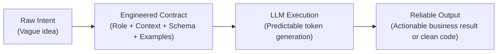
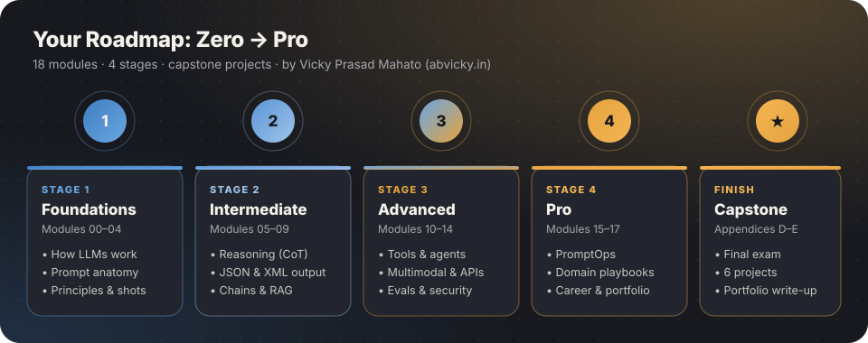

# 🎯 Prompt Engineering: Zero to Pro

### The complete, practical guide: from your first prompt to production AI systems

> 💡 **Welcome to the course!** Every concept, technique, blueprint, and template you need is inside this reader. There are no paid upgrades, no locked chapters, and no hidden dependencies. Whether you are leading a team or writing backend code, this guide was built to take you from day one to professional mastery.

---

## 1. Why Prompt Engineering Matters

Most people use AI chatbots like a search engine or a slot machine: they type a vague question, hope for a miracle, and feel let down when the answer comes out generic, inaccurate, or fabricated.

Much of the advice online swings between two extremes:
- **Superficial "magic prompt cheat sheets"** that break down the moment your task changes.
- **Dense academic papers** filled with equations that never explain how to solve real problems at work.

This course takes a practical path. It treats prompts as **clear interface contracts** between your intent and probabilistic language models. 

Once you understand what's going on underneath (how tokens work, how the model decides what to pay attention to, how to pin down the shape of an answer, and how to break big jobs into steps), prompting stops being a guessing game. It becomes a reliable, repeatable craft.

---

## 2. Two Tailored Pathways: Non-Tech vs. Tech

We designed this course with dual pathways so every lesson gives you direct, actionable depth regardless of your technical background. 

You can switch between tracks anytime using the **audience switcher on the top navigation bar** (`🌟 All`, `👔 Non-Tech`, `💻 Tech`):

> 👔 **Non-Tech Track · Everyday & Business:**
> Built for product managers, marketers, writers, founders, analysts, educators, and team leads. You will use everyday chat tools like ChatGPT, Claude Projects, Google Gemini, and Microsoft Copilot to draft executive memos, analyze messy spreadsheets, summarize lengthy documents, and build custom no-code assistants that save hours every week.

> 💻 **Tech Track · Developer & Engineering:**
> Built for software engineers, full-stack developers, data scientists, and ML architects. You will treat prompts as versioned code components using Python SDKs, strict Pydantic schemas, function calling, Model Context Protocol (MCP), autonomous ReAct agent loops, hybrid vector RAG pipelines, and automated CI/CD eval regression suites.

| Dimension | 👔 Non-Tech Track | 💻 Tech Track |
|---|---|---|
| **Primary Audience** | Business leaders, creators, managers, analysts, educators | Developers, data teams, software architects |
| **Primary Tools** | ChatGPT, Claude Projects, Microsoft Copilot, Gemini | Python/Node SDKs, OpenAI/Anthropic APIs, Pydantic, Git |
| **Prerequisites** | None! Clear communication and domain knowledge | Familiarity with Python or JavaScript |
| **Core Skills** | The workplace briefing method, Custom GPTs, chat chains | Structured schemas, tool use, RAG pipelines, CI/CD evals |
| **Final Deliverable** | A team prompt library and automated business assistants | A production-ready LLM service with automated tests |

> 💡 **Live Track Filtering:** Selecting **👔 Non-Tech** on the top bar cleanly hides technical code blocks and developer notes across the entire reader. Selecting **💻 Tech** hides the non-tech callouts so engineers can focus directly on architecture and code. Selecting **🌟 All** keeps everything visible.

---

## 3. The 4-Stage Curriculum Roadmap

The curriculum is divided into four sequential stages, plus an extensive reference vault. You can complete the full course in sequence or jump directly to the modules you need today:

### 🟢 Stage 1: Foundations (Modules 00–04)
*Build reliable mental models and master core prompt mechanics.*
- **[Module 00: Welcome & How to Use This Course](modules/00-welcome.md)** — The professional mindset, setting up your 5-minute practice lab (no-code or Python), study plans, and privacy rules.
- **[Module 01: How Large Language Models Work](modules/01-how-llms-work.md)** — Tokens, context windows, next-token prediction, temperature, top-p, training stages, and why models hallucinate.
- **[Module 02: Anatomy of a Prompt](modules/02-anatomy-of-a-prompt.md)** — The six essential prompt elements, delimiters, dynamic variable separation, and clear task framing.
- **[Module 03: Core Principles](modules/03-core-principles.md)** — The 12 battle-tested rules behind every high-performing prompt.
- **[Module 04: Zero-Shot, Few-Shot & Role Prompting](modules/04-zero-few-shot-and-roles.md)** — Example formatting, assistant prefilling, in-context learning, and crafting domain personas.

### 🔵 Stage 2: Intermediate Techniques (Modules 05–09)
*Solve complex problems, enforce formats, and connect private data.*
- **[Module 05: Reasoning Techniques](modules/05-reasoning-techniques.md)** — Chain-of-Thought (CoT), Tree of Thoughts, and working with modern test-time compute reasoning ("thinking") models.
- **[Module 06: Structured Output](modules/06-structured-output.md)** — Clean tables and CSVs for spreadsheets, strict JSON Schemas, Pydantic validation, and XML boundaries.
- **[Module 07: System Prompts & Conversation Design](modules/07-system-prompts-and-conversation.md)** — Custom Instructions, Claude Projects, prompt caching, conversation state, and memory.
- **[Module 08: Prompt Chaining & Workflows](modules/08-prompt-chaining-workflows.md)** — Step-by-step chat workflows, deterministic DAG pipelines, routing, parallel execution, and evaluator gates.
- **[Module 09: Context Engineering & RAG](modules/09-context-engineering-rag.md)** — Long-context limits, "lost in the middle," document Q&A, citations, embeddings, chunking, and hybrid vector search.

### 🟣 Stage 3: Advanced Architectures (Modules 10–14)
*Build autonomous agents, integrate external tools, and secure your systems.*
- **[Module 10: Tool Use, Function Calling & Agents](modules/10-tool-use-and-agents.md)** — Tool definitions, the ReAct loop, Model Context Protocol (MCP), and human-in-the-loop guardrails.
- **[Module 11: Multimodal & Image Prompting](modules/11-multimodal-and-image-prompting.md)** — Vision analysis, document OCR extraction, UI code from mockups, and image generation prompts.
- **[Module 12: Model Parameters, APIs & Cost](modules/12-parameters-apis-and-cost.md)** — Sampling dials, streaming responses, provider SDKs, latency optimization, and token cost economics.
- **[Module 13: Evaluation & Testing](modules/13-evaluation-and-testing.md)** — Creating golden test sets, rubrics, LLM-as-a-Judge, automated scoring, and CI/CD regression gates.
- **[Module 14: Safety, Security & Ethics](modules/14-safety-security-ethics.md)** — Direct and indirect prompt injection, jailbreaking, data leakage, red-teaming, and defense-in-depth architectures.

### 🌟 Stage 4: Production & Career (Modules 15–17)
*Ship production software, lead AI operations, and build your career.*
- **[Module 15: Production Prompt Engineering](modules/15-production-promptops.md)** — Version control with Git, prompt telemetry, tracing, observability, and fallback cascades.
- **[Module 16: Domain Playbooks](modules/16-domain-playbooks.md)** — 11 detailed field guides (Software Development, Writing & Editing, Marketing & Sales, Data & SQL, Research, Teaching, Operations, Support, HR, Legal/Finance, and Personal Productivity).
- **[Module 17: Becoming a Pro](modules/17-becoming-a-pro.md)** — Meta-prompting, portfolio building, freelancing, and career roadmaps for AI Operations Leaders and Production AI Engineers.

### 📚 The Reference Vault (Appendices A–G)
*Your permanent desktop reference library.*
- **[Appendix A: Cheat Sheet](appendix/A-cheat-sheet.md)** — Rapid-lookup rules, syntax patterns, and checklists for daily prompting.
- **[Appendix B: Prompt Library](appendix/B-prompt-library.md)** — 60 tested, copy-paste prompt templates across 10 business and technical categories.
- **[Appendix C: Glossary](appendix/C-glossary.md)** — 90+ prompt engineering and AI terms, defined in plain English with technical context.
- **[Appendix D: Final Exam](appendix/D-final-exam.md)** — 40 comprehensive questions and 5 practical tasks to validate your understanding.
- **[Appendix E: Capstone Projects](appendix/E-capstone-projects.md)** — 6 end-to-end portfolio projects (3 Non-Tech and 3 Tech) with evaluation rubrics.
- **[Appendix F: Troubleshooting Guide](appendix/F-troubleshooting.md)** — Systematic diagnosis matrix: symptom → root cause → proven fix.
- **[Appendix G: Resources & Practice Plan](appendix/G-resources.md)** — Recommended papers, official documentation, benchmarks, and a structured 30-day study plan.

---

## 4. What Makes This Reader Special

We built this learning environment to be fast, distraction-free, and respectful of your privacy:

- 🏠 **Home Hub:** View overall progress, continue from your last read module, and scan stage overviews.
- 🎯 **Track Lens Switcher:** Toggle between **🌟 All**, **👔 Non-Tech**, and **💻 Tech** at any time. Content and Table of Contents update immediately.
- 🔎 **Instant Search:** Press **⌘K** or **/** anywhere in the app to find any term, prompt pattern, or section across the entire curriculum.
- 🌗 **High-Contrast Design System:** Custom light and dark themes using a focused Mustard (`#F3B552`), Navy Blue (`#407EBF`), and Charcoal palette tested for readability.
- 📱 **100% Offline & Private:** Zero third-party trackers, zero cookies, zero analytics. Your module completion progress stays in your local browser storage.
- ⌨️ **Keyboard-First Navigation:** Use the **←** and **→** arrow keys to step between modules, and **Esc** to dismiss palettes or zoom windows.

---

## 5. Meet the Author

  

    
  

  

    <h3>Vicky Prasad Mahato</h3>
    Course Author · System Architect
    

      Vicky Prasad Mahato (online as <strong>abvicky</strong>) is a system architect, software engineer, and digital product builder based in Kolkata, India. He builds resilient digital systems and software tools, with a strong focus on offline-first architectures, personal data sovereignty, and practical artificial intelligence.
    

    

      As the founder of the <strong>Coders' Club at BBIT Kolkata</strong> and former student coordinator at the Innovation and Incubation Center (IIC) and Entrepreneurship Development Cell (EDC), Vicky has mentored hundreds of student developers in software design, problem solving, and modern development practices. He is also the creator of open-source projects including <em>Mera Paisaa</em>, an offline-first personal expense and financial tracking system.
    

    

      <strong>Author's Teaching Philosophy:</strong> <em>"Prompt engineering is not about finding 'magic spells'. It is the engineering discipline of providing clear, unambiguous interface contracts to generative models. When you understand how language models interpret context, you gain an unfair advantage in whatever work you do."</em>
    

    

      <a class="pill-btn primary" href="https://abvicky.in" target="_blank" rel="noopener">🌐 abvicky.in</a>
      <a class="pill-btn" href="https://www.linkedin.com/in/abvicky/" target="_blank" rel="noopener">💼 LinkedIn Profile</a>
      <a class="pill-btn" href="https://github.com/ABVicky" target="_blank" rel="noopener">💻 GitHub (@ABVicky)</a>
    

  

---

## 6. Platform & Technical Infrastructure

  

    
  

  

    <h3>Manikarnika Technologies</h3>
    Platform Architecture & Development
    

      The custom reading experience, interactive design system, live audience lens engine, client-side search infrastructure, and responsive web components were designed and engineered by <strong>Manikarnika Technologies</strong>.
    

    

      Manikarnika Technologies builds high-performance, distraction-free educational platforms, developer tooling, and modern digital infrastructure. The platform was created from the ground up without heavy external frameworks, providing instantaneous page loads, zero runtime bloat, and full privacy for learners worldwide.
    

    

      <a class="pill-btn primary" href="https://www.manikarnikatechnologies.in/" target="_blank" rel="noopener">🌐 manikarnikatechnologies.in</a>
    

  

---

## 7. Copyright & Terms of Use

© 2026 **[Manikarnika Technologies](https://www.manikarnikatechnologies.in/)**. All rights reserved.

- **Course Author:** **[Vicky Prasad Mahato](https://abvicky.in)** ([LinkedIn](https://www.linkedin.com/in/abvicky/) · [GitHub](https://github.com/ABVicky))
- **Platform Architecture & Development:** **[Manikarnika Technologies](https://www.manikarnikatechnologies.in/)**

This course, including its text, diagrams, exercises, code examples, and instructional designs, is provided for personal learning and educational use. Redistribution, commercial resale, republication, or training on these materials without express written authorization is prohibited. All product names, logos, and brands mentioned are property of their respective owners and are used solely for identification and educational reference.
