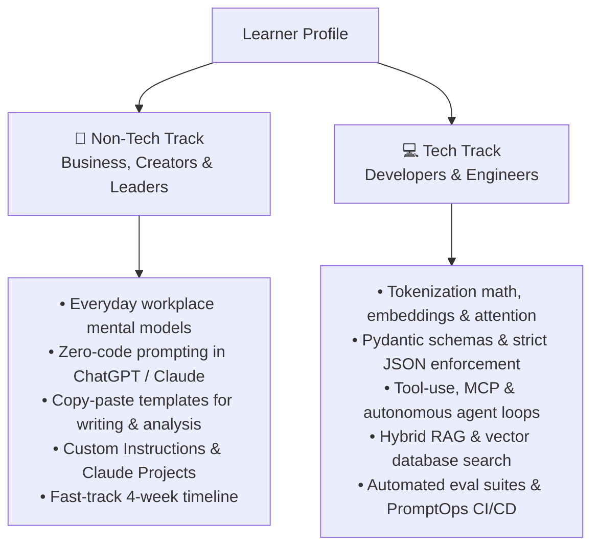

# 🎯 Prompt Engineering: Zero to Pro

### The complete course: from your first prompt to production AI systems

| ✍️ Author | 🌐 Website | 📅 Edition | 📈 Level | ⏱️ Duration |
|---|---|---|---|---|
| **Vicky Prasad Mahato** | [abvicky.in](https://abvicky.in) | 2026 | Absolute beginner → Professional | ~45–50 h + capstone |


---

## 📌 About This Course

This is a **complete, self-contained** prompt engineering course. Every concept, technique, template, exercise, and reference you need is inside these pages, so you don't need to look anywhere else.

You'll learn how Large Language Models actually work, how to write prompts that reliably produce what you want, and how professionals design, evaluate, secure and ship prompt-powered products.

### ✨ What's inside

| | |
|---|---|
| 📚 **18 modules** | From "what is a token?" to agents, RAG, evaluation, security and production |
| 🖼️ **Visuals** | Custom diagrams, flowcharts and illustrations in every stage |
| ❌➡️✅ **Before/after makeovers** | See exactly what turns a weak prompt into a strong one |
| 🏋️ **60+ exercises** | With hidden, worked solutions |
| ✅ **Quizzes** | After every module, plus a 40-question final exam |
| 📋 **Cheat sheet** | One-page reference for daily use |
| 📚 **60 prompt templates** | Ready to copy for writing, code, data, business, education and more |
| 📖 **Glossary** | 90+ terms, A–Z |
| 🩺 **Troubleshooting guide** | Symptom → cause → fix |
| 🏆 **6 capstone projects** | Portfolio-ready, with levels and success criteria |

---

## 🎯 Two Tailored Tracks: Non-Tech vs Tech

This course is designed with dual pathways so that whether you are writing business memos in a web browser or shipping production LLM microservices in Python, every lesson gives you actionable, relevant depth.



| Dimension | 👔 Non-Tech Track | 💻 Tech Track |
|---|---|---|
| **Audience** | Product managers, marketers, writers, founders, analysts, educators | Software engineers, full-stack devs, data scientists, ML architects |
| **Primary Tools** | ChatGPT, Claude Projects, Google Gemini, MS Copilot | Python / Node SDKs, OpenAI/Anthropic APIs, Pydantic, Ollama, Git |
| **Prerequisites** | None! Clear communication and domain knowledge | Basic comfort with Python or JavaScript |
| **Core Modules** | 00–08, 09 (doc chat), 11, 14 (privacy), 16 (playbooks), 17 | All 18 modules (00–17) with deep focus on 06, 09, 10, 12, 13, 14, 15 |
| **Deliverable** | High-leverage workflow prompts, Custom GPTs, business playbook | Production-tested prompt pipelines, function-calling agents, eval suites |

---

## 🗺️ Curriculum


### 🟢 Stage 1: Foundations

| # | Module | You'll learn | Track Fit |
|---|---|---|---|
| 00 | [Welcome & How to Use This Course](modules/00-welcome.md) | Roadmap, dual lab setup, study plans, the pro mindset | 🌟 Both |
| 01 | [How Large Language Models Work](modules/01-how-llms-work.md) | Tokens, context windows, attention, temperature, training, limits | 🌟 Both (plain analogies + math) |
| 02 | [Anatomy of a Prompt](modules/02-anatomy-of-a-prompt.md) | Role, task, context, input, examples, format; delimiters | 🌟 Both (Executive brief + API schemas) |
| 03 | [Core Principles](modules/03-core-principles.md) | The 12 principles behind every good prompt | 🌟 Both |
| 04 | [Zero-Shot, Few-Shot & Role Prompting](modules/04-zero-few-shot-and-roles.md) | Examples, personas, prefilling, in-context learning | 🌟 Both |

### 🔵 Stage 2: Intermediate

| # | Module | You'll learn | Track Fit |
|---|---|---|---|
| 05 | [Reasoning Techniques](modules/05-reasoning-techniques.md) | CoT, self-consistency, ToT, reasoning models (o1/o3/Claude 3.7) | 🌟 Both |
| 06 | [Structured Output](modules/06-structured-output.md) | JSON schemas, Pydantic, XML, Markdown tables, CSVs | 👔 Tables/CSVs · 💻 Strict Schemas |
| 07 | [System Prompts & Conversation Design](modules/07-system-prompts-and-conversation.md) | Personas, Custom Instructions, memory, state management | 👔 Projects · 💻 State serialization |
| 08 | [Prompt Chaining & Workflows](modules/08-prompt-chaining-workflows.md) | Sequential, routing, parallel, evaluator patterns | 👔 Chat chains · 💻 DAG pipelines |
| 09 | [Context Engineering & RAG](modules/09-context-engineering-rag.md) | Long context, retrieval, grounding, citations, vector DBs | 👔 Doc uploads · 💻 Embeddings/hybrid search |

### 🟣 Stage 3: Advanced

| # | Module | You'll learn | Track Fit |
|---|---|---|---|
| 10 | [Tool Use, Function Calling & Agents](modules/10-tool-use-and-agents.md) | Tool schemas, ReAct loop, MCP, guardrails | 👔 Agent capabilities · 💻 Full code |
| 11 | [Multimodal & Image Prompting](modules/11-multimodal-and-image-prompting.md) | Vision, image generation, video/audio prompts | 🌟 Both |
| 12 | [Model Parameters, APIs & Cost](modules/12-parameters-apis-and-cost.md) | Sampling settings, SDKs, streaming, cost & latency | 👔 Cost tuning · 💻 SDKs & streaming |
| 13 | [Evaluation & Testing](modules/13-evaluation-and-testing.md) | Test sets, rubrics, LLM-as-judge, automated metrics | 👔 Rubrics/A-B · 💻 Automated CI/CD |
| 14 | [Safety, Security & Ethics](modules/14-safety-security-ethics.md) | Prompt injection, jailbreaks, data privacy, responsible AI | 👔 Data privacy · 💻 Red teaming & defenses |

### 🌟 Stage 4: Pro

| # | Module | You'll learn | Track Fit |
|---|---|---|---|
| 15 | [Production Prompt Engineering](modules/15-production-promptops.md) | Versioning, telemetry, observability, PromptOps | 👔 Team prompt libraries · 💻 PromptOps |
| 16 | [Domain Playbooks](modules/16-domain-playbooks.md) | Code, writing, marketing, data, research, education, business | 🌟 Both (customized by domain) |
| 17 | [Becoming a Pro](modules/17-becoming-a-pro.md) | Meta-prompting, optimization, portfolio, dual career paths | 🌟 Both (AI Champion vs AI Engineer) |

### 📚 Appendices

| | Appendix | Track Fit |
|---|---|---|
| A | [Cheat Sheet](appendix/A-cheat-sheet.md) | 🌟 Both (dual checklists) |
| B | [Prompt Pattern Library (60 templates)](appendix/B-prompt-library.md) | 👔 Business templates · 💻 Code/Dev templates |
| C | [Glossary](appendix/C-glossary.md) | 🌟 Both (plain English + technical definitions) |
| D | [Final Exam](appendix/D-final-exam.md) | 🌟 Both (Part 1 Foundations · Part 2 Engineering) |
| E | [Capstone Projects](appendix/E-capstone-projects.md) | 👔 3 Non-Tech Capstones · 💻 3 Tech Capstones |
| F | [Troubleshooting Guide](appendix/F-troubleshooting.md) | 🌟 Both |
| G | [Resources, Papers & Practice Plan](appendix/G-resources.md) | 🌟 Both |

---

## 💻 How to Read This Course

**Option 1: In your browser (recommended)**
Double-click **`index.html`**. You get a full course reader:

- 🏠 A home page with your progress, a "continue where you left off" card and every module as a card
- 🔎 Instant search across the whole course (press **/** or **⌘K / Ctrl K**), including jumping straight to a section
- 🌗 Dark and light mode, three text sizes and a distraction-free focus mode
- ✅ Progress tracking with "mark as complete", per-stage counters and a progress ring
- 🧩 Styled tips, warnings, before/after prompts, exercise and quiz cards, and code blocks with copy buttons
- 🔍 Click any diagram or illustration to enlarge it
- ⌨️ Use the **←** and **→** keys to move between pages

It works straight from your computer; fonts, the Markdown renderer and diagrams load from a CDN when you're online.

**Option 2: As Markdown**
Open the `.md` files in any Markdown viewer (VS Code, Obsidian, Typora, GitHub). Mermaid diagrams render on GitHub and in most modern viewers.

**Editing the course?** After changing any `.md` file, run `python3 build.py` to refresh the browser reader's bundled content (`course-data.js`). To add a new module or appendix, also add a line for it in `assets/reader/course-map.js`.

```text
Prompt Engineering/
├── index.html            ← open this in your browser
├── README.md             ← you are here
├── build.py              ← rebuilds course-data.js from the .md files
├── course-data.js        ← bundled content for index.html
├── assets/               ← cover art and SVG illustrations
│   └── reader/           ← the reader's styles, scripts and course map
├── modules/              ← 18 course modules (00–17)
└── appendix/             ← cheat sheet, library, glossary, exam, capstones…
```

---

## 🧑‍🏫 About the Author

<p align="center">
  
</p>

**Vicky Prasad Mahato** builds and teaches practical AI. This course brings together the techniques, patterns and habits that make prompts work reliably, from everyday use to production systems.

🌐 **[abvicky.in](https://abvicky.in)**

---

## ©️ Copyright

© 2026 **Vicky Prasad Mahato** ([abvicky.in](https://abvicky.in)). All rights reserved.

This course, including its text, structure, illustrations and exercises, is the intellectual property of Vicky Prasad Mahato. You may use it for personal learning. Redistribution, resale, or republication, in whole or in part, requires written permission from the author. Third-party product names mentioned are trademarks of their respective owners and are used for identification only.
