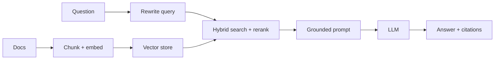
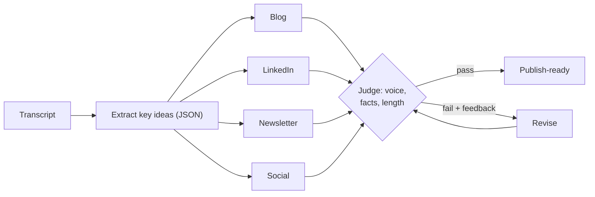

# 🏆 Appendix E — Capstone Projects

> Pick at least **one** project (two or more for a strong portfolio). Each has levels so you can start simple and grow.

> 👔 **Non-Tech Track Capstones:**
> - **Project 1 (Basic/Intermediate):** Team Prompt Library & Qualitative Evaluation Suite
> - **Project 4:** Multi-Format Content Repurposing Pipeline with Rubric Gates
> - **Project 6:** Multimodal Creative Brand Kit & Visual Style Guide
> *(Deliverables can be created entirely in ChatGPT, Claude Projects, and Notion/Google Docs without writing code.)*

> 💻 **Tech Track Capstones:**
> - **Project 2:** Production Document Q&A Assistant (Hybrid RAG with Vector DB)
> - **Project 3:** Tool-Using Agent with MCP & Function Calling
> - **Project 5:** Red-Teaming & Security Hardening Framework
> *(Deliverables require Python/TypeScript code, API integrations, and automated test evaluation.)*

Every capstone must include a **write-up** with: problem · approach · prompts (with versions) · evaluation (test set + metrics + before/after) · safety analysis · demo · lessons learned.

---

## 🥉 Project 1 — Personal Prompt Library & Evaluator

**Skills:** Modules 02–06, 13

| Level | Deliverable |
|---|---|
| 🟢 Basic | 20 prompt templates for your field, organized by category, in Markdown |
| 🔵 Intermediate | A Python script that runs any template over a CSV of inputs and saves outputs |
| 🟣 Advanced | Add code-based and LLM-as-judge graders; produce a score report comparing two prompt versions |

**Success criteria:** at least 3 templates improved with a measured gain (e.g., judge score 3.4 → 4.3).

---

## 🥈 Project 2 — Document Q&A Assistant (RAG)

**Skills:** Modules 07, 09, 12, 13, 14

Build a chatbot that answers questions about a document set (college prospectus, company handbook, product manuals, government scheme documents…).

| Level | Deliverable |
|---|---|
| 🟢 Basic | Long-context version: paste docs into a well-structured prompt with citations |
| 🔵 Intermediate | RAG with chunking, embeddings, vector store, grounded prompt, citations |
| 🟣 Advanced | Hybrid search + reranking + query rewriting + eval set of 50 questions (retrieval recall@k, faithfulness) + injection tests |

**Architecture**



**Success criteria:** ≥ 90% faithfulness, ≥ 85% answer correctness on your test set, correct refusals on out-of-scope questions.

---

## 🥇 Project 3 — Tool-Using Agent

**Skills:** Modules 05, 08, 10, 14, 15

Build an agent with 3–5 tools for a real workflow. Ideas:
- 📈 *Market research agent*: web search + page fetch + calculator → cited brief
- 🧾 *Expense assistant*: reads receipt images (vision) → extracts JSON → categorizes → writes to a spreadsheet
- 🛠️ *DevOps helper*: reads logs, queries metrics, proposes (not executes) fixes
- 📅 *Study planner*: reads syllabus, creates calendar plan, sends reminders (with approval)

| Level | Deliverable |
|---|---|
| 🟢 Basic | Single tool + loop with step limit |
| 🔵 Intermediate | 3–5 tools, error handling, structured final output, logging |
| 🟣 Advanced | Human approval for write actions, injection defenses, eval of 20 tasks (success rate, steps, cost) |

---

## 🏅 Project 4 — Content Pipeline with Quality Gates

**Skills:** Modules 03, 06, 08, 13, 16

Turn one input (podcast transcript, research notes, webinar) into multiple assets: blog post, LinkedIn post, newsletter, 5 tweets, FAQ.



**Success criteria:** all outputs pass the judge rubric ≥ 4/5; zero invented facts (verified against the transcript).

---

## 🎖️ Project 5 — Red-Team & Harden a Chatbot

**Skills:** Modules 07, 13, 14, 15

1. Build (or use your Project 2) chatbot.
2. Write 40 adversarial tests: direct/indirect injection, prompt leaking, off-topic, harmful requests, PII extraction.
3. Measure the attack success rate.
4. Apply defense-in-depth; re-measure.
5. Publish a security report (threat model, results table, mitigations, residual risk).

**Success criteria:** attack success rate reduced by ≥ 75% with no more than 5% increase in false refusals on normal questions.

---

## 🎨 Project 6 — Multimodal Creative Kit

**Skills:** Modules 04, 11, 17

Create a brand kit for a fictional business using AI: logo concepts, social images, product photos, a 15-second video storyboard, and a jingle description — all from prompts you design and iterate.

**Deliverable:** a prompt log showing iterations (one change at a time), final assets, and a style guide for prompts so others can produce consistent images.

---

## 📝 Write-Up Template

```markdown
# {{Project name}}

## Problem
Who is it for? What pain does it solve?

## Approach
Architecture diagram + key design decisions.

## Prompts
| Version | Change | Why | Score |
|---|---|---|---|
| v1 | baseline | — | 71% |
| v2 | added examples | format errors | 82% |
| v3 | quote-then-answer | hallucinations | 91% |

## Evaluation
Test set description, metrics, results table, failure analysis.

## Safety
Threats, mitigations, residual risks.

## Demo
Link / screenshots / video.

## Lessons learned
What surprised you? What would you do differently?

---
Built after completing "Prompt Engineering: Zero to Pro" by Vicky Prasad Mahato (abvicky.in)
```

---

> © 2026 [Manikarnika Technologies](https://www.manikarnikatechnologies.in/) · All rights reserved.
