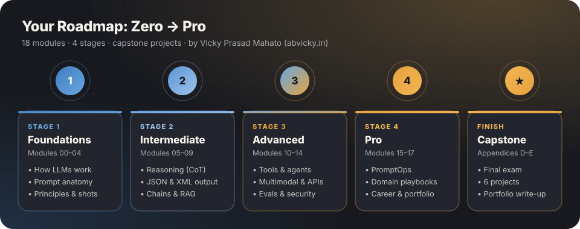
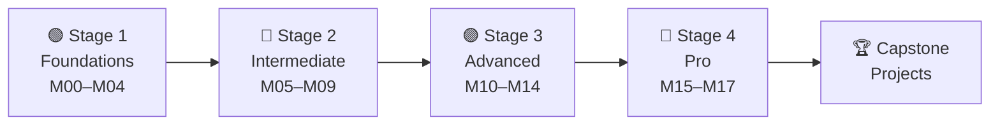

# 🚀 Module 00 — Welcome & How to Use This Course

> **Prompt Engineering: Zero to Pro** — a complete, self-contained course
> Author: **Vicky Prasad Mahato** · [abvicky.in](https://abvicky.in)



---

## 👋 Welcome

Prompt engineering is the skill of **communicating with AI models so they reliably do what you want**. It is part writing, part logic, part experimentation, and — at the professional level — part software engineering.

This course takes you from *"I've typed a few questions into ChatGPT"* to *"I can design, test, secure, and ship prompt-powered systems in production."* Everything you need is inside: concepts, visuals, worked examples, templates, exercises with solutions, quizzes, a glossary, a cheat sheet, and capstone projects. You should never need to look anywhere else to finish it.

### What you will be able to do by the end

| Level | You will be able to… |
|---|---|
| 🟢 Beginner | Explain how LLMs generate text, write clear prompts with role / task / context / format, and fix common bad outputs |
| 🔵 Intermediate | Use few-shot, chain-of-thought, structured JSON/XML output, system prompts, and multi-step prompt chains |
| 🟣 Advanced | Build RAG pipelines, tool-using agents, multimodal prompts; evaluate prompts quantitatively; defend against prompt injection |
| 🌟 Pro | Run prompts in production (versioning, monitoring, cost/latency tuning), apply domain playbooks, and build a portfolio that gets you hired |

---

## 🗺️ Course Map



| # | Module | Stage | Est. time |
|---|---|---|---|
| 00 | Welcome & How to Use This Course | 🟢 | 30 min |
| 01 | How Large Language Models Work | 🟢 | 2 h |
| 02 | Anatomy of a Prompt | 🟢 | 1.5 h |
| 03 | Core Principles of Effective Prompting | 🟢 | 2 h |
| 04 | Zero-Shot, Few-Shot & Role Prompting | 🟢 | 2 h |
| 05 | Reasoning Techniques (CoT, Self-Consistency, ToT…) | 🔵 | 3 h |
| 06 | Structured Output: JSON, XML, Tables & Schemas | 🔵 | 2 h |
| 07 | System Prompts, Personas & Conversation Design | 🔵 | 2 h |
| 08 | Prompt Chaining & Workflows | 🔵 | 2.5 h |
| 09 | Context Engineering & RAG | 🔵 | 3 h |
| 10 | Tool Use, Function Calling & Agents | 🟣 | 3.5 h |
| 11 | Multimodal & Image-Generation Prompting | 🟣 | 2.5 h |
| 12 | Model Parameters, APIs & Cost | 🟣 | 2.5 h |
| 13 | Evaluation & Testing of Prompts | 🟣 | 3 h |
| 14 | Safety, Security & Ethics | 🟣 | 3 h |
| 15 | Production Prompt Engineering (PromptOps) | 🌟 | 3 h |
| 16 | Domain Playbooks (Code, Writing, Data, Business…) | 🌟 | 4 h |
| 17 | Becoming a Pro: Meta-Prompting, Optimization & Career | 🌟 | 2.5 h |
| A–G | Appendices: Cheat Sheet, Prompt Library, Glossary, Final Exam, Capstones, Troubleshooting, Resources | 📚 | reference |

**Total:** roughly **45–50 hours** of study + practice, plus capstone time.

---

## 🧰 Prerequisites

- **None for Stage 1–2.** If you can write a clear email, you can start.
- **For Stage 3–4:** basic comfort reading Python or JavaScript helps. Every code sample is explained line by line, and all core ideas also work in chat interfaces without code.

---

## 🛠️ Set Up Your Practice Lab

You need *one* place to run prompts. Pick any:

| Option | Good for | Cost |
|---|---|---|
| **Chat apps** (Claude.ai, ChatGPT, Gemini, Copilot, etc.) | Modules 00–09, quick experiments | Free tiers available |
| **Provider playgrounds / consoles** (Anthropic Console, OpenAI Playground, Google AI Studio) | Controlling system prompts, temperature, max tokens | Free tier / pay-as-you-go |
| **API + code** (Python or Node.js) | Modules 10–17: tools, agents, evaluation, production | Pay per token (cents for this whole course) |
| **Local open models** (Ollama, LM Studio + Llama / Mistral / Qwen / Gemma) | Privacy, offline practice, comparing models | Free (needs a decent computer) |

### Minimal Python setup (for later modules)

```bash
# 1. Create a project folder and a virtual environment
mkdir pe-lab && cd pe-lab
python3 -m venv .venv
source .venv/bin/activate          # Windows: .venv\Scripts\activate

# 2. Install SDKs (install the ones you will use)
pip install anthropic openai google-genai python-dotenv

# 3. Store your API key in a .env file (never commit this file!)
echo "ANTHROPIC_API_KEY=sk-ant-..." > .env
```

```python
# hello_llm.py — your first API call
from dotenv import load_dotenv
import anthropic

load_dotenv()                       # reads ANTHROPIC_API_KEY from .env
client = anthropic.Anthropic()

response = client.messages.create(
    model="claude-sonnet-5-5",      # use any current model name your provider lists
    max_tokens=300,
    messages=[{"role": "user", "content": "Explain prompt engineering in one sentence."}],
)
print(response.content[0].text)
```

> 💡 **Model names change often.** Wherever this course shows a model ID, replace it with a current one from your provider's documentation. The *techniques* don't expire; model names do.

---

## 📖 How Each Module Is Structured

Every module follows the same rhythm so you always know where you are:

1. 🎯 **Learning objectives** — what you'll be able to do
2. 📘 **Concepts** — explained plainly with diagrams
3. ❌➡️✅ **Bad vs good examples** — side-by-side prompt makeovers
4. 🧪 **Try it** — mini-experiments to run immediately
5. 🔑 **Key takeaways** — the summary to re-read before interviews
6. 🏋️ **Exercises** — with hidden solutions (click to reveal)
7. ✅ **Quick quiz** — with hidden answers

### Icon legend

| Icon | Meaning |
|---|---|
| 💡 | Tip / insight |
| ⚠️ | Warning / common mistake |
| 🧪 | Try it yourself |
| 🔑 | Key takeaway |
| 🏋️ | Exercise |
| ✅ | Quiz |
| 🧠 | Deep dive (optional, for the curious) |
| 🛡️ | Security note |

---

## 📅 Suggested Study Plans

### 🐢 Steady — 8 weeks (≈ 6 h/week)

| Week | Modules | Milestone |
|---|---|---|
| 1 | 00, 01, 02 | Explain tokens & temperature to a friend |
| 2 | 03, 04 | Build your personal prompt template |
| 3 | 05, 06 | Get valid JSON from a model 10/10 times |
| 4 | 07, 08 | Ship a multi-step prompt chain |
| 5 | 09, 10 | Build a mini RAG bot or a tool-using agent |
| 6 | 11, 12, 13 | Run your first prompt evaluation with a test set |
| 7 | 14, 15 | Red-team your own app; version your prompts |
| 8 | 16, 17 + Capstone | Publish a portfolio project |

### 🐇 Intensive — 2 weeks (≈ 25 h/week)
Do two modules per day, exercises included, and spend the last three days on a capstone.

### 🎯 Just-in-time
Already using AI at work? Take the **Final Exam (Appendix D)** first, then study only the modules where you missed questions.

---

## 🧠 The Pro Mindset (read this twice)

1. **Prompts are programs written in natural language.** Treat them with the same rigor: version, test, review.
2. **The model is a brilliant new colleague with zero context.** It knows a lot about the world and nothing about *your* situation unless you say it.
3. **Show, then tell.** One good example often beats ten sentences of instructions.
4. **Measure, don't guess.** "It looks better" is not evidence. A test set is.
5. **Models change; principles don't.** Clarity, context, structure, and evaluation outlive any specific model or trick.

---

## 🏋️ Exercise 0.1 — Your Baseline

Before learning anything, write a prompt asking an AI to *"plan a 3-day trip to a city of your choice"*. Save the prompt and the output in a file called `baseline.md`. At the end of Module 04, you'll rewrite it and compare.

<details>
<summary>💡 Why do this?</summary>

Seeing your own before/after is the fastest way to internalize what changed. Most learners discover their baseline prompt lacked: a budget, traveler profile, pace preference, output format, and constraints (dietary, accessibility, season). You'll learn to add all of these in Modules 02–04.

</details>

---

## 🔑 Key Takeaways

- The course has **4 stages, 18 modules, 7 appendices** and a capstone.
- You only need a chat app to start; APIs become useful from Module 10.
- Every module ends with exercises and a quiz — **do them**; skill comes from practice.

---

> © 2026 **Vicky Prasad Mahato** · [abvicky.in](https://abvicky.in) · All rights reserved.
> ➡️ Next: [Module 01 — How Large Language Models Work](01-how-llms-work.md)
