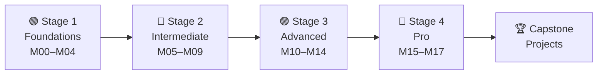

# 🚀 Module 00 — Welcome & How to Use This Course

> **Prompt Engineering: Zero to Pro** — a complete, self-contained course
> Author: **Vicky Prasad Mahato** · [abvicky.in](https://abvicky.in)


---

## 👋 Welcome

Prompt engineering is the skill of **communicating with AI models so they reliably do what you want**. It is part writing, part logic, part experimentation, and — at the professional level — part software engineering.

This course takes you from *"I've typed a few questions into ChatGPT"* to *"I can design, test, secure, and ship prompt-powered systems in production."* Everything you need is inside: concepts, visuals, worked examples, templates, exercises with solutions, quizzes, a glossary, a cheat sheet, and capstone projects. You should never need to look anywhere else to finish it.

### What you will be able to do by the end

| Level | You will be able to… |
|---|---|
| 🟢 Beginner | Explain how LLMs generate text, write clear prompts with role / task / context / format, and fix common bad outputs |
| 🔵 Intermediate | Use few-shot, chain-of-thought, structured JSON/XML output, system prompts, and multi-step prompt chains |
| 🟣 Advanced | Build RAG pipelines, tool-using agents, multimodal prompts; evaluate prompts quantitatively; defend against prompt injection |
| 🌟 Pro | Run prompts in production (versioning, monitoring, cost/latency tuning), apply domain playbooks, and build a portfolio that gets you hired |

---

## 🗺️ Course Map



| # | Module | Stage | Est. time |
|---|---|---|---|
| 00 | Welcome & How to Use This Course | 🟢 | 30 min |
| 01 | How Large Language Models Work | 🟢 | 2 h |
| 02 | Anatomy of a Prompt | 🟢 | 1.5 h |
| 03 | Core Principles of Effective Prompting | 🟢 | 2 h |
| 04 | Zero-Shot, Few-Shot & Role Prompting | 🟢 | 2 h |
| 05 | Reasoning Techniques (CoT, Self-Consistency, ToT…) | 🔵 | 3 h |
| 06 | Structured Output: JSON, XML, Tables & Schemas | 🔵 | 2 h |
| 07 | System Prompts, Personas & Conversation Design | 🔵 | 2 h |
| 08 | Prompt Chaining & Workflows | 🔵 | 2.5 h |
| 09 | Context Engineering & RAG | 🔵 | 3 h |
| 10 | Tool Use, Function Calling & Agents | 🟣 | 3.5 h |
| 11 | Multimodal & Image-Generation Prompting | 🟣 | 2.5 h |
| 12 | Model Parameters, APIs & Cost | 🟣 | 2.5 h |
| 13 | Evaluation & Testing of Prompts | 🟣 | 3 h |
| 14 | Safety, Security & Ethics | 🟣 | 3 h |
| 15 | Production Prompt Engineering (PromptOps) | 🌟 | 3 h |
| 16 | Domain Playbooks (Code, Writing, Data, Business…) | 🌟 | 4 h |
| 17 | Becoming a Pro: Meta-Prompting, Optimization & Career | 🌟 | 2.5 h |
| A–G | Appendices: Cheat Sheet, Prompt Library, Glossary, Final Exam, Capstones, Troubleshooting, Resources | 📚 | reference |

**Total:** roughly **45–50 hours** of study + practice, plus capstone time.

---

## 🧰 Prerequisites & Audience Tracks

This course is built from the ground up for two distinct audiences:

> 👔 **Non-Tech Track · Everyday & Business:**
> If you are a marketer, product manager, writer, analyst, founder, teacher, or everyday professional, you need zero coding experience. You will learn to use AI chat apps (ChatGPT, Claude, Gemini, Copilot) as power tools for writing, analysis, research, and daily workflow automation. Your focus is high-leverage prompting without touching code.

> 💻 **Tech Track · Developer & Engineering:**
> If you are a software engineer, data scientist, or ML practitioner, you will learn to treat prompts as software components: deterministic output schemas (JSON/Pydantic), tool calling, autonomous agent loops, hybrid RAG pipelines, automated eval suites (G-Eval, assertion testing), and production PromptOps CI/CD.

| Track | Who it is for | Primary tools | What you master |
|---|---|---|---|
| 👔 **Non-Tech** | Creators, managers, analysts, domain experts | ChatGPT, Claude Projects, Copilot, Gemini | 5-part prompt briefs, few-shot templates, custom GPTs, document Q&A, workflow chains |
| 💻 **Tech** | Developers, engineers, architects, data scientists | Python/Node SDKs, APIs, Pydantic, Vector DBs, Git | API parameters, structured output, function calling, agent loops, RAG, automated evals, PromptOps |

---

## 🛠️ Set Up Your Practice Lab

Choose the setup that fits your track:

### 👔 Non-Tech Track Setup (Zero Code · 5 minutes)

You only need access to at least one modern conversational AI tool. Free versions work, but paid subscriptions offer higher-tier reasoning models and document upload capabilities:

1. **Pick your primary assistant:**
   - **Claude.ai** (Anthropic) — excellent for nuanced writing, complex reasoning, and large document analysis with *Projects*.
   - **ChatGPT** (OpenAI) — great for web browsing, code interpreter / data analysis, image generation, and *Custom GPTs*.
   - **Google Gemini** or **Microsoft Copilot** — strong for workspace integration, deep search, and multimodal inputs.
2. **Set up a personal prompt notebook:**
   - Create a folder in Notion, Apple Notes, Obsidian, or Google Docs named `Prompt Engineering Lab`.
   - Save your prompt templates, versions, and interesting model outputs as you practice each module.

### 💻 Tech Track Setup (Code & APIs · 10 minutes)

For developers building applications with LLMs, set up a local development environment:

```bash
# 1. Create a project folder and a virtual environment
mkdir pe-lab && cd pe-lab
python3 -m venv .venv
source .venv/bin/activate          # Windows: .venv\Scripts\activate

# 2. Install SDKs (install the ones you will use)
pip install anthropic openai google-genai pydantic python-dotenv

# 3. Store your API key in a .env file (never commit this file!)
echo "ANTHROPIC_API_KEY=sk-ant-..." > .env
```

```python
# hello_llm.py — your first API call
from dotenv import load_dotenv
import anthropic

load_dotenv()                       # reads ANTHROPIC_API_KEY from .env
client = anthropic.Anthropic()

response = client.messages.create(
    model="claude-sonnet-5-5",      # use any current model name your provider lists
    max_tokens=300,
    messages=[{"role": "user", "content": "Explain prompt engineering in one sentence."}],
)
print(response.content[0].text)
```

> 💡 **Model names change often.** Wherever this course shows a model ID, replace it with a current one from your provider's documentation. The *techniques* don't expire; model names do.

---

## 📖 How Each Module Is Structured

Every module follows the same rhythm so you always know where you are:

1. 🎯 **Learning objectives** — what you'll be able to do
2. 📘 **Concepts** — explained plainly with diagrams
3. ❌➡️✅ **Bad vs good examples** — side-by-side prompt makeovers
4. 🧪 **Try it** — mini-experiments to run immediately
5. 🔑 **Key takeaways** — the summary to re-read before interviews
6. 🏋️ **Exercises** — with hidden solutions (click to reveal)
7. ✅ **Quick quiz** — with hidden answers

### Icon legend

| Icon | Meaning |
|---|---|
| 👔 | **Non-Tech Track** — Business & everyday productivity lens |
| 💻 | **Tech Track** — Developer, architecture & code lens |
| 💡 | Tip / insight |
| ⚠️ | Warning / common mistake |
| 🧪 | Try it yourself |
| 🔑 | Key takeaway |
| 🏋️ | Exercise |
| ✅ | Quiz |
| 🧠 | Deep dive (optional, for the curious) |
| 🛡️ | Security note |

---

## 📅 Suggested Study Plans by Track

### 👔 Non-Tech Track — 4 Weeks (≈ 4–5 h/week)
*Goal: Automate everyday work, write high-leverage prompts, master Claude Projects & Custom GPTs.*

| Week | Focus Modules | Key Milestone |
|---|---|---|
| 1 | 00, 01 (concepts), 02, 03 | Write 5-part executive prompts; fix vague outputs |
| 2 | 04, 05, 06 (tables/CSVs) | Build role-based templates; format Excel-ready tables |
| 3 | 07, 08, 09 (doc chat), 11 | Set up Claude Projects/GPTs; chain multi-step tasks |
| 4 | 14 (privacy), 16, 17 + Capstone | Build a team prompt playbook or content engine (Project 1, 4 or 6) |

### 💻 Tech Track — 8 Weeks (≈ 6 h/week)
*Goal: Build production LLM systems with code, function calling, RAG, and eval suites.*

| Week | Focus Modules | Key Milestone |
|---|---|---|
| 1 | 00, 01, 02, 03 | Tokens, logits, temperature math, message roles |
| 2 | 04, 05, 06 | Few-shot prefilling, reasoning models, strict Pydantic JSON schemas |
| 3 | 07, 08 | System prompt caching, multi-turn state, DAG workflow chaining |
| 4 | 09, 10 | Hybrid RAG with vector DBs; tool-calling agents & MCP |
| 5 | 11, 12 | Multimodal inputs, API streaming, token cost & latency profiling |
| 6 | 13, 14 | Automated eval test suites (LLM-as-judge, assertions); injection defenses |
| 7 | 15, 16 | PromptOps (Git versioning, Langfuse tracing, CI/CD gates); domain playbooks |
| 8 | 17 + Capstone | Ship a production-grade portfolio agent or RAG system (Project 2, 3 or 5) |

### 🐇 Intensive — 2 weeks (≈ 25 h/week)
Do two modules per day, exercises included, and spend the last three days on a capstone.

### 🎯 Just-in-time
Already using AI at work? Take the **Final Exam (Appendix D)** first, then study only the modules where you missed questions.

---

## 🧠 The Pro Mindset (read this twice)

1. **Prompts are programs written in natural language.** Treat them with the same rigor: version, test, review.
2. **The model is a brilliant new colleague with zero context.** It knows a lot about the world and nothing about *your* situation unless you say it.
3. **Show, then tell.** One good example often beats ten sentences of instructions.
4. **Measure, don't guess.** "It looks better" is not evidence. A test set is.
5. **Models change; principles don't.** Clarity, context, structure, and evaluation outlive any specific model or trick.

---

## 🏋️ Exercise 0.1 — Your Baseline

Before learning anything, write a prompt asking an AI to *"plan a 3-day trip to a city of your choice"*. Save the prompt and the output in a file called `baseline.md`. At the end of Module 04, you'll rewrite it and compare.

<details>
<summary>💡 Why do this?</summary>

Seeing your own before/after is the fastest way to internalize what changed. Most learners discover their baseline prompt lacked: a budget, traveler profile, pace preference, output format, and constraints (dietary, accessibility, season). You'll learn to add all of these in Modules 02–04.

</details>

---

## 🔑 Key Takeaways

- The course has **4 stages, 18 modules, 7 appendices** and a capstone.
- You only need a chat app to start; APIs become useful from Module 10.
- Every module ends with exercises and a quiz — **do them**; skill comes from practice.

---

> © 2026 **Vicky Prasad Mahato** · [abvicky.in](https://abvicky.in) · All rights reserved.
> ➡️ Next: [Module 01 — How Large Language Models Work](01-how-llms-work.md)
