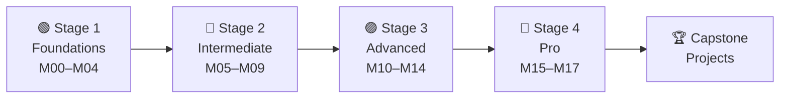

# 🚀 Module 00 — Welcome & How to Use This Course

> **Prompt Engineering: Zero to Pro** — a complete, self-contained course
> Author: **Vicky** · [abvicky.in](https://abvicky.in) · Platform built by [Manikarnika Technologies](https://www.manikarnikatechnologies.in/)


---

Have you ever opened an AI chat, typed a quick question, and received an answer so generic it felt like a soggy bowl of cornflakes?

You are not alone. Almost everyone begins the exact same way. You ask something like *"Write a marketing email for my new cafe"*, and the AI spits out three paragraphs of cheerleading cliches packed with exclamation marks. You sigh, delete half of it, and wonder why people on the internet keep calling this technology magical.

Here is the secret: AI models do not read minds. They read instructions. When you give them vague instructions, they average out everything they read during training and hand you the most generic response possible. But when you learn how to steer them with clear context, structure, and intent, they become the sharpest, most capable assistant you have ever worked with.

That is what prompt engineering is. It is simply the skill of communicating with an AI so that it reliably gives you what you actually need on the very first try.

---

## 🎯 Learning Objectives

By the end of this module, you will be able to:
- Understand how this course takes you step-by-step from beginner to pro.
- Pick the right track (Non-Tech or Tech) for your goals.
- Set up your practice environment in five minutes.
- Follow essential safety rules so you never leak private data into an AI tool.
- Run your baseline prompt to measure your growth across the course.

---

## 1. What You Will Learn (From Ground Zero to Pro)

Whether you write software for a living or haven't written a single line of code in your life, this course was designed so you never need another tab open.



Here is how your progression works:

| Stage | What you master | Real-world outcome |
|---|---|---|
| **🟢 Stage 1: Foundations** (M00–M04) | How models think, tokens, prompt anatomy, the 12 core principles, examples and personas. | Stop getting vague fluff. Get crisp, tailored answers for daily work. |
| **🔵 Stage 2: Intermediate** (M05–M09) | Step-by-step reasoning, clean JSON and tables, system prompts, prompt chains, and search grounding (RAG). | Handle multi-step analysis, format data for spreadsheets, and build custom assistants. |
| **🟣 Stage 3: Advanced** (M10–M14) | Autonomous agents, tool use, image inputs, model settings, test suites, and security defenses. | Build reliable AI workflows that connect to outside tools and test them systematically. |
| **🌟 Stage 4: Pro** (M15–M17) | Production PromptOps, domain playbooks (business, sales, code, health), portfolio, and career prep. | Design enterprise-ready prompt systems, lead AI projects at work, or freelance. |

---

## 2. Choose Your Track

You can take this course through two different lenses. Switch between them anytime using the toggle on the top navigation bar.

> 👔 **Non-Tech Track · Everyday & Business:**
> If you are a marketer, manager, creator, teacher, accountant, or founder, you do not need code. You will use everyday chat tools like ChatGPT, Claude, and Gemini to draft executive briefs, analyze reports, polish customer emails, and build custom assistants that save you hours every week.

> 💻 **Tech Track · Developer & Engineering:**
> If you build software or work with data, you will treat prompts as software components. You will write code with Python SDKs, enforce strict JSON schemas with Pydantic, connect external tools via function calling, test outputs with automated graders, and manage prompts with Git.

| Track | Who it is for | Everyday tools | What you build |
|---|---|---|---|
| 👔 **Non-Tech** | Managers, writers, analysts, educators | ChatGPT, Claude Projects, Copilot, Gemini | Reusable prompt libraries, meeting summarizers, policy analyzers, content engines |
| 💻 **Tech** | Software engineers, data teams, architects | Python/Node, APIs, Pydantic, Vector databases, Git | Structured API pipelines, automated test suites, customer support agents, hybrid RAG |

---

## 3. Set Up Your Practice Lab in 5 Minutes

You learn prompting by doing, not by passively reading. Let's get your setup ready right now.

### 👔 For Non-Tech Learners (Zero Code)
1. **Choose one free chat app:**
   - [Claude](https://claude.ai) (Anthropic) — exceptional for thoughtful writing, clear explanations, and analyzing pasted documents.
   - [ChatGPT](https://chatgpt.com) (OpenAI) — great all-rounder with web search and data handling.
   - [Google Gemini](https://gemini.google.com) — handy for quick searches and Google Workspace tasks.
2. **Open a clean notebook:**
   - Create a single document in Google Docs, Apple Notes, or Notion called `My Prompt Notebook`.
   - Every time you find a prompt that works well in this course, paste it there. By the end, you will have your own personal productivity toolkit.

### 💻 For Tech Learners (Code & APIs)
If you plan to complete the coding exercises, set up a Python environment:

```bash
# 1. Create a workspace folder and virtual environment
mkdir pe-lab && cd pe-lab
python3 -m venv .venv
source .venv/bin/activate          # Windows: .venv\Scripts\activate

# 2. Install provider SDKs
pip install anthropic openai pydantic python-dotenv
```

```python
# test_call.py — test your setup
import os
from dotenv import load_dotenv

load_dotenv()
print("Environment ready! Add your API keys to .env when you reach Stage 3.")
```

> 💡 **Model names change often.** Whenever you see a model name in code, treat it as an example. Check your provider's official documentation for the current version. The core prompting principles remain the same regardless of which model is in vogue.

---

## 4. Safety Rules: What Never to Paste

Before you type another word into an AI model, memorize these basic safety rules. Think of an AI chat window like a public whiteboard in a busy office hallway:

1. **Never paste personal secrets:** Leave out credit card numbers, passwords, OTPs, Aadhaar numbers, PAN numbers, or home addresses.
2. **Never paste unreleased company data:** If your company has not published its quarterly revenue, customer email list, or confidential source code, do not paste it into a consumer chat tool.
3. **Turn off training on your chats:**
   - In ChatGPT: Go to *Settings → Data Controls → Turn off "Improve the model for everyone"*.
   - In Claude: Anthropic does not train on paid consumer accounts or API inputs by default, but check your privacy settings.
   - In Gemini: Go to *Gemini Apps Activity* and review your retention settings.
4. **Assume the model can be wrong:** Always verify facts, dates, citations, and calculations before sending an AI-written report to your boss or a client.

---

## 5. Realistic Before and After: The Power of Intent

Let's look at what happens when you treat the AI like an inexperienced intern who needs clear directions, rather than a magical mind reader.

Suppose you manage an operations team in Bengaluru and want to email your team about switching to hybrid work.

❌ **Weak**
```text
Write an email to my team about returning to the office 3 days a week.
```

*Why it fails:* The AI doesn't know who you are, why you are doing this, which days matter, what tone to take, or what concerns your team has. You will get a robotic, corporate-sounding broadcast that feels cold and defensive.

✅ **Strong**
```text
You are a warm, empathetic operations director at a 50-person logistics firm in Bengaluru.

Write a 200-word email to our team announcing our new hybrid schedule starting next month: Tuesdays and Thursdays in the Indiranagar office, with Wednesdays as an optional team lunch day. 

Tone: Friendly, supportive, but clear.
Key points to cover:
- Why we're doing this: in-person collaboration for sprint planning.
- Flexibility: core hours are 10:00 AM to 4:00 PM to help avoid peak traffic.
- Next step: reply with any commute or scheduling questions by Friday.

Avoid buzzwords like "synergy" or "new normal".
```

*Why it works:* You gave it a persona (warm operations director), clear context (Bengaluru traffic, Indiranagar office), exact constraints (200 words, specific days, core hours), and boundaries on what words to avoid. The resulting email sounds human and requires almost zero editing.

---

## 💡 Common Mistakes & How to Spot Them

| Mistake | What it looks like | How to fix it |
|---|---|---|
| The One-Sentence Wish | *"Help me with my budget."* | Tell the model who you are, what figures you have, and what decision you need to make. |
| The Unending Prompt | Typing three paragraphs of disorganized thoughts without bullet points. | Break your prompt into labeled sections: Background, Task, Constraints, and Desired Output. |
| Forgetting Format | Expecting a tidy table but receiving five sprawling paragraphs. | Explicitly state: *"Format your answer as a 3-column table with headers: Step, Responsible Person, Due Date."* |

---

## 🧪 Try It Now

Open your favorite chat app right now and test this quick prompt:

```text
I want to improve my daily focus at work. 

Before giving me advice, ask me 3 targeted questions about my current routine, my biggest distractions, and the type of work I do. Wait for my answers before making recommendations.
```

Notice what happens: instead of dumping ten generic productivity tips on you, the model pauses, interviews you, and customizes its advice. You just turned the AI from a search engine into a collaborative thinking partner.

---

## 🔑 Key Takeaways

- AI models do not read minds; they predict likely words based on your instructions.
- Give the model the same context you would give a smart human colleague who just joined your team this morning.
- Always protect private data. Never paste sensitive customer info, credentials, or internal trade secrets into a public chat.
- The best prompt engineers experiment constantly. When an output is mediocre, don't give up; change your instructions.

---

## 🏋️ Exercises

### Exercise 0.1: Record Your Baseline Prompt
Before you read another page, open your chat tool and write a prompt asking it to:
*"Plan a 3-day trip to a city of your choice."*

Copy both your prompt and the AI's response into a note titled `baseline.md`. Keep it safe. At the end of Stage 1 (Module 04), you will rewrite this prompt using everything you have learned and compare the two results side by side.

<details>
<summary>💡 What should you look for in your baseline?</summary>

Most beginner prompts produce a superficial checklist (Day 1: Visit Museum. Day 2: Eat lunch in city center). 

Notice what your initial prompt forgot:
- Who is traveling? (A solo backpacker, a family with small kids, or a business traveler?)
- What is the budget? (Budget ₹3,000/day or luxury hotel?)
- What are the physical constraints? (Walking only, public transit, rental car?)
- What format do you want? (A morning-by-morning table, a map-friendly itinerary, or a packing list?)

You will learn how to build all of these elements naturally in the next three modules.

</details>

---

## ✅ Quick Quiz

1. Why do vague prompts lead to generic, cliché-filled AI responses?
   - A) Because the AI is lazy and conserves compute.
   - B) Because the AI predicts the most statistically common response when it lacks specific constraints.
   - C) Because free AI tools intentionally degrade answer quality.
2. What should you do before pasting an internal company document into a public AI chat?
   - A) Check company policy, remove sensitive names or financials, and ensure training data sharing is disabled.
   - B) Translate it to another language first.
   - C) Add a sentence saying "Please keep this confidential".

<details>
<summary>View Answers</summary>

1. **B** — Large language models predict the next most likely words. Without constraints, the most likely words are broad, average generalizations.
2. **A** — AI models cannot read contractual non-disclosure requests in your prompt text. You must actively clean sensitive data and configure your privacy settings.

</details>

---

> Author: **Vicky** ([abvicky.in](https://abvicky.in)) · Platform built by [Manikarnika Technologies](https://www.manikarnikatechnologies.in/) · © 2026 All rights reserved.
> ➡️ Next: [Module 01 — How Large Language Models Work](01-how-llms-work.md)
