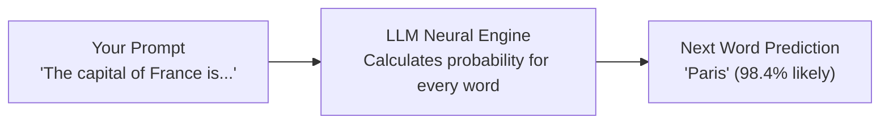
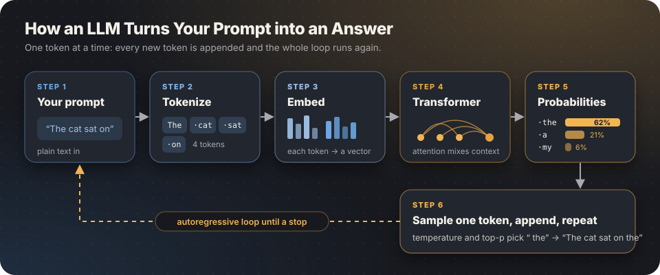
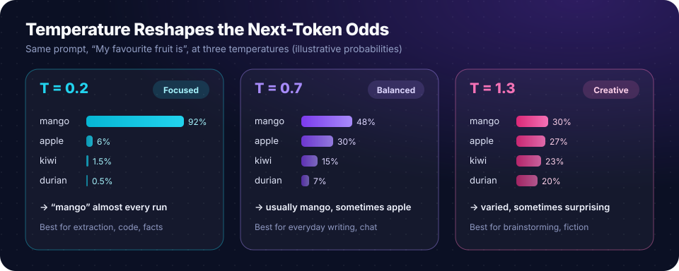

# 🧠 Module 01 — How Large Language Models Work

> 🟢 Stage 1 · Foundations · ⏱️ ~2 hours

Think about the last time you typed a message on your smartphone. You type *"I am on my..."* and your keyboard suggests *"way"*. It doesn't suggest *"giraffe"* or *"refrigerator"*, because millions of text messages have taught the software that *"way"* almost always comes next.

A Large Language Model (often called an LLM) does the exact same thing. It is essentially your phone's autocomplete, but trained on a massive portion of the world's books, articles, websites, and code. 

When you type a prompt, the model is not sitting in a dark room pondering the meaning of life or looking up facts in a filing cabinet. It is asking one single mathematical question: *Given all the words this person just typed, what is the single most likely word to write next?*

Once you grasp this simple fact, prompting stops feeling like guesswork. Every strange quirk, every hallucination, and every brilliant response suddenly makes sense.

---

## 🎯 Learning Objectives

By the end of this module, you will be able to:
- Explain what an LLM actually does when it reads your prompt.
- Understand tokens and why the model reads text differently than humans do.
- Explain temperature and why the exact same prompt can give two different answers.
- Recognize what AI models do well and what causes them to fail.
- Use explicit instructions to stop the model from guessing when it does not know the answer.

---

## 1. What Is a Large Language Model?

An LLM is a computer program trained on billions of sentences to predict what text comes next. 

When you ask a model to write a poem, translate French into Hindi, or debug a piece of code, it does not have separate engines for poetry, translation, and programming. It uses the exact same pattern-matching engine for all of them.



> 👔 **Non-Tech Lens · The Brilliant New Hire With Amnesia:**
> Imagine hiring a brilliant assistant who has read millions of books, reports, and manuals. However, they have one quirk: every time you start a new conversation, their memory is completely wiped clean. If you give them a vague one-line note (*"Write a proposal"*), they will guess what you want based on generic averages. If you give them clear background, your audience, and an example of what good looks like, they will give you executive-level work.

> 💻 **Tech Lens · Autoregressive Transformers:**
> Modern LLMs are decoder-only Transformers. Given a sequence of tokens $x_1, \dots, x_t$, the model calculates logits across its entire vocabulary using causal self-attention. It predicts one token at a time in an autoregressive loop. Because token generation is memory-bandwidth bound, the system stores previous key-value states in a KV-cache to avoid recomputing past tokens.

Here is the whole trip in one picture, from the text you type to the word that comes back. Notice the loop at the bottom: each new word is added to the input and the process runs again, one word at a time.



---

## 2. Tokens — The Real Building Blocks of AI Text

Models do not see letters or full words. They read **tokens**, which are small chunks of text. A token can be a single character, a whole word, or part of a word.

Here is how common words split into tokens:

| Text phrase | How the model breaks it down | Token count |
|---|---|---|
| `Good morning` | `[Good][ morning]` | 2 tokens |
| `Prompt engineering` | `[Prompt][ engineering]` | 2 tokens |
| `Unbelievable` | `[Un][believ][able]` | 3 tokens |
| `12345` | `[12][34][5]` (varies by model) | 2–3 tokens |
| `नमस्ते` | Byte-level pieces | 3–6 tokens |

**Simple rules of thumb:**
- 1 token is roughly 4 characters in English.
- 100 tokens is roughly 75 English words.
- A standard single-spaced page of text is roughly 500 to 700 tokens.

### Why Tokens Matter to You
1. **Counting letters is hard for AI:** Have you ever asked an AI how many "r"s are in the word *strawberry*, only to watch it insist there are two? The model does not see individual letters; it sees the token `[straw]` and the token `[berry]`. It is like asking a human how many syllables are in a picture.
2. **Languages other than English cost more:** Because tokenizers are trained mostly on English text, languages like Hindi, Arabic, Tamil, or Japanese often get chopped into smaller fragments. A paragraph in Hindi might take twice as many tokens as the same paragraph in English, which uses up context space faster.
3. **Usage and billing:** Paid AI services and developer APIs charge by the number of tokens you send and receive.

---

## 3. How the Model Picks the Next Word: Temperature & Randomness

If an LLM just predicts the next most likely word, why does asking the same question twice often give you two different answers?

The answer is a setting called **Temperature**.

After calculating the odds for the next word, the model doesn't always pick the number one option. If it always picked the top choice, text would feel mechanical and repetitive. Instead, it samples from the top choices based on probabilities.



- **Low Temperature (0.0 to 0.2):** The model sticks tightly to the most predictable, highest-probability words. The output is focused, logical, and consistent. Use this for data extraction, code, math, and factual summaries.
- **High Temperature (0.7 to 1.0):** The model takes more risks, picking less obvious words. The output becomes more varied, colorful, and unexpected. Use this for brainstorming, fiction, creative writing, and generating varied marketing angles.

> 👔 **Non-Tech Lens:** Most chat apps hide the temperature dial behind the scenes. If you want conservative, precise answers in a regular chat window, simply tell the model: *"Be factual, direct, and conservative. Do not guess or add flair."* When you want creativity, say: *"Give me 5 unconventional, unexpected angles."*

> 💻 **Tech Lens:** In API calls, never change both `temperature` and `top_p` simultaneously. Keep `top_p=1.0` and adjust `temperature`, or keep `temperature=1.0` and adjust `top_p` (nucleus sampling). For reliable structured JSON output, set `temperature=0`.

---

## 4. The Context Window: The Model's Working Memory

The **context window** is the maximum amount of text the model can consider at one single moment.

Think of it like a physical desk. Your instructions, the background information, any documents you uploaded and the whole conversation so far all have to fit on this desk at the same time.

```text
┌──────────────────────── Your Context Window (Desk Space) ────────────────────────┐
│ System Rules  │  Pasted Document / Context  │  Chat History  │  Your New Prompt  │
└──────────────────────────────────────────────────────────────────────────────────┘
```

Important realities about working memory:
- **Stateless nature:** The model does not remember your chat from yesterday. When you continue a conversation in a chat app, the software silently bundles the previous messages and sends them back to the model with your new question.
- **The "Lost in the Middle" problem:** When you paste a massive 50-page document into a chat, models pay the closest attention to the very beginning and the very end. Crucial facts buried on page 24 can sometimes get overlooked. Always put your core instructions at the end of long prompts.

---

## 5. What Models Do Well vs. Where They Struggle

Understanding what an AI cannot do is just as valuable as knowing what it can do.

| What AI excels at | What causes trouble | How to fix it with prompting |
|---|---|---|
| Summarizing long text | Precise math and counting | Ask it to write Python code to calculate, or do calculations step by step. |
| Rewriting tone and style | Current events after its training cutoff | Paste the source material directly into the chat prompt. |
| Brainstorming options | Confident guessing (**Hallucination**) | Tell it: *"Only answer using the text provided. If the answer is not there, reply: I do not have enough information."* |
| Explaining complex ideas | Agreeing with your bad assumptions | Explicitly ask: *"Critique my proposal and identify three hidden risks."* |

---

## 6. Realistic Before and After: Stopping Hallucinations

Hallucination happens when an AI doesn't know a fact, but its training compels it to produce text that *sounds* convincing.

Suppose you want to know the return policy for a local boutique in Pune called "Deccan Handlooms".

❌ **Weak**
```text
What is the return policy for Deccan Handlooms in Pune?
```

*Why it fails:* The model likely has no exact data on this specific local shop. But because you asked a direct factual question, it will invent a plausible-sounding policy (e.g., *"Deccan Handlooms accepts returns within 14 days with original tags..."*). You now have false information that sounds completely real.

✅ **Strong**
```text
Here is the text from Deccan Handlooms' official website FAQ:
"""
All handloom sarees and fabrics are woven by artisan collectives. Because each piece is unique, we do not offer cash refunds. Exchanges are accepted within 7 days of purchase at our FC Road store for store credit only. Custom-stitched blouses cannot be returned.
"""

Based strictly on the text above, answer these questions:
1. Can a customer get cash back for an unstitched saree?
2. What is the deadline to exchange an item?
3. Where must the exchange take place?

If a question cannot be answered using only the provided text, write "Not specified in the text". Do not use outside knowledge or make assumptions.
```

*Why it works:* You gave the model the source material (grounding) and gave it explicit permission to decline if the answer is missing. The model now acts like an accurate reading assistant rather than an inventive storyteller.

---

## 7. How to Think About Different Models

You do not need to memorize every model name that appears in the news. New versions launch every few months. Instead, understand these three main types:

1. **Fast, Lightweight Models:** Quick and inexpensive. Ideal for classification, spelling correction, simple summaries, and high-volume tasks.
2. **Flagship Frontier Models:** Deep general knowledge and strong writing ability. Ideal for complex synthesis, nuanced writing, and multi-step business analysis.
3. **Reasoning / Thinking Models:** These models spend extra seconds or minutes working through internal reasoning steps before displaying an answer. Ideal for tough math, tricky logic puzzles, and difficult programming architecture.

---

## 💡 Common Mistakes & How to Spot Them

| Mistake | What happens | How to tell you got it right |
|---|---|---|
| Treating the AI like Google Search | You ask for a recent news event or local store hours, and get an outdated or made-up answer. | You provide the text or use an AI tool with live web search enabled. |
| Asking it to count characters | You ask for a 50-character headline, and get 78 characters. | You ask for words or sentences instead (*"Write a headline under 10 words"*). |
| Leading the witness | *"Don't you agree that our marketing strategy is great?"* The AI will flatter you. | *"Review this strategy as an adversarial competitor. Point out the three weakest assumptions."* |

---

## 🧪 Try It Now

Try this simple experiment in any free chat app to see how token-based thinking works:

1. **Prompt 1:** Type: *"How many letters 'r' are in the word strawberry?"* Check the answer.
2. **Prompt 2:** Type: *"Spell the word 'strawberry' with spaces between each letter, like s - t - r... Then count each 'r' one by one."*

Notice the difference. By forcing the model to break the word into individual letters, you help its attention mechanism inspect the characters one by one.

---

## 🔑 Key Takeaways

- An LLM is a predictive engine. It generates text by repeatedly guessing the most probable next token.
- A token is roughly three-quarters of an English word. Models process tokens, not letters.
- The context window is the model's temporary workspace. If you start a new chat, previous context disappears.
- Hallucination happens when the model generates plausible-sounding text without grounding. Always provide source material for specific factual tasks.
- Give the model permission to say "I don't know" to prevent it from inventing facts.

---

## 🏋️ Exercises

### Exercise 1.1: Spot the Token Pitfall
Which of these tasks is an LLM most likely to struggle with if you ask it directly in one sentence?
- A) Summarizing a 500-word news article into three bullet points.
- B) Writing a haiku about rainy days in Mumbai.
- C) Reversing the letters in the phrase "prompt engineering" backwards.

<details>
<summary>View Solution & Explanation</summary>

**C** is the hardest for an LLM. Because the model sees the tokens `[prompt]` and `[engineering]`, it does not have easy access to the individual letters in reverse order. To make it succeed, you would have to instruct it to spell out each letter first or write a small Python script to reverse the string.

</details>

### Exercise 1.2: Grounding a Factual Request
Take this weak prompt: *"Tell me about the refund policy of our SaaS product."*
Rewrite it so that the model cannot hallucinate, assuming you have three bullet points from your company's terms of service.

<details>
<summary>View Solution & Explanation</summary>

**A strong rewrite:**

```text
Here are our company's refund terms:
"""
- Full refunds are available within 14 days of initial signup.
- After 14 days, subscriptions can be canceled for the next billing cycle, but past payments are non-refundable.
- Enterprise annual contracts require a 30-day written cancellation notice.
"""

Based ONLY on the terms above, write a polite 3-sentence reply to a customer who signed up 20 days ago and is asking for their money back. 
State the policy clearly. If you cannot answer a detail from these bullet points, do not guess.
```

*Explanation:* By enclosing the exact policy inside delimiters (`"""`) and specifying that it must rely only on the provided text, you eliminate the risk of the model promising something your company doesn't offer.

</details>

---

## ✅ Quick Quiz

1. What is an LLM doing mathematically when it outputs text?
   - A) Retrieving pre-written answers from a database.
   - B) Translating thoughts into human speech.
   - C) Predicting the most likely next token based on training and context.
2. What does setting temperature to 0 do?
   - A) Makes the output more consistent and conservative by picking the highest-probability tokens.
   - B) Turns off the model completely.
   - C) Makes the model faster by skipping grammar checks.
3. If you open a brand new chat window and ask *"What was the first thing I asked you?"*, what will the model do?
   - A) It will check its internal hard drive and tell you.
   - B) It cannot tell you, because each new conversation starts with an empty context window.
   - C) It will call your browser's history.

<details>
<summary>View Answers</summary>

1. **C** — The model predicts the next token based on probabilities learned from its training data and your prompt.
2. **A** — Low temperature reduces randomness, keeping responses focused and reproducible.
3. **B** — LLMs are stateless. Each new chat starts with a clean context window unless the application specifically injects past memory.

</details>

---

> Author: **Vicky** ([abvicky.in](https://abvicky.in)) · Platform built by [Manikarnika Technologies](https://www.manikarnikatechnologies.in/) · © 2026 All rights reserved.
> ⬅️ [Module 00](00-welcome.md) · ➡️ [Module 02 — Anatomy of a Prompt](02-anatomy-of-a-prompt.md)
