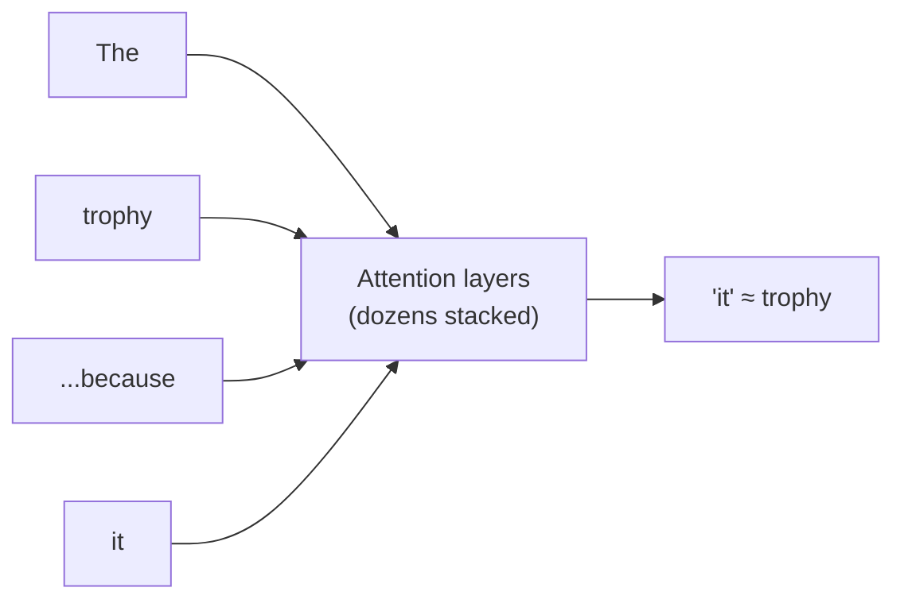
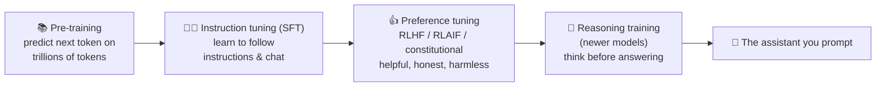

# 🧠 Module 01 — How Large Language Models Work

> 🟢 Stage 1 · Foundations · ⏱️ ~2 hours

## 🎯 Learning Objectives

By the end of this module you will be able to:

- Explain in plain words what a Large Language Model (LLM) is and how it produces text
- Describe **tokens**, **context windows**, **embeddings**, and **attention**
- Explain **temperature**, **top-p**, and why the same prompt can give different answers
- Understand the training stages (**pre-training → instruction tuning → RLHF/RLAIF**) and why they matter for prompting
- Name the main limitations of LLMs (hallucination, knowledge cutoff, math, bias) and how prompting mitigates them

---

## 1. What Is a Large Language Model?

An LLM is a neural network trained on enormous amounts of text to do one deceptively simple thing:

> **Given some text, predict the most likely next piece of text.**

That's it. Translation, coding, summarizing, reasoning, role-play — all of it emerges from *next-token prediction* done extremely well, at massive scale.


### The autocomplete analogy (and where it breaks)

Your phone keyboard suggests the next word. An LLM is like that — but trained on a large fraction of the public internet, books, and code, with billions of parameters, and able to consider **hundreds of thousands of tokens** of context at once. The difference in scale produces a difference in kind: it can follow instructions, keep a persona, write working programs, and reason through multi-step problems.

> 💡 **Why this matters for you:** a prompt is the *beginning of a document* the model will continue. The better your "beginning" describes the document you want, the better the continuation.

---

## 2. Tokens — The Atoms of LLM Text

Models don't read characters or words; they read **tokens** — chunks of text produced by a *tokenizer*.

| Text | Possible tokenization | Token count |
|---|---|---|
| `Hello world` | `[Hello][ world]` | 2 |
| `prompt engineering` | `[prompt][ engineering]` | 2 |
| `unbelievably` | `[un][believ][ably]` | 3 |
| `नमस्ते` (Hindi) | often 3–6 byte-level pieces | 3–6 |
| `{"name": "Vicky"}` | `[{"][name][":][ "][V][icky]["}]` | ~7 |

**Rules of thumb (English):**
- 1 token ≈ 4 characters ≈ ¾ of a word
- 100 tokens ≈ 75 words
- 1 page of text ≈ 500–700 tokens

### Why tokens matter to a prompt engineer

1. **Cost** — APIs charge per input token and per output token.
2. **Limits** — every model has a maximum **context window** (input + output).
3. **Quirks** — tasks like "count the letters in *strawberry*" or "reverse this word" are hard because the model sees tokens, not letters.
4. **Languages** — non-English text often uses more tokens per word, so it costs more and fills the context faster.

🧪 **Try it:** Search for a "tokenizer playground" for your model provider (most have one) and paste a paragraph in English, then the same paragraph in another language. Compare token counts.

---

## 3. Embeddings and Attention (the 5-minute version)

### Embeddings
Each token is turned into a long list of numbers (a **vector**) that captures meaning. Words with similar meanings end up with similar vectors: *king* is close to *queen*, *Paris* is close to *France*. Embeddings are also used directly in **RAG** search (Module 09).

### Attention
The **Transformer** architecture (2017, "Attention Is All You Need") lets every token "look at" every other token and decide how relevant it is. In *"The trophy didn't fit in the suitcase because **it** was too big"*, attention helps the model link **it** to *trophy*.



> 🧠 **Deep dive:** Each layer refines every token's representation by mixing in information from other tokens. After dozens of layers, the final vector of the last token is converted into a probability for every token in the vocabulary (often 50k–250k tokens).

---

## 4. Generation: Sampling the Next Token

After the model computes probabilities, it **samples** one token, appends it, and repeats. This loop is called **autoregressive generation**.


### Key sampling parameters

| Parameter | What it does | Typical values | Use |
|---|---|---|---|
| **Temperature** | Sharpens (low) or flattens (high) the probability curve | 0 – 1 (some APIs allow up to 2) | 0–0.3 for facts, extraction, code; 0.7–1.0 for brainstorming, fiction |
| **Top-p** (nucleus) | Only sample from the smallest set of tokens whose probabilities sum to *p* | 0.9 – 1.0 | Alternative to temperature; change one, not both |
| **Top-k** | Only sample from the *k* most likely tokens | 20 – 100 | Some APIs only |
| **Max tokens** | Hard limit on output length | task-dependent | Prevents runaway cost; can truncate answers |
| **Stop sequences** | Strings that end generation early | e.g. `"\n\nUser:"`, `"</answer>"` | Clean cut-offs |

> ⚠️ **Temperature 0 is not perfectly deterministic** on most hosted models (batching and floating-point effects), but it is *much* more consistent. Some newer reasoning models fix or ignore temperature — check your provider's docs.

---

## 5. How Models Are Trained — and Why It Changes How You Prompt



| Stage | What the model learns | Prompting implication |
|---|---|---|
| **Pre-training** | Language, facts, code, styles — a "world model" of text | The model *knows* a lot; your job is to *activate* the right knowledge |
| **Instruction tuning** | Follow requests, answer in chat format | Direct instructions work; you don't need tricks like "Q: … A:" anymore |
| **Preference tuning** | Be helpful, polite, safe; refuse harmful requests | Clear, legitimate context gets better help; vague "edgy" requests may be refused |
| **Reasoning training** | Produce internal step-by-step thinking | For reasoning models, give the goal and constraints; don't micromanage the steps |

### Base models vs chat/instruct models

- **Base model:** pure next-token predictor. You prompt it by *starting a document* (e.g., the first lines of an article).
- **Instruct/chat model:** fine-tuned to follow instructions. You prompt it by *asking*. Almost all products you use are this type.

---

## 6. The Context Window — The Model's Working Memory

The **context window** is everything the model can "see" in one call: system prompt + conversation history + documents + your message + its own reply.

```text
┌──────────────────────── Context window (e.g. 200k tokens) ────────────────────────┐
│ System prompt │ Tool definitions │ Retrieved docs │ Chat history │ User msg │ Reply │
└────────────────────────────────────────────────────────────────────────────────────┘
```

Important facts:
- **No memory between calls.** A chat app "remembers" by resending the history each turn. (Some apps add a separate memory feature that injects saved notes into the context.)
- **Bigger isn't free.** More tokens = more cost and latency, and relevant details can get "lost in the middle" of very long contexts.
- **Order matters.** Instructions and the question placed *after* a long document often work better than before it (more in Module 09).

---

## 7. What LLMs Are Bad At (and the Prompt Fix)

| Limitation | Example | Prompting mitigation |
|---|---|---|
| **Hallucination** — confident fabrication | Invents a citation or API function | Provide sources; ask for quotes; allow "I don't know"; verify (M09, M13) |
| **Knowledge cutoff** | Doesn't know last month's news | Paste current info; use search/RAG tools |
| **Exact arithmetic & counting** | Miscounts letters or large multiplications | Ask for step-by-step work or use a code/calculator tool (M05, M10) |
| **Following too many constraints at once** | Forgets constraint #9 of 12 | Prioritize; use structure; split into a chain (M08) |
| **Sycophancy** — agreeing with the user | "You're right!" to a wrong claim | Ask for critique explicitly; don't reveal your preferred answer |
| **Bias** | Stereotyped outputs | Specify diversity / neutrality; review outputs (M14) |
| **Non-determinism** | Different answer each run | Lower temperature; structured output; evaluation over many runs |
| **Prompt injection** | Obeys instructions hidden in a document | Delimit untrusted data; least-privilege tools (M14) |

---

## 8. The Landscape of Models (concepts that don't expire)

Instead of memorizing model names (they change every few months), understand the **dimensions** you choose along:

| Dimension | Options |
|---|---|
| **Access** | Closed/hosted (Anthropic Claude, OpenAI GPT, Google Gemini…) vs open-weight (Llama, Mistral, Qwen, Gemma, DeepSeek…) |
| **Size / tier** | Small & fast & cheap ↔ Large & smart & expensive (most providers offer 3 tiers) |
| **Reasoning** | Standard vs "thinking"/reasoning modes that spend extra tokens deliberating |
| **Modality** | Text-only vs vision, audio, video input; image/audio output |
| **Context length** | From a few thousand to a million+ tokens |
| **Specialty** | Coding, embeddings, speech, image generation, safety classifiers |

> 💡 **Pro habit:** prototype with a strong model to learn what's *possible*, then try a smaller/cheaper one and measure whether quality holds (Module 13).

---

## 🔑 Key Takeaways

- LLMs **predict the next token**, repeatedly. Your prompt is the start of the text they continue.
- **Tokens** drive cost, limits, and some quirks (counting letters, non-English cost).
- **Temperature/top-p** control randomness: low for precision, higher for creativity.
- The **context window** is the model's only working memory — no memory between API calls.
- Training stages explain behavior: instruct models follow instructions; preference tuning makes them helpful and cautious; reasoning models think before answering.
- Know the limitations — most "bad AI" outputs are prompt or context problems you can fix.

---

## 🏋️ Exercises

**1.1 — Token estimation.** Estimate the tokens in this module's first paragraph (≈ 60 words). Then check with a tokenizer tool.

<details>
<summary>✅ Solution</summary>

60 words × ~1.33 tokens/word ≈ **80 tokens**. Real tokenizers typically land within ±15% for English prose. If your number was way off, check whether the text had many numbers, code, or rare words — those inflate token counts.

</details>

**1.2 — Temperature experiment.** Ask *"Give me a name for a coffee shop"* five times at temperature 0 and five times at temperature 1 (use a playground). Record the outputs.

<details>
<summary>✅ What you should observe</summary>

At **T=0**, you'll get the same or nearly the same name each time (the highest-probability continuation). At **T=1**, names vary widely, some more creative, some odd. Lesson: use low temperature for consistency, high for idea generation — and when you need *variety* at low temperature, ask for "10 different names" in a single response instead.

</details>

**1.3 — Hallucination hunt.** Ask a model: *"Summarize the 2019 paper 'Quantum Banana Networks' by Dr. A. Fakename."* Then re-ask with: *"If you are not certain this paper exists, say so."*

<details>
<summary>✅ Discussion</summary>

Many models will invent a plausible summary for the first prompt (less often for recent, well-aligned models). The second prompt gives explicit **permission to say "I don't know"**, which significantly reduces fabrication. This is one of the most powerful anti-hallucination techniques.

</details>

---

## ✅ Quick Quiz

1. What is the single task an LLM is trained to do during pre-training?
2. Roughly how many English words fit in 1,000 tokens?
3. You need the same JSON extraction every time. Which temperature range do you choose?
4. True or false: the API remembers your previous request automatically.
5. Why might a model fail to count the "r"s in "strawberry"?
6. What does top-p = 0.9 mean?

<details>
<summary>Show answers</summary>

1. Predict the next token given the previous tokens.
2. About **750 words**.
3. **Low: 0 – 0.3.**
4. **False.** Each call is stateless; history must be resent.
5. It sees **tokens** (e.g., `straw` + `berry`), not individual letters.
6. Sample only from the smallest set of tokens whose cumulative probability reaches 90%.

</details>

---

> © 2026 **Vicky Prasad Mahato** · [abvicky.in](https://abvicky.in)
> ⬅️ [Module 00](00-welcome.md) · ➡️ [Module 02 — Anatomy of a Prompt](02-anatomy-of-a-prompt.md)
