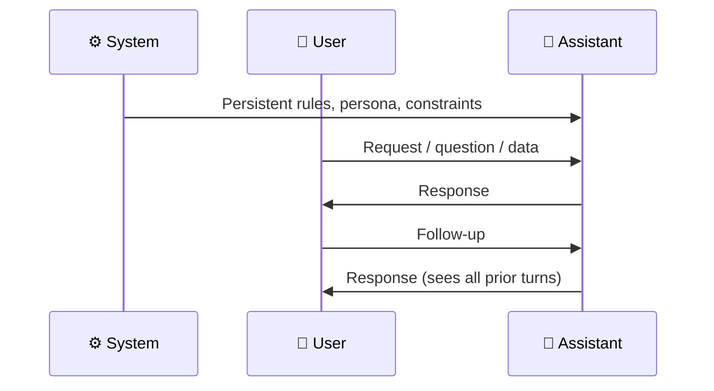

# 🧩 Module 02 — Anatomy of a Prompt

> 🟢 Stage 1 · Foundations · ⏱️ ~1.5 hours

## 🎯 Learning Objectives

- Identify the six building blocks of a prompt: **Role, Task, Context, Input, Examples, Format**
- Understand the **message roles** (system, user, assistant) used by chat models
- Use **delimiters** to separate instructions from data
- Turn a vague request into a complete, well-structured prompt using a reusable framework

---

## 1. The Six Building Blocks


| Block | Question it answers | Example |
|---|---|---|
| 👤 **Role** | Who should the model act as? | "You are an experienced pediatric nutritionist." |
| 🎯 **Task** | What exactly should it do? | "Create a 7-day lunchbox plan." |
| 🧭 **Context** | Why, for whom, under what constraints? | "For a 6-year-old who is vegetarian and allergic to peanuts; parents have 10 minutes each morning." |
| 📄 **Input** | What material should it work on? | A pasted list of foods the child likes |
| 🧪 **Examples** | What does good look like? | One sample day in the desired style |
| 📐 **Format** | What shape should the answer take? | "A markdown table: Day / Main / Snack / Fruit / Prep time." |

> 💡 **Task and Context are the two most important blocks.** Role and Format are cheap upgrades. Examples are the most powerful but cost the most tokens. Input is whatever data the task needs.

> 👔 **Non-Tech Lens · The Workplace Briefing Method:**
> If you delegate a project to a junior colleague or freelance contractor, you wouldn't just say *"Write our newsletter"*. You would specify: who the audience is, what the goal is, key updates to include, tone (friendly vs formal), length limit, and what sections to create. Treat your AI prompt with that same managerial clarity.

> 💻 **Tech Lens · Decoupling Instructions from Dynamic Data:**
> In production backends, always separate static instructions from untrusted user data. Treating user inputs as unescaped raw strings inside instructions creates delimiter confusion and prompt injection vulnerabilities. Wrap dynamic user variables in explicit XML tags (e.g., `<user_query>{{query}}</user_query>`) and reference them unambiguously in your system prompt.

### Before / after

❌ **Weak**
```text
Write lunch ideas for kids.
```

✅ **Strong**
```text
You are an experienced pediatric nutritionist.

Create a 5-day school lunchbox plan for a 6-year-old.

Context:
- Vegetarian, severe peanut allergy (no peanuts or peanut oil at all)
- Picky eater: likes pasta, cheese, apples, cucumbers, rice
- Parents have at most 10 minutes of prep each morning
- No refrigeration until lunch (about 4 hours)

Format: a markdown table with columns Day | Main | Snack | Fruit/Veg | Prep time.
After the table, add 3 short tips for keeping food fresh without a fridge.
```

The strong version took 60 seconds longer to write and removes ~90% of the guesswork.

---

## 2. Message Roles in Chat Models

Modern APIs structure a conversation as a list of messages with **roles**:



| Role | Purpose | Who writes it |
|---|---|---|
| **system** (or "developer"/"instructions") | Long-lived behavior: persona, rules, output conventions, tool policy | The app developer |
| **user** | The request and data for this turn | The end user (or your code) |
| **assistant** | The model's replies; you can also *pre-fill* the start of a reply on some APIs | The model (or you, to steer) |
| **tool** | Results returned from function/tool calls | Your code (Module 10) |

```json
[
  {"role": "system", "content": "You are a concise technical support agent for AcmeCloud. Answer in under 120 words."},
  {"role": "user", "content": "My deployment fails with error 503. What should I check?"}
]
```

> 💡 In chat apps (Claude.ai, ChatGPT…) you usually can't edit the system prompt directly, but you can use **custom instructions**, **projects**, or a first message that sets the rules.

---

## 3. Delimiters — Separating Instructions from Data

When your prompt contains both **instructions** and **material** (an email, a document, code), clearly separate them. This improves accuracy and is a first line of defense against prompt injection (Module 14).

Common delimiters:

| Style | Example |
|---|---|
| XML-style tags (very effective with Claude and widely understood) | `<email> … </email>` |
| Triple quotes / backticks | `""" … """` or ```` ``` … ``` ```` |
| Markdown headings | `### Document` |
| Labeled sections | `ARTICLE:` … `END ARTICLE` |

```text
Summarize the customer email below in 2 sentences, then classify its sentiment
as positive, neutral, or negative.

<email>
Hi, I ordered the blue jacket three weeks ago and it still hasn't arrived.
Tracking hasn't updated in 10 days. This is really frustrating.
</email>
```

> ⚠️ Pick one style and use it consistently. Refer to sections by name: *"Using the data in `<report>`…"*

---

## 4. A Universal Prompt Framework: **R-T-C-I-E-F**

Use this checklist until it becomes instinct:

```text
[R] ROLE      You are a {expert role} who {relevant experience}.
[T] TASK      Your task is to {verb} {object} so that {purpose}.
[C] CONTEXT   Audience: … | Constraints: … | Tone: … | What to avoid: …
[I] INPUT     <input> … </input>
[E] EXAMPLES  <example> … </example>  (optional but powerful)
[F] FORMAT    Respond as {structure}, {length}, {style}.
```

### Other popular frameworks (all variations of the same idea)

| Framework | Stands for | Best for |
|---|---|---|
| **CO-STAR** | Context, Objective, Style, Tone, Audience, Response | Marketing & writing |
| **RTF** | Role, Task, Format | Quick everyday prompts |
| **CRISPE** | Capacity/Role, Insight, Statement, Personality, Experiment | Exploring variations |
| **RISEN** | Role, Instructions, Steps, End goal, Narrowing | Procedural tasks |
| **APE** | Action, Purpose, Expectation | Short business prompts |

> 🔑 Frameworks are training wheels. A pro doesn't fill every slot — they include exactly what the model needs to succeed and nothing that distracts.

---

## 5. Prompt Length — How Much Is Enough?

- **Too short:** the model fills gaps with generic assumptions → bland, off-target output.
- **Too long:** important instructions get diluted; contradictory rules creep in; cost rises.
- **Just right:** everything a smart new colleague would need, nothing they'd find confusing.

> 🧪 **The "colleague test":** If you gave this prompt to a capable human contractor who has never met you, could they do the task well without asking a question? If not, add what they'd ask about.

---

## 6. Worked Example — Building a Prompt Step by Step

**Goal:** a LinkedIn post announcing a new free workshop.

| Step | Add | Prompt so far |
|---|---|---|
| 1 | Task | "Write a LinkedIn post announcing a free workshop." |
| 2 | Context | "+ Topic: prompt engineering for teachers. Date: 14 Dec, 6 pm IST, online. 50 seats. Host: Vicky Prasad Mahato." |
| 3 | Audience & tone | "+ Audience: school teachers new to AI. Tone: warm, encouraging, no jargon." |
| 4 | Format | "+ 120–160 words, a hook in the first line, 3 bullet benefits, a clear call-to-action, max 3 hashtags, max 2 emojis." |
| 5 | Example (optional) | "+ Here's a past post whose style I liked: <example>…</example>" |
| 6 | Role | "+ You are a social-media copywriter for education brands." |

Notice that *role* came last: it helps, but it is the least important piece.

---

## 🔑 Key Takeaways

- A complete prompt has up to **six blocks**: Role, Task, Context, Input, Examples, Format.
- Chat APIs use **system / user / assistant / tool** roles. Put durable rules in the system prompt.
- **Delimit** data from instructions — XML tags are clear and robust.
- Apply the **colleague test**: include what a smart outsider would need.

---

## 🏋️ Exercises

**2.1 — Label the blocks.** Identify each block in this prompt:

```text
As a travel agent specialising in budget trips, plan a 3-day itinerary in Jaipur
for two college students with ₹8,000 total budget excluding travel. They love
history and street food, hate early mornings. Give a day-by-day table with
morning/afternoon/evening and estimated cost per item.
```

<details>
<summary>✅ Solution</summary>

- **Role:** travel agent specialising in budget trips
- **Task:** plan a 3-day itinerary in Jaipur
- **Context:** two college students; ₹8,000 budget excluding travel; love history & street food; hate early mornings
- **Input:** none (no material provided)
- **Examples:** none
- **Format:** day-by-day table with morning/afternoon/evening and estimated costs

</details>

**2.2 — Rewrite with R-T-C-I-E-F.** Improve: *"Explain machine learning."*

<details>
<summary>✅ Sample solution</summary>

```text
You are a patient teacher who explains technical ideas to complete beginners.

Explain what machine learning is to a 15-year-old who is good at math but has
never programmed.

Constraints:
- Use one everyday analogy (e.g., learning to recognise spam emails)
- Avoid jargon; if you must use a technical term, define it in brackets
- No code

Format: 3 short paragraphs (what it is, how it learns, one real-world example),
then a 3-question self-check quiz with answers.
```

</details>

**2.3 — Delimit it.** Write a prompt that asks for a bug explanation, with the code clearly separated from the instructions.

<details>
<summary>✅ Sample solution</summary>

````text
Explain why the Python function below raises an error, then provide a fixed
version. Keep the explanation under 80 words.

<code language="python">
def average(nums):
    return sum(nums) / len(nums)

print(average([]))
</code>
````

Expected answer: `ZeroDivisionError` on an empty list; fix by returning `None`/`0` or raising a clear `ValueError` when `len(nums) == 0`.

</details>

---

## ✅ Quick Quiz

1. Which two blocks matter most in most prompts?
2. Where should rules that apply to every turn of a chatbot go?
3. Name two reasons to use delimiters.
4. What is the "colleague test"?

<details>
<summary>Show answers</summary>

1. **Task** and **Context.**
2. The **system prompt.**
3. Clarity (model knows what's instruction vs data) and **security** (reduces prompt-injection risk); also lets you refer to sections by name.
4. Ask: could a capable outsider do this task well using only this prompt, without asking questions?

</details>

---

> © 2026 **Vicky Prasad Mahato** · [abvicky.in](https://abvicky.in)
> ⬅️ [Module 01](01-how-llms-work.md) · ➡️ [Module 03 — Core Principles](03-core-principles.md)
