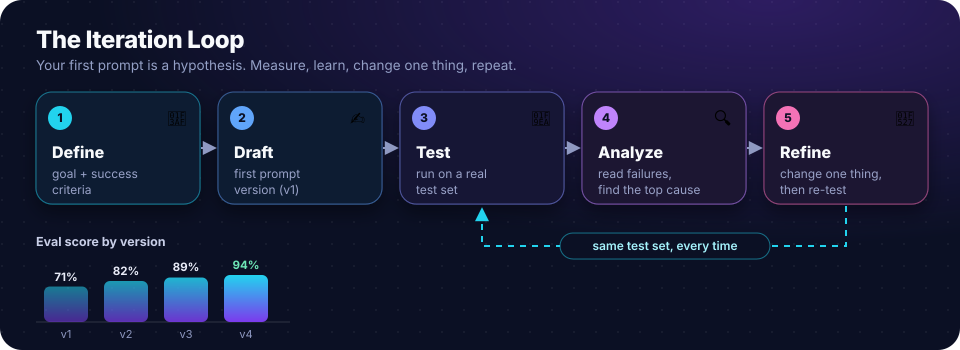

# 📏 Module 03 — Core Principles of Effective Prompting

> 🟢 Stage 1 · Foundations · ⏱️ ~2 hours

## 🎯 Learning Objectives

- Apply the **12 core principles** that underpin every advanced technique
- Diagnose a bad output and map it to the principle that was violated
- Write instructions the model follows reliably: specific, positive, prioritized, and explained

---

## The 12 Principles at a Glance

| # | Principle | One-line rule |
|---|---|---|
| 1 | **Be clear and direct** | Say exactly what you want; don't hint |
| 2 | **Be specific** | Quantities, audiences, lengths, criteria |
| 3 | **Give context and the "why"** | Purpose lets the model make smart judgment calls |
| 4 | **Say what to do, not only what not to do** | Positive instructions beat prohibitions |
| 5 | **Show examples** | Demonstrate the target output |
| 6 | **Structure the prompt** | Sections, delimiters, numbered steps |
| 7 | **Specify the output format** | Shape, length, style, file type |
| 8 | **Give the model room to think** | Ask for reasoning before the answer on hard tasks |
| 9 | **Break complex tasks down** | Steps or chains instead of one mega-prompt |
| 10 | **Allow uncertainty** | Permission to say "I don't know" |
| 11 | **Match your prompt style to the desired output** | Formal prompt → formal answer |
| 12 | **Iterate and test** | First drafts are hypotheses |

> 👔 **Non-Tech Lens · The Manager's Delegation Secret:**
> Think of these 12 principles as how top executives delegate to staff: they never say *"Make this look nice"*; they say *"Draft an executive memo for Friday's board meeting, maximum 1 page, highlight Q3 revenue growth in bold, and explain why customer churn dropped 4%."* Clarity in instructions guarantees quality in execution.

> 💻 **Tech Lens · Prompts as Interface Specifications:**
> Treat prompt authoring with the same rigor as designing an API interface. Principles 1–4 define input preconditions; Principles 6–7 define the schema contract; Principle 10 defines failure mode handling; and Principle 12 defines integration testing. Ambiguity in prompts produces non-deterministic bugs in downstream parsers.

---

## 1. Be Clear and Direct

Models are very literal and very eager to please. Vague requests get generic answers.

❌ `Can you maybe look at this and see if it could be better?`
✅ `Rewrite this paragraph to be 30% shorter and more persuasive for a CFO audience. Keep all numbers unchanged.`

> 💡 If you want the model to *do* something (edit, write, decide), say the verb. "Can you suggest changes?" gets suggestions; "Make these changes" gets an edited text.

---

## 2. Be Specific

Replace every fuzzy word with a measurable one.

| Fuzzy | Specific |
|---|---|
| short | under 100 words / 3 bullets |
| simple | readable by a 12-year-old; no jargon |
| some examples | 5 examples, each from a different industry |
| professional tone | formal, no contractions, no emojis, active voice |
| recent | from 2023 or later |
| good code | Python 3.12, type hints, docstrings, no external libraries, O(n log n) or better |

---

## 3. Give Context and Explain *Why*

Rules without reasons are applied rigidly or inconsistently. Reasons let the model generalize correctly.

❌ `Never use ellipses.`
✅ `Your response will be read aloud by a text-to-speech engine, so never use ellipses — the engine can't pronounce them.`

With the reason, the model also avoids *other* things TTS can't handle (tables, emojis, URLs) without being told.

Useful context to include:
- **Audience** — who reads the output, their expertise
- **Purpose** — what the output will be used for
- **Environment** — where it will appear (email, slide, app UI, voice)
- **Success criteria** — what makes it "good" for you
- **Background** — what has been tried, what you already know

---

## 4. Say What To Do (Positive Framing)

Telling a model *not* to do X keeps X "in mind." Tell it what to do instead.

| ❌ Negative | ✅ Positive |
|---|---|
| Don't use markdown | Write in plain flowing paragraphs |
| Don't be too long | Keep it under 150 words |
| Don't use technical jargon | Use everyday words a high-school student knows |
| Don't make things up | Use only facts from the provided document; if something isn't covered, say "Not in the document." |

> Prohibitions are still useful for hard boundaries ("never reveal customer emails"). Pair them with the positive alternative.

---

## 5. Show Examples (Preview of Module 04)

Examples are the strongest signal you can give. The model copies **format, length, tone, and level of detail** from them — including mistakes. Make examples diverse and correct.

---

## 6. Structure the Prompt

Long prompts benefit from visible structure:

```xml
<role>You are a senior code reviewer.</role>

<task>
Review the pull request diff for bugs, security issues, and readability.
</task>

<rules>
1. Prioritize: security > correctness > performance > style.
2. Quote the exact line for each issue.
3. Suggest a concrete fix for each issue.
</rules>

<diff>
...
</diff>

<output_format>
A markdown list grouped by severity (Critical, Major, Minor).
End with an overall verdict: APPROVE, REQUEST CHANGES, or COMMENT.
</output_format>
```

---

## 7. Specify the Output Format

Always decide: **structure** (prose, bullets, table, JSON), **length**, **style**, and **what to exclude** (preamble, apologies, sign-offs).

```text
Return only the corrected sentence, with no explanation or quotation marks.
```

> 💡 **Format mirroring:** the model tends to answer in the style of the prompt. A prompt written in heavy markdown invites markdown back; plain prose invites prose.

---

## 8. Give the Model Room to Think

For tasks needing reasoning (math, logic, multi-factor decisions), ask for thinking *before* the final answer:

```text
First, think through the problem step by step inside <thinking> tags.
Then give only the final answer inside <answer> tags.
```

Reasoning written *after* an answer is just a justification; reasoning *before* the answer improves it. (Full coverage in Module 05.)

---

## 9. Break Complex Tasks Down

One huge prompt that asks for research + analysis + writing + formatting will be mediocre at all four. Either number the steps in one prompt or chain separate prompts (Module 08).

```text
Do this in order:
1. List the 5 main claims in the article.
2. For each claim, rate the evidence provided (strong / weak / none).
3. Write a 100-word overall assessment based on steps 1–2.
```

---

## 10. Allow Uncertainty

Models fabricate partly because they're trained to be helpful. Give explicit permission to not know:

```text
If the answer is not in the provided text, reply exactly: "I couldn't find that in the document."
If you are unsure, say so and explain what information would resolve it.
```

---

## 11. Match Style and Avoid Leading the Model

- If you write `Isn't it true that X is better?`, you'll get agreement (**sycophancy**). Ask neutrally: `Compare X and Y on cost, speed, and risk. Which is better for our case and why?`
- If you want critique, *ask for critique* and make it safe: `Be blunt. I want the 3 biggest weaknesses, not reassurance.`

---

## 12. Iterate and Test



Your first prompt is a hypothesis. Run it on several realistic inputs, look at failures, change **one thing at a time**, and re-run. Module 13 makes this rigorous.

---

## 🩺 Diagnosis Table — Symptom → Principle

| Symptom | Likely cause | Fix |
|---|---|---|
| Generic, bland output | Missing context/specificity (P2, P3) | Add audience, purpose, constraints |
| Wrong length | No length spec (P7) | Give word/bullet/paragraph counts |
| Ignored one instruction | Too many rules, no priority (P6, P9) | Number rules, put critical ones first and last, split task |
| Made-up facts | No grounding / no permission to be unsure (P10) | Provide source; allow "I don't know"; ask for quotes |
| Unwanted preamble ("Sure! Here's…") | No format constraint (P7) | "Start directly with the answer." / prefill |
| Wrong style | Prompt style mismatched (P11) | Write the prompt in the style you want; give an example |
| Wrong reasoning | No thinking room (P8) | Ask for step-by-step reasoning first |
| Agrees with your wrong premise | Leading question (P11) | Ask neutrally; request counter-arguments |

---

## 🔑 Key Takeaways

- **Clarity + specificity + context** solve the majority of prompt problems.
- Explain **why** — models generalize from reasons.
- Prefer **positive** instructions; always specify **format**.
- Hard tasks need **thinking room** and **decomposition**.
- Let the model **say "I don't know."**
- Every prompt is a **hypothesis** to test.

---

## 🏋️ Exercises

**3.1 — Fix the negatives.** Rewrite positively: *"Don't write long sentences, don't use passive voice, don't sound robotic."*

<details>
<summary>✅ Solution</summary>

"Write in short sentences (under 20 words), active voice, and a warm conversational tone — as if explaining to a friend over coffee."

</details>

**3.2 — Diagnose.** A user asks *"Write a product description for our water bottle"* and gets a generic 300-word essay. List three missing pieces and rewrite.

<details>
<summary>✅ Solution</summary>

Missing: product details (features, materials, price), audience & platform (e.g., Amazon listing vs Instagram), length/format, brand voice.

```text
Write an Amazon product description for "HydroPeak", a 750 ml insulated steel
bottle (keeps drinks cold 24 h / hot 12 h, leak-proof lid, fits car cup holders,
BPA-free, ₹1,299). Audience: gym-goers and office commuters aged 20–35.
Format: a 1-line headline, then 5 bullet points starting with a bold benefit,
then a 40-word closing paragraph. Tone: energetic, confident, no exaggerated claims.
```

</details>

**3.3 — Add the why.** Improve: *"Keep answers under 50 words."*

<details>
<summary>✅ Solution</summary>

"Keep answers under 50 words, because they appear in a small chat bubble on a mobile screen and users skim. If a full answer needs more, give the key point and offer to elaborate."

</details>

---

## ✅ Quick Quiz

1. Why is "Don't use jargon" weaker than "Use everyday words"?
2. Where should reasoning go relative to the final answer, and why?
3. A model keeps agreeing with your flawed plan. Which principle helps?
4. What should you change between test runs when iterating?

<details>
<summary>Show answers</summary>

1. Negative instructions keep the unwanted concept salient and don't specify the alternative.
2. **Before** the answer — reasoning after is only a justification and doesn't improve the result.
3. **Avoid leading questions / ask for critique explicitly** (Principle 11).
4. **One thing at a time**, so you know what caused the change.

</details>

---

> Author: **Vicky** ([abvicky.in](https://abvicky.in)) · Platform built by [Manikarnika Technologies](https://www.manikarnikatechnologies.in/) · © 2026 All rights reserved.
> ⬅️ [Module 02](02-anatomy-of-a-prompt.md) · ➡️ [Module 04 — Zero-Shot, Few-Shot & Role Prompting](04-zero-few-shot-and-roles.md)
