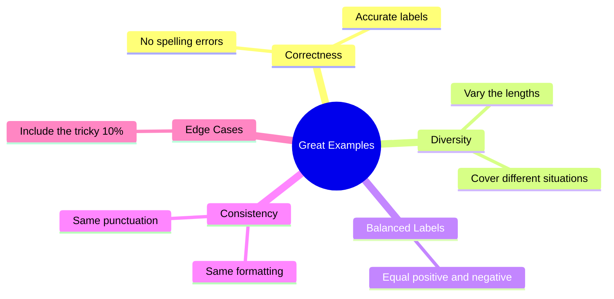

# 🎭 Module 04 — Zero-Shot, Few-Shot & Role Prompting

> 🟢 Stage 1 · Foundations · ⏱️ ~2 hours

Think about how you train someone to make coffee at a busy cafe. 

You could hand them a 10-page employee manual describing the exact foam density and temperature of a cappuccino. Or you could pull two shots of espresso, steam the milk, pour a neat rosetta on top, slide the cup across the counter, and say: *"Make the next five look just like this."*

Almost everyone learns faster from the second method.

AI models are no different. They are pattern-matching engines. When you write paragraphs of instructions explaining what you want, the model has to interpret every word. But when you show it two or three clear examples of what good looks like, it grasps the format, tone, length, and style instantly.

In this module, you will learn how to use examples (few-shot prompting) and personas (role prompting) to steer AI models with precision.

---

## 🎯 Learning Objectives

By the end of this module, you will be able to:
- Choose between **zero-shot** (no examples) and **few-shot** (with examples) for any task.
- Build clean, balanced examples that teach the model your exact format and style.
- Craft grounded, realistic **role personas** that sharpen tone and vocabulary without cartoonish fluff.
- Use **output priming** to skip conversational filler and jump straight into the answer.
- Rewrite your Module 00 baseline travel prompt and see your progress firsthand.

---

## 1. Zero-Shot Prompting: Just Give the Instructions

**Zero-shot prompting** simply means giving the model an instruction without providing any examples of the answer.

```text
Classify the sentiment of this customer review as Positive, Neutral, or Negative:
"The battery lasts all day, but the touchscreen freezes every time it rains."

Sentiment:
```

Modern models handle straightforward zero-shot requests remarkably well. 

- **When to use zero-shot:** For everyday summaries, straightforward translations, standard grammar checks, and common coding questions.
- **When zero-shot struggles:** When you have a custom format, strict company guidelines, subtle tone requirements, or tricky edge cases. That is when you switch to few-shot prompting.

---

## 2. Few-Shot Prompting: Teach by Showing

**Few-shot prompting** means giving the model 2 to 5 examples of an input paired with the ideal output before asking it to solve your new problem.

This was one of the biggest milestones in AI research (popularized by OpenAI's landmark 2020 paper *"Language Models are Few-Shot Learners"*). It is still one of the most reliable techniques in a prompt engineer's toolkit.

Here is a practical example. Suppose you run a customer support team and want customer complaints turned into clean, standardized ticket titles:

```text
Turn each customer complaint into a short, standardized support ticket title (max 8 words).

Complaint: "The mobile app crashes every single time I try to upload my KYC documents."
Title: App crash during KYC document upload

Complaint: "I was billed twice for my quarterly subscription on May 1st."
Title: Duplicate charge for quarterly subscription

Complaint: "Can you please add a dark mode? My eyes hurt working late at night."
Title: Feature request: Dark mode option

Complaint: "I haven't received my refund of ₹1,499 even though the courier picked up my return 5 days ago."
Title:
```

Notice what happens: you didn't have to write rules like *"Don't include customer names"*, *"Capitalize only the first word"*, or *"Keep it under eight words"*. The model absorbs all of those patterns directly from the examples.

> 👔 **Non-Tech Lens · Show, Don't Just Tell:**
> If you struggle to explain your company's writing tone using adjectives (*"Be professional yet warm, authoritative but friendly"*), stop writing descriptions. Instead, copy-paste two emails or LinkedIn posts you have written in the past that you love. Tell the AI: *"Analyze the tone, sentence length, and vocabulary in these two examples, then write the new announcement in that exact same voice."*

> 💻 **Tech Lens · In-Context Learning & Assistant Prefilling:**
> Few-shot examples guide the model's self-attention layers during inference without updating model weights. When working with chat APIs, format your examples as actual conversational turns (`user` then `assistant`). When you need immediate JSON output without introductory pleasantries, use **Assistant Prefilling** (for instance, starting the assistant turn with `{` or `[`) to force the generation to start directly with the desired data structure.

---

## 3. The Rules of High-Quality Examples

A bad example will mislead the model faster than a bad instruction. Follow these six rules:



1. **Be 100% Correct:** Models copy mistakes faithfully. If your sample output has a spelling mistake or mislabeled category, the model assumes you want errors.
2. **Keep Labels Balanced:** If you provide four positive examples and only one negative example, the model develops an artificial bias toward the positive class. Keep counts roughly equal.
3. **Include the Tricky Edge Cases:** Don't just give easy examples. If a customer writes *"I love paying full price for broken software!"*, give an example showing that sarcasm should be tagged as Negative.
4. **Use Consistent Formatting:** Use the exact same delimiters, capitalization, and punctuation across all examples.
5. **Use XML Tags for Clean Separation:**
   Wrap examples in `<examples>` tags so the model knows where your demonstration ends and the real task begins:

```xml
<examples>
  <example>
    <customer_query>Where is my order #48291?</customer_query>
    <intent>order_tracking</intent>
  </example>
  <example>
    <customer_query>I want to return the red kurti I received yesterday.</customer_query>
    <intent>return_request</intent>
  </example>
</examples>

<customer_query>Do you deliver to pincode 560038?</customer_query>
<intent>
```

---

## 4. Role (Persona) Prompting Done Right

Telling the model who to act as primes its internal vocabulary, priorities, and tone.

However, many beginners use cartoonish roles that do nothing:
- ❌ *"You are the world's most brilliant, award-winning marketing genius."* (This adds zero useful information; the model doesn't become smarter.)
- ✅ *"You are a direct-response copywriter for B2B SaaS companies who specializes in email onboarding sequences."* (This tells the model the exact domain, style, and goal.)

### The Anatomy of an Effective Persona
A strong role includes five specific ingredients:
1. **Domain:** What field? (Accounting, logistics, high school physics).
2. **Seniority / Experience:** Senior practitioner, patient tutor, cynical critic.
3. **Target Audience:** Speaking to a beginner, a busy CEO, or a child.
4. **Behavioral Constraint:** *"Ask guiding questions instead of giving direct answers"* or *"Be concise and avoid corporate jargon."*
5. **Point of View:** *"Prioritize security over convenience"* or *"Focus on cost reduction over speed."*

### Multi-Perspective Role Prompting
When making difficult business or strategic decisions, ask the model to evaluate the issue from multiple viewpoints:

```text
Evaluate our plan to switch from a free mobile app with ads to a ₹299 monthly subscription.

Analyze this move from three distinct perspectives (one short paragraph each):
1. A price-sensitive student user who uses the app daily for study notes.
2. A power user who wants an ad-free experience and advanced export features.
3. Our CFO who is focused on predictable monthly recurring revenue.

Conclude with the single biggest adoption risk all three perspectives share.
```

---

## 5. Output Priming & Prefilling

When you chat with an AI, it often starts its reply with conversational pleasantries:
*"Sure! I would be delighted to help you write a business email. Here is the draft..."*

If you are copying text into a document or using an API, this chit-chat gets in the way.

**Output priming** means putting words right at the end of your prompt that the model is forced to continue:

```text
Write a concise 3-sentence summary of the news article below.

Summary:
```

By ending with `"Summary:"`, the model immediately starts writing the summary rather than rambling about how happy it is to help.

In developer APIs (such as Anthropic Claude or local models), this is called **prefilling**:

```python
# API Prefill Example
messages = [
    {"role": "user", "content": "Extract the company name and funding amount in JSON from this press release: ..."},
    {"role": "assistant", "content": "{\n  \"company\":"}  # Prefill forces JSON output immediately
]
```

---

## 6. Revisiting Your Baseline: Compare Your Growth

Remember Exercise 0.1 from Module 00? You wrote a prompt asking an AI to plan a 3-day trip.

Look back at the response you got. It was probably a generic list of sights with no consideration for your budget, travel style, or pace.

Now look at how you can rewrite that prompt using everything you've learned in Stage 1:

✅ **The Pro Makeover**
```text
You are an experienced, budget-conscious travel guide who specializes in heritage walking tours in Rajasthan.

Create a detailed 3-day itinerary for two college friends visiting Jaipur in November.

Context & Constraints:
- Budget: Total ₹12,000 for both travelers (excluding intercity trains).
- Interests: Architecture, photography, and local street food; no shopping for expensive handicrafts.
- Pace: Slow and relaxed. No wake-ups before 9:00 AM.
- Transport: Prefer walking, e-rickshaws, and metro over taxis.

Format:
Present the plan as a day-by-day guide. For each day, include:
- Morning (from 9:30 AM), Afternoon, and Evening activities.
- One specific local food spot with a recommended dish and estimated cost in ₹.
- Total estimated daily spend.

At the end, provide 3 practical tips to avoid crowds at the major forts.
```

Test both prompts in your chat tool. Notice the dramatic difference in quality. That is the power of prompt engineering.

---

## 💡 Common Mistakes & How to Spot Them

| Mistake | What goes wrong | How to fix it |
|---|---|---|
| The Inflated Title | *"You are an omniscient genius who knows everything."* The model still hallucinates. | Replace fluff with domain, audience, and constraints (*"You are a patent attorney in India reviewing a software copyright"*). |
| The Copy-Paste Example | Your examples use the words "Item A" and "Item B", and the model outputs "Item C". | Make your examples look like real, authentic data. |
| One-Sided Training | You give 5 examples of glowing 5-star reviews and ask it to classify a 1-star review. | Balance your examples with equal numbers of positive, negative, and neutral cases. |

---

## 🧪 Try It Now

Open your chat app and test this few-shot prompt to convert messy meeting notes into crisp action items:

```text
Convert unstructured meeting notes into crisp action items.

<example>
Notes: "Priya said she will look at the Figma wireframes by Wednesday. Arjun needs to confirm AWS budget with finance before we launch."
Action Items:
- [ ] Priya: Review Figma wireframes (Due: Wednesday)
- [ ] Arjun: Get AWS budget sign-off from finance (Due: Prior to launch)
</example>

<example>
Notes: "Vikram mentioned the client wants the slide deck updated with Q3 numbers. He said he will email them the revised PDF by tomorrow evening."
Action Items:
- [ ] Vikram: Update slide deck with Q3 numbers and email PDF to client (Due: Tomorrow evening)
</example>

Notes: "Ananya agreed to draft the vendor contract today. Rohit needs to send the revised pricing spreadsheet to the marketing team by Thursday 2 PM."
Action Items:
```

Observe how accurately the model formats the new notes without a single extra instruction.

---

## 🔑 Key Takeaways

- **Zero-shot** works well for common, everyday tasks; **few-shot** is the gold standard when you need strict formats, unique styles, or reliable classification.
- Examples must be **correct, diverse, balanced, and consistent**. Errors in your examples get copied.
- A strong **role** specifies domain, experience level, target audience, and constraints. Avoid hollow compliments like "world's best".
- End prompts with an **output cue** or use **prefilling** to skip conversational fluff and force the desired format.

---

## 🏋️ Exercises

### Exercise 4.1: Build a Few-Shot Tone Transformer
Write a few-shot prompt that converts technical error messages into warm, helpful customer-facing notices. Include two high-quality examples.

<details>
<summary>View Solution & Explanation</summary>

**A strong solution:**

```xml
<instructions>
Rewrite developer error messages into plain, reassuring notices for non-technical users. 
Include what happened in simple words and one clear next step.
</instructions>

<examples>
  <example>
    <dev_error>504 Gateway Timeout: Upstream server unresponsive on port 443.</dev_error>
    <user_notice>Our servers are taking a little longer than usual to respond. Please refresh the page in a minute or two.</user_notice>
  </example>
  <example>
    <dev_error>AUTH_009: JWT expired. Signature verification failed.</dev_error>
    <user_notice>Your session has timed out for your security. Please log in again to continue.</user_notice>
  </example>
</examples>

<dev_error>ERR_DISK_FULL: Write failed on /var/log/uploads. No space left on device.</dev_error>
<user_notice>
```

*Explanation:* Two clean examples clearly demonstrate the target style: calm, non-technical, and action-oriented.

</details>

### Exercise 4.2: Spot the Flaw in the Examples
Look at this prompt. Why will the model perform poorly on negative customer tweets?

```text
Classify each customer tweet as Positive or Negative.

Tweet: "I am in love with this new phone! Best purchase ever." -> Positive
Tweet: "Fast delivery, neat packaging. Very impressed." -> Positive
Tweet: "Great customer care support in Mumbai today." -> Positive
Tweet: "Battery life exceeds expectations." -> Positive

Tweet: "My package arrived damaged and nobody is answering the phone." ->
```

<details>
<summary>View Solution & Explanation</summary>

**The Flaw: Label Imbalance.**
All four examples are Positive. The model's attention mechanism is heavily biased toward predicting "Positive" because that is the only label it has seen in the pattern. To fix this, provide two positive examples and two negative examples.

</details>

---

## ✅ Quick Quiz

1. When should you choose few-shot prompting over zero-shot prompting?
   - A) When you want to save money on API tokens.
   - B) When zero-shot fails to capture your exact format, style, or tricky edge cases.
   - C) Only when writing computer code.
2. What happens if you include a typo or factual mistake in one of your few-shot examples?
   - A) The model automatically corrects it for you.
   - B) The model treats the mistake as an intentional pattern and may replicate it in future answers.
   - C) The prompt crashes the server.
3. Why is "You are a direct-response copywriter for fintech startups" better than "You are the smartest writer on earth"?
   - A) Because the first role provides concrete domain context and stylistic expectations, while the second is empty hype.
   - B) Because the word "smartest" is filtered out by safety filters.
   - C) It is not better; both work the same.

<details>
<summary>View Answers</summary>

1. **B** — Few-shot is ideal when you need to teach subtle formatting, tone, or specific categorization rules that instructions alone fail to communicate.
2. **B** — Models are relentless pattern copiers; errors in examples teach the model that errors are acceptable.
3. **A** — Specific roles shape vocabulary, tone, and practical constraints. Flattering adjectives provide no useful guidance.

</details>

---

> Author: **Vicky** ([abvicky.in](https://abvicky.in)) · Platform built by [Manikarnika Technologies](https://www.manikarnikatechnologies.in/) · © 2026 All rights reserved.
> ⬅️ [Module 03](03-core-principles.md) · ➡️ [Module 05 — Reasoning Techniques](05-reasoning-techniques.md)
