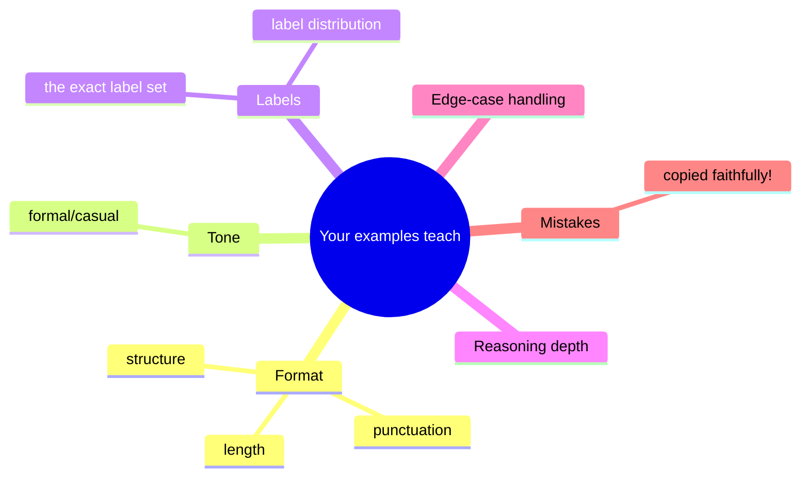

# 🎭 Module 04 — Zero-Shot, Few-Shot & Role Prompting

> 🟢 Stage 1 · Foundations · ⏱️ ~2 hours

## 🎯 Learning Objectives

- Know when to use **zero-shot**, **one-shot**, and **few-shot** prompting
- Design high-quality examples: diverse, correct, representative, well-formatted
- Use **role / persona prompting** effectively — and know its limits
- Use **prefilling** and **output priming** to steer responses

---

## 1. Zero-Shot Prompting

**Zero-shot** = instructions only, no examples. Modern instruction-tuned models handle most common tasks zero-shot.

```text
Classify the sentiment of this review as positive, negative, or mixed.
Review: "Battery life is amazing, but the camera is disappointing."
Sentiment:
```

✅ Use zero-shot when the task is common and the output format is simple.
⚠️ Move to few-shot when the model misreads the format, tone, edge cases, or labels.

---

## 2. Few-Shot Prompting (In-Context Learning)

**Few-shot** = include a few input → output examples. The model infers the pattern. This was a headline discovery of the GPT-3 era ("Language Models are Few-Shot Learners", 2020) and remains one of the most reliable techniques.

```text
Convert each product feedback into a support ticket title (max 8 words).

Feedback: "The app crashes every time I upload a photo bigger than 10MB."
Title: App crashes on photo uploads over 10MB

Feedback: "I was charged twice for my March subscription!!"
Title: Duplicate charge for March subscription

Feedback: "Would be great if there was a dark mode."
Title: Feature request: dark mode

Feedback: "Can't log in with Google since yesterday's update."
Title:
```

### What examples teach (whether you intend it or not)

> 👔 **Non-Tech Lens · Show, Don't Just Tell:**
> Describing your personal writing style or company tone with vague adjectives ("professional yet approachable, concise but detailed") almost always leaves the AI guessing. Instead, paste 2 or 3 examples of previous emails, reports, or social media posts that you love. The model absorbs the rhythm, length, vocabulary, and formatting instantly.

> 💻 **Tech Lens · In-Context Learning Dynamics & Assistant Prefilling:**
> Few-shot prompting guides transformer attention maps without weight updates. Ensure balanced class frequency in classification examples to prevent majority-class prediction skew. When calling chat APIs (such as Anthropic or local models), use *Assistant Prefilling* (e.g. `messages=[..., {"role": "assistant", "content": "{"}]`) to force output generation to start immediately with valid JSON, bypassing conversational conversational filler.



### 🏅 The rules of great examples

| Rule | Why | Example |
|---|---|---|
| **Correct** | Errors get copied | Double-check every label |
| **Diverse** | Prevents overfitting to one pattern | Vary length, topic, difficulty |
| **Representative** | Should look like real inputs | Use actual (anonymized) data |
| **Cover edge cases** | Teaches the tricky boundaries | Include a sarcastic or mixed review |
| **Balanced labels** | Skewed examples skew answers | Don't give 4 positives and 1 negative |
| **Consistent format** | Model copies format exactly | Same labels, same punctuation |
| **Clearly delimited** | Distinguishes examples from instructions | Wrap in `<example>` tags |
| **Order-aware** | Recent examples weigh more | Shuffle; don't put all of one class last |

### How many examples?
- **1 (one-shot):** to show format.
- **3–5:** the usual sweet spot for classification/transformation.
- **5–20+:** for complex styles or many labels — watch the token cost.

> 💡 **Examples vs instructions:** if the model ignores your instruction, an example often fixes it instantly. If examples cause the model to copy *content* too closely, add: *"These examples show the format only; create original content."*

### Structured few-shot with XML

```xml
<instructions>Rewrite technical release notes as friendly customer updates.</instructions>

<examples>
  <example>
    <input>Fixed race condition in session token refresh.</input>
    <output>We fixed an issue that sometimes logged you out unexpectedly. 🎉</output>
  </example>
  <example>
    <input>Reduced p95 latency of search API by 40%.</input>
    <output>Search is now noticeably faster — results load up to 40% quicker.</output>
  </example>
</examples>

<input>Added OAuth2 PKCE flow for mobile clients.</input>
```

### Few-shot via fake conversation turns

With chat APIs, you can place examples as previous user/assistant turns:

```python
messages = [
    {"role": "user", "content": "Classify: 'Love it!'"},
    {"role": "assistant", "content": "positive"},
    {"role": "user", "content": "Classify: 'Broke after a day.'"},
    {"role": "assistant", "content": "negative"},
    {"role": "user", "content": "Classify: 'It's okay, does the job.'"},
]
```

---

## 3. Role (Persona) Prompting

Assigning a role primes vocabulary, depth, priorities, and tone.

```text
You are a cybersecurity auditor with 15 years of experience in fintech.
Review this login flow for vulnerabilities.
```

### Make roles more effective

| Weak role | Strong role |
|---|---|
| "You are an expert." | "You are a senior tax accountant in India who specializes in freelancers and explains things simply." |
| "Act as a teacher." | "You are a Socratic math tutor. Never give the answer directly; ask one guiding question at a time." |

A strong role includes: **domain + seniority + specialization + audience + behavior style**.

### Where roles help vs. don't

| ✅ Helps | ❌ Doesn't help much |
|---|---|
| Tone and vocabulary | Making the model know facts it doesn't know |
| Prioritization (an auditor looks for risk) | Guaranteeing accuracy ("You are always correct") |
| Perspective-taking ("as a skeptical investor…") | Bypassing safety policies |
| Consistent character in apps | Replacing clear task instructions |

> ⚠️ "You are the world's best X" adds little. Specific context about the task beats inflated titles.

### Multi-perspective role prompting

```text
Evaluate this startup idea from three perspectives, one paragraph each:
1. A venture capitalist focused on market size
2. A CTO focused on technical feasibility
3. A target customer (a small bakery owner)
Then synthesize the biggest risk all three would agree on.
```

---

## 4. Prefilling & Output Priming

Some APIs (e.g., Anthropic's Messages API on many models) let you write the **beginning of the assistant's reply**, and the model continues from there. Even where prefill isn't supported, ending your prompt with a cue works similarly.

```python
messages = [
    {"role": "user", "content": "Extract name and city from: 'Vicky moved to Pune last year.' Reply in JSON."},
    {"role": "assistant", "content": "{"}   # prefill forces JSON to start immediately
]
```

Uses:
- Force a format (`{`, `<answer>`, `|Name|`)
- Skip preambles ("Sure! Here is…")
- Keep a character in role (`[Captain Rex]:`)

Output priming in plain prompts:

```text
Write a haiku about monsoon rain.
Haiku:
```

> ⚠️ Prefill support varies by provider and model (some reasoning modes don't allow it). Structured-output features (Module 06) are often the better modern option for JSON.

---

## 5. Putting It Together — Revisit Your Baseline

Remember Exercise 0.1 (the 3-day trip)? Rewrite it now using: role, context (budget, travelers, interests, pace, season), format, and one example day. Compare with your baseline.

---

## 🔑 Key Takeaways

- **Zero-shot** for simple, common tasks; **few-shot** when format, labels, tone, or edge cases matter.
- Examples must be **correct, diverse, representative, balanced, consistent**.
- **Roles** shape tone and priorities; make them specific. They don't add knowledge.
- **Prefilling/priming** is a precise steering tool for format and character.

---

## 🏋️ Exercises

**4.1 — Build a few-shot classifier.** Create a prompt that classifies customer messages into `billing`, `technical`, `account`, `other`. Include 4 examples with one edge case.

<details>
<summary>✅ Sample solution</summary>

```xml
<instructions>
Classify each customer message into exactly one category:
billing, technical, account, or other.
Reply with the category word only.
</instructions>

<examples>
<example><message>I was charged ₹499 but my plan is ₹399.</message><category>billing</category></example>
<example><message>The export button gives a blank file.</message><category>technical</category></example>
<example><message>How do I change the email on my profile?</message><category>account</category></example>
<example><message>My card was declined and now I can't log in at all.</message><category>account</category></example>
</examples>

<message>{{customer_message}}</message>
```

The 4th example is the **edge case**: it mentions billing (card declined) but the user's actual blocker is account access. Add a rule if you want consistent tie-breaking: *"If several apply, choose the one blocking the user right now."*

</details>

**4.2 — Upgrade the role.** Improve: *"You are a doctor. Tell me about diabetes."*

<details>
<summary>✅ Sample solution</summary>

```text
You are a diabetes educator who explains medical topics to newly diagnosed
patients in plain, reassuring language. Explain what type 2 diabetes is, how
diet and exercise affect blood sugar, and the 3 warning signs that require
contacting a doctor urgently. Keep it under 300 words, use short headings,
and remind the reader this is general information, not personal medical advice.
```

</details>

**4.3 — Prefill.** Write a message list that forces a model to reply with a markdown table that starts `| Language | Year |`.

<details>
<summary>✅ Sample solution</summary>

```python
messages = [
  {"role": "user", "content": "List 5 programming languages and the year each was released, as a markdown table."},
  {"role": "assistant", "content": "| Language | Year |\n|---|---|\n|"}
]
```

</details>

---

## ✅ Quick Quiz

1. What's the main signal few-shot examples provide that instructions often don't?
2. Your examples are all short, so outputs are too short. What principle was violated?
3. Does "You are a world-class physicist" make the model know more physics?
4. Give two uses of prefilling.

<details>
<summary>Show answers</summary>

1. The exact **format/pattern** of the desired output (plus tone, length, label set).
2. **Diversity / representativeness** of examples.
3. **No** — it may shift tone and depth, but it doesn't add knowledge or guarantee accuracy.
4. Forcing an output format (e.g., starting with `{`), skipping preambles, keeping a character voice.

</details>

---

> © 2026 [Manikarnika Technologies](https://www.manikarnikatechnologies.in/) · All rights reserved.
> ⬅️ [Module 03](03-core-principles.md) · ➡️ [Module 05 — Reasoning Techniques](05-reasoning-techniques.md)
