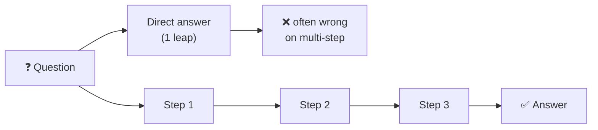
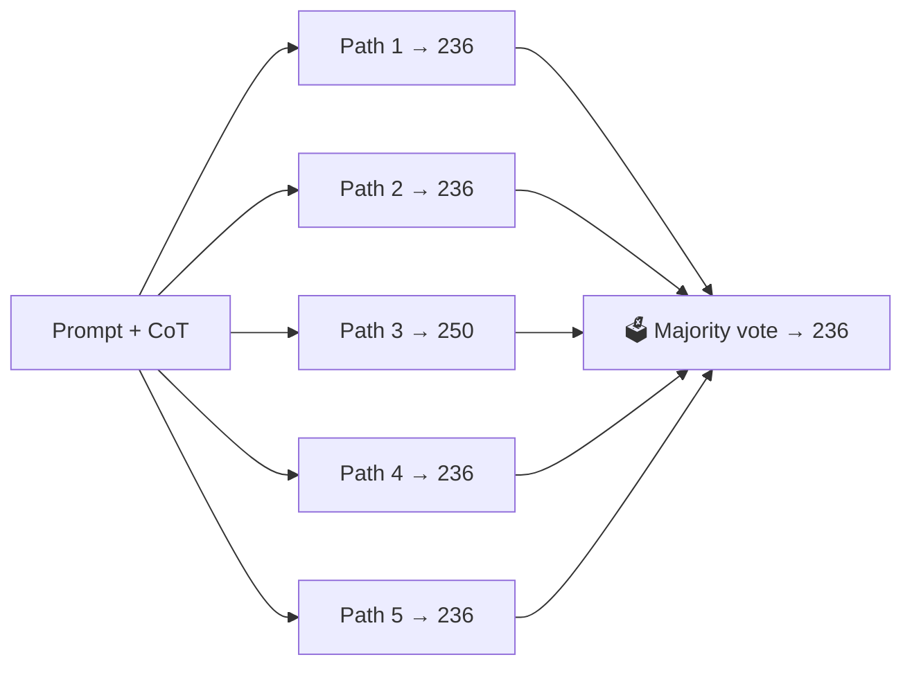
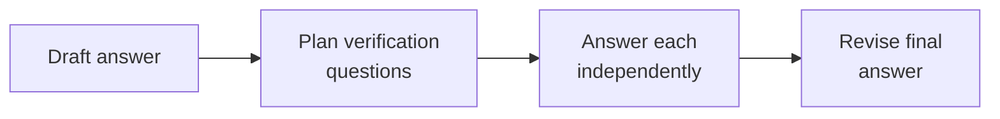

# 🧮 Module 05 — Reasoning Techniques

> 🔵 Stage 2 · Intermediate · ⏱️ ~3 hours

## 🎯 Learning Objectives

- Apply **Chain-of-Thought (CoT)** in zero-shot and few-shot forms
- Use **Self-Consistency**, **Tree of Thoughts**, **Step-Back**, **Least-to-Most**, **Decomposition**, and **Self-Critique / Reflexion**
- Separate reasoning from final answers with tags so outputs stay parseable
- Prompt modern **reasoning ("thinking") models** correctly — which is different from prompting standard models

---

## 1. Why Reasoning Prompts Work

An LLM spends roughly the same computation per token. A hard problem answered in one token gets one "step" of thought. Asking it to **write out intermediate steps** gives it more tokens — more computation — and lets each step condition on the previous ones.



> 👔 **Non-Tech Lens · How to Get Deep Insights Instead of Fluff:**
> When you need help with business decisions, competitor analysis, or pricing calculations, never just ask: *"Which vendor should we choose?"*
> Instead, ask: *"Before recommending a vendor, list the pros, cons, hidden costs, and operational risks of each option step-by-step. Once you've analyzed the trade-offs, state your final recommendation."* Forcing the AI to 'think out loud' first prevents hasty, superficial conclusions.

> 💻 **Tech Lens · Test-Time Compute Scaling & Dedicated Reasoning Models:**
> Chain-of-Thought works because it scales *test-time compute*: every intermediate token acts as additional transformer feed-forward computation, expanding working memory.
> In newer reasoning models (OpenAI o1/o3, Claude 3.7 Sonnet with extended thinking, DeepSeek R1), the model produces internal hidden reasoning chains optimized via reinforcement learning (RL).
> **Best practice for reasoning models:** State high-level goals and constraints; do NOT micromanage step-by-step CoT prompts (e.g. avoid manual few-shot thinking steps), and regulate depth via `budget_tokens` or `reasoning_effort` settings.

---

## 2. Chain-of-Thought (CoT)

### Zero-shot CoT
Add a cue such as *"Think step by step."* (Kojima et al., 2022 showed large gains on arithmetic from this single phrase.)

```text
A shop sells pens at ₹12 each or a pack of 5 for ₹50. Ravi needs 23 pens.
What's the cheapest total cost? Think step by step, then give the final answer.
```

Expected reasoning: 4 packs = 20 pens = ₹200; 3 singles = ₹36; total **₹236** (vs 5 packs = 25 pens = ₹250).

### Few-shot CoT
Show worked examples that include the reasoning (Wei et al., 2022):

```text
Q: A train leaves at 9:40 and the journey takes 2 h 35 min. When does it arrive?
A: 9:40 + 2 h = 11:40. 11:40 + 35 min = 12:15. Answer: 12:15.

Q: A meeting starts at 14:50 and lasts 1 h 25 min. When does it end?
A:
```

### Structured CoT (recommended for apps)
Separate thinking from the answer so your code can parse just the answer:

```text
Solve the problem below.
Write your reasoning inside <thinking></thinking>.
Then write only the final numeric answer inside <answer></answer>.
```

> ⚠️ For simple lookups or creative tasks, CoT adds cost and latency without benefit. Use it when the task has **multiple steps, conditions, or calculations**.

---

## 3. Guided CoT — Tell It *How* to Think

Instead of a generic "think step by step," list the steps:

```text
Before recommending a laptop:
1. List the user's hard requirements.
2. Eliminate options that fail any requirement.
3. Compare the remaining options on price, weight, and battery.
4. Recommend one, stating the main trade-off.
```

This is especially useful when you know the expert procedure (diagnosis checklists, review rubrics, legal tests).

---

## 4. Self-Consistency

Run the same CoT prompt **several times at temperature > 0** and take the **majority answer** (Wang et al., 2022). Different reasoning paths that converge on the same answer are more likely correct.



```python
from collections import Counter
answers = [ask_llm(prompt, temperature=0.8) for _ in range(5)]
final = Counter(extract_answer(a) for a in answers).most_common(1)[0][0]
```

Trade-off: 5× cost. Use for high-stakes answers with a single checkable output (number, label).

---

## 5. Tree of Thoughts (ToT)

Explore **multiple partial solutions**, evaluate them, and expand only the promising ones (Yao et al., 2023). Implemented as a loop in code, or approximated in one prompt:

```text
Imagine three different experts are solving this problem.
Each writes one step of their thinking, then shares it with the group.
After each step, any expert who realizes their path is wrong drops out.
Continue until a solution is agreed.
Problem: ...
```

Best for: puzzles, planning, creative problems with many possible directions.

---

## 6. Step-Back Prompting

Ask a more **general question first**, then use that principle to answer the specific one (Zheng et al., 2023).

```text
Step 1: What general physics principles govern what happens to a gas's pressure
        when its temperature changes at constant volume?
Step 2: Using those principles, answer: if a sealed can at 27 °C is heated to 327 °C,
        by what factor does its pressure change?
```

(Answer: Gay-Lussac's law, P ∝ T in Kelvin: 600 K / 300 K → pressure **doubles**.)

---

## 7. Least-to-Most & Decomposition

**Least-to-most:** first ask the model to break a problem into sub-problems, then solve them in order, feeding each answer into the next.

```text
To answer the question below, first list the sub-questions that must be answered,
from simplest to hardest. Then answer each in order, using earlier answers.
Question: Is it cheaper for a family of 4 in Delhi to take a train or drive to Jaipur?
```

**Decomposition** in code = prompt chaining (Module 08).

---

## 8. Self-Critique, Reflexion & Verification

Models often catch their own mistakes when asked to review.

```text
Draft an answer. Then critique your draft against these criteria:
(1) factual accuracy, (2) answers every part of the question, (3) under 200 words.
Finally, output an improved version addressing every critique.
```

**Chain-of-Verification (CoVe):** generate an answer → generate verification questions → answer them independently → revise.



> 💡 Self-critique works best with **explicit criteria**. "Check your work" is weaker than "Check that every date is between 2010 and 2020 and every total sums correctly."

---

## 9. Other Named Techniques (quick reference)

| Technique | Idea | When |
|---|---|---|
| **Program-of-Thought / PAL** | Have the model write code to compute the answer, then run it | Math, data, dates |
| **ReAct** | Interleave Reasoning and Actions (tool calls) | Agents (Module 10) |
| **Analogical prompting** | "Recall a similar problem you know, solve it, then solve this one" | Novel problems |
| **Contrastive CoT** | Show a correct and an incorrect reasoning example | Common error patterns |
| **Plan-and-Solve** | "First devise a plan, then carry it out" | Multi-step tasks |
| **Rephrase-and-Respond** | "Rephrase the question in your own words, then answer" | Ambiguous questions |
| **Skeleton-of-Thought** | Generate an outline, then fill sections (in parallel) | Long answers, speed |

---

## 10. Prompting Reasoning ("Thinking") Models

Many current models have a built-in **thinking** phase (sometimes called extended thinking or reasoning effort). They already do CoT internally. Adjust your prompting:

| Standard models | Reasoning models |
|---|---|
| "Think step by step" helps a lot | Usually unnecessary; they already do |
| Detailed step-by-step procedure helps | Give the **goal, constraints and success criteria**; prescriptive steps can hurt |
| Few-shot CoT examples useful | Fewer examples needed; high-level guidance works better |
| Temperature tuning common | Often fixed; control via **thinking budget / effort** settings |
| Cheap & fast | More tokens and latency — reserve for hard problems |

```text
✅ Good prompt for a reasoning model:
Find the bug causing intermittent test failures in the attached code.
Constraints: don't change the public API; Python 3.11.
Success = all tests pass 50 consecutive runs. Explain the root cause in 3 sentences.
```

> 💡 You can still ask a reasoning model to *"consider several approaches before choosing"* or *"verify your answer against the test cases before finishing"* — high-level guidance on how to think is useful; micromanaging each step is not.

---

## 🔑 Key Takeaways

- Reasoning before answering = more computation = better results on multi-step problems.
- Use **tags** to separate thinking from the final answer.
- **Self-consistency** trades cost for accuracy; **ToT** explores; **step-back** generalizes first; **least-to-most** decomposes.
- **Self-critique** works best with explicit criteria.
- **Reasoning models** need goals and constraints, not hand-holding.

---

## 🏋️ Exercises

**5.1 — CoT vs direct.** Ask: *"I have 3 apples, I eat one, buy a dozen, give half of all my apples to my sister. How many do I have?"* — once with "answer with only a number" and once with structured CoT.

<details>
<summary>✅ Solution</summary>

3 − 1 = 2; 2 + 12 = 14; 14 / 2 = **7**. Smaller models more often fail the direct version (e.g., answering 6 or 8). The CoT version is consistently correct.

</details>

**5.2 — Write a guided-CoT prompt** for deciding whether a customer qualifies for a refund under this policy: within 30 days, unused, receipt required; damaged-on-arrival items always qualify.

<details>
<summary>✅ Sample solution</summary>

```text
Decide whether the customer qualifies for a refund.

<policy>
- Damaged-on-arrival items always qualify.
- Otherwise ALL must be true: purchased within 30 days, unused, receipt provided.
</policy>

Reason inside <thinking>:
1. Was the item damaged on arrival? If yes → qualifies; stop.
2. Check each remaining condition, quoting the evidence from the message.
3. If information is missing, list it.

Then output <decision>QUALIFIES | DOES_NOT_QUALIFY | NEED_INFO</decision>
and a one-sentence <reason>.

<customer_message>{{message}}</customer_message>
```

</details>

**5.3 — Step-back.** Write a step-back version of: *"Should my 10-person startup use microservices?"*

<details>
<summary>✅ Sample solution</summary>

"First, explain the general factors that determine whether microservices or a monolith is the better architecture (team size, deployment frequency, domain complexity, operational maturity). Then apply those factors to a 10-person startup with one product and a 2-person DevOps capacity, and recommend one."

</details>

---

## ✅ Quick Quiz

1. Why should reasoning come before the final answer?
2. What does self-consistency need that plain CoT doesn't?
3. Which technique explores and prunes multiple partial solutions?
4. How should you change your prompts for reasoning models?
5. Name a technique where the model writes code to get the answer.

<details>
<summary>Show answers</summary>

1. The answer is generated conditioned on the reasoning; reasoning after the answer can't improve it.
2. **Multiple samples** at temperature > 0 and a **voting/aggregation** step.
3. **Tree of Thoughts.**
4. Give goals, constraints, and success criteria; skip "think step by step" and over-prescriptive procedures; tune thinking budget instead of temperature.
5. **Program-of-Thought / PAL.**

</details>

---

> © 2026 [Manikarnika Technologies](https://www.manikarnikatechnologies.in/) · All rights reserved.
> ⬅️ [Module 04](04-zero-few-shot-and-roles.md) · ➡️ [Module 06 — Structured Output](06-structured-output.md)
