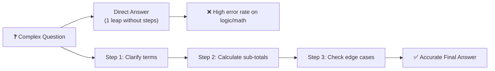
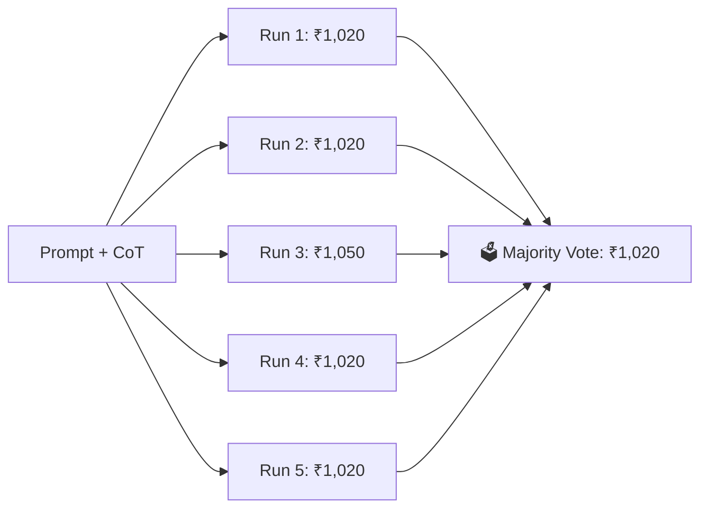

# 🧮 Module 05 — Reasoning Techniques

> 🔵 Stage 2 · Intermediate · ⏱️ ~3 hours

Try solving this in your head in two seconds: *What is 18 × 24?*

If someone demands that you shout out the answer instantly, your heart rate spikes and you will probably guess something like 400. But if you have a pencil and a scrap of paper, you break it down without stress:
- 18 × 20 = 360
- 18 × 4 = 72
- 360 + 72 = 432

An AI model faces the exact same challenge. 

Because an LLM predicts text one token at a time, each new word gets only one quick burst of mathematical computation. If you demand that the model spit out a complex final answer in its very first word, it has to guess. But if you give it permission to write out intermediate steps on its "digital scratchpad", each step builds on the last, and its accuracy jumps dramatically.

In this module, you will learn the practical reasoning techniques that turn an AI from a hasty guesser into a rigorous problem-solver.

---

## 🎯 Learning Objectives

By the end of this module, you will be able to:
- Use **Chain-of-Thought (CoT)** in everyday chat and production workflows.
- Guide the model's reasoning process using structured step-by-step checklists.
- Apply advanced techniques like **Self-Consistency**, **Tree of Thoughts**, and **Step-Back Prompting**.
- Use `<thinking>` and `<answer>` tags to keep reasoning clean and parseable.
- Adjust your prompting strategy for modern **reasoning ("thinking") models** like o1, Claude 3.7 Sonnet Thinking, and Gemini Thinking.

---

## 1. Why Reasoning Prompts Work

When an LLM generates text, every word it writes becomes part of its context for the next word. 

Writing out reasoning steps is not just a stylistic choice; it physically scales **test-time compute**. Each intermediate token gives the neural network an extra layer of calculation before it commits to the final answer.



> 👔 **Non-Tech Lens · The Executive Decision Memo:**
> If you ask a business analyst: *"Should we open a second retail store in Indiranagar?"*, you would never accept a one-word answer: *"Yes."* You want to see their working: footfall estimates, rent, staffing costs, and breakeven timelines. Treat the AI the same way. Ask for the analysis before the conclusion.

> 💻 **Tech Lens · Test-Time Compute & Reasoning Models:**
> Autoregressive inference generates tokens sequentially. With Chain-of-Thought, intermediate tokens act as working memory in the attention KV-cache. In modern dedicated reasoning models (such as OpenAI o1/o3, Claude 3.7 Sonnet with extended thinking, or DeepSeek R1), this reasoning happens internally via hidden chains. With these models, state high-level goals and constraints; do not micromanage individual reasoning steps.

---

## 2. Chain-of-Thought (CoT) Prompting

### Zero-Shot CoT: The Magic Phrase
In 2022, AI researchers discovered that simply adding one phrase—*"Think step by step"*—radically improved accuracy on math and logic benchmarks.

❌ **Without CoT**
```text
A stationery shop in Pune sells notebooks for ₹60 each or in packs of 4 for ₹210. 
Anjali needs 19 notebooks. What is the lowest price she can pay?
```
*(The model often guesses ₹1,020 or ₹1,050 without checking all combinations).*

✅ **With Zero-Shot CoT**
```text
A stationery shop in Pune sells notebooks for ₹60 each or in packs of 4 for ₹210. 
Anjali needs 19 notebooks. What is the lowest price she can pay?

Work through the math step by step before stating the final total cost in ₹.
```
*(The model calculates: 4 packs of 4 = 16 notebooks for ₹840. Remaining 3 notebooks as singles = 3 × ₹60 = ₹180. Total = ₹840 + ₹180 = ₹1,020. Alternative: 5 packs = 20 notebooks for ₹1,050. ₹1,020 is cheaper).*

### Structured CoT: Separating Thoughts from Answers
When you build applications or spreadsheets, you don't want the model's conversational scratchpad cluttering your clean data. Use XML tags to separate them:

```text
Analyze the customer feedback below.

First, write your step-by-step reasoning inside <thinking>...</thinking> tags:
- Identify the customer's emotional state.
- Determine whether they are threatening to cancel their subscription.
- Check if their issue is a bug or a user misunderstanding.

Then, write your final classification inside <verdict>...</verdict> as either:
URGENT_CHURN_RISK, STANDARD_BUG, or GENERAL_INQUIRY.

<feedback>
{{customer_text}}
</feedback>
```

---

## 3. Guided CoT: Tell It How to Think

Instead of asking the model to think in the abstract, give it an expert checklist to follow. This is especially helpful for complex business policies, legal contracts, or technical architecture reviews.

```text
You are an IT procurement specialist. Evaluate whether this software vendor meets our company's security baseline.

Follow this exact evaluation procedure:
1. Check data residency: Will customer data be stored inside India?
2. Check compliance certifications: Does the vendor hold active ISO 27001 or SOC 2 Type II certificates?
3. Check backup policy: Do they provide daily automated backups with 30-day retention?
4. Flag any red flags or missing documentation.
5. Provide a final recommendation: APPROVE, CONDITIONALLY_APPROVE, or REJECT.

<vendor_proposal>
{{proposal_text}}
</vendor_proposal>
```

---

## 4. Self-Consistency: Voting Across Multiple Paths

Even with Chain-of-Thought, a model can occasionally make a miscalculation on a tricky step.

**Self-Consistency** solves this: you run the exact same prompt 3 to 5 times with temperature set around `0.7`, and take the **majority vote** among the final answers.



Because reasoning errors tend to be random while correct logical deductions converge on the same conclusion, the majority answer is far more reliable. Use this for high-stakes financial calculations, classification pipelines, or data extraction where accuracy is critical.

---

## 5. Tree of Thoughts (ToT): Exploring Multiple Paths

Chain-of-Thought moves in a straight line: Step 1 → Step 2 → Step 3. But what if Step 2 was a bad idea?

**Tree of Thoughts** allows the model to explore multiple possible branches, evaluate each option, and abandon dead ends before moving forward.

Here is how you can prompt for Tree of Thoughts in everyday chat:

```text
We need to design a customer referral program for our fitness app in Mumbai.

Act as three distinct growth advisors (A, B, and C).

Round 1: Each advisor proposes one distinct referral mechanism.
Round 2: The advisors critique each other's proposals, pointing out operational bottlenecks and fraud risks.
Round 3: Abandon the weakest idea, combine the best elements of the remaining two, and present the final plan.
```

---

## 6. Step-Back Prompting: See the Big Picture First

When people get stuck on a difficult problem, stepping back to remember fundamental principles often makes the answer obvious.

**Step-Back Prompting** asks the model a high-level conceptual question *before* addressing the specific situation.

❌ **Direct question:**
```text
Should our 8-person startup migrate our monolithic database to a distributed microservices architecture this quarter?
```

✅ **Step-back prompt:**
```text
Step 1 (The Fundamental Principles): 
What are the primary prerequisites that make a microservices architecture worth its operational complexity? (Consider team size, deployment frequency, domain boundaries, and DevOps overhead).

Step 2 (The Specific Decision): 
Using those core prerequisites as a lens, evaluate an 8-person engineering team with one main web app and no dedicated DevOps engineer. Provide a definitive recommendation.
```

By forcing the model to articulate the general rules first, it avoids chasing shiny buzzwords and delivers sound architectural advice.

---

## 7. Self-Critique and Verification (CoVe)

Models are often much better at reviewing text than writing it from scratch.

In **Chain-of-Verification (CoVe)**, you instruct the model to:
1. Generate an initial draft.
2. Formulate 3 specific verification questions to check its own work.
3. Answer those questions independently.
4. Output a revised, corrected final answer.


```text
Draft an explanation of how Unified Payments Interface (UPI) handles transaction settlement between two different Indian banks.

After drafting:
1. Generate 3 specific verification questions to check whether your explanation accurately distinguishes between NPCI switching, IMPS rails, and RBI net settlement.
2. Answer each question carefully.
3. If your initial draft contained ambiguities or inaccuracies, produce a revised final explanation.
```

---

## 8. Prompting Modern Reasoning ("Thinking") Models

Newer frontier models (like OpenAI's o1 and o3, Claude 3.7 Sonnet with Thinking mode enabled, and Gemini 2.0 Flash Thinking) have built-in reasoning mechanisms. They spend real-time compute thinking through problems *before* outputting their first token.

When prompting reasoning models, change your habits:

| Standard Chat Models | Reasoning / Thinking Models |
|---|---|
| *"Think step by step"* gives huge gains. | Unnecessary. The model already thinks before answering. |
| You must write detailed reasoning templates. | Prescriptive step-by-step rules can constrain the model's internal search. |
| Temperature is tuned for balance. | Temperature is often locked or ignored; regulate depth via the "thinking budget". |
| Inexpensive and rapid. | Higher token cost and longer response latency; use for complex tasks. |

**The golden rule for reasoning models:** Clearly define the **goal**, the **constraints**, and the **definition of success**. Let the model decide how to navigate between them.

---

## 💡 Common Mistakes & How to Spot Them

| Mistake | What happens | How to fix it |
|---|---|---|
| Putting Reasoning After the Answer | The model writes *"The total is ₹500. Here is how I got it..."* and the math is wrong. | Always instruct the model to write its working *before* stating the final answer. |
| Overusing CoT on Simple Tasks | Using 500 tokens of step-by-step reasoning to summarize a two-sentence email. | Reserve reasoning techniques for multi-step logic, math, policy decisions, and code debugging. |
| Vague Self-Critique | Asking *"Are you sure?"* The model just apologizes and hallucinates an alternative. | Give specific verification rubrics: *"Verify that all line items sum to the invoice total."* |

---

## 🧪 Try It Now

Open any chat app and run this logic puzzle with and without reasoning:

```text
Rohan has 4 boxes. 
Box A contains a red ball. 
Box B is empty. 
Box C contains whatever is inside Box A. 
Box D contains whatever is inside Box B, plus a green ball. 
Rohan moves the contents of Box C into Box B, and removes the green ball from Box D. 

What is inside each of the 4 boxes right now?

Think step by step on separate lines before giving your final inventory.
```

Notice how writing out each action sequentially prevents the model from getting confused by the shifting box contents.

---

## 🔑 Key Takeaways

- Reasoning before answering scales test-time compute. Intermediate tokens act as a working memory scratchpad.
- Use `<thinking>` and `<answer>` tags to keep reasoning clean and parseable in software applications.
- **Guided CoT** applies proven expert procedures to business rules and compliance audits.
- **Self-Consistency** runs multiple reasoning chains and takes the majority vote to eliminate random arithmetic or logic slips.
- For dedicated **thinking models**, define clear goals, edge cases, and constraints; avoid micromanaging their internal steps.

---

## 🏋️ Exercises

### Exercise 5.1: Build a Guided-Reasoning Policy Evaluator
Create a prompt that evaluates whether an employee qualifies for emergency remote work based on this policy:
- Must have completed 3 months of probation.
- Must have a performance rating of "Meets Expectations" or higher.
- Medical emergencies are approved immediately regardless of probation status.

<details>
<summary>View Solution & Explanation</summary>

**A strong solution:**

```text
Evaluate whether the employee's request for remote work should be approved.

<policy>
Rule 1: Medical emergencies are approved immediately, regardless of probation status or performance rating.
Rule 2: For non-medical requests, the employee must have completed 3 months of probation AND hold a performance rating of "Meets Expectations" or higher.
</policy>

Reason step-by-step inside <thinking>:
1. Is this request classified as a medical emergency? If yes, cite the reason and approve immediately.
2. If no, check probation status: Has the employee worked more than 90 days?
3. Check performance: Does the employee have a rating of Meets Expectations or above?
4. Flag any missing information needed to make a final call.

Then output your final verdict inside <verdict>APPROVED | REJECTED | MORE_INFO_NEEDED</verdict> followed by a concise 1-sentence explanation inside <explanation>.

<request>
{{employee_request}}
</request>
```

*Explanation:* By checking Rule 1 (medical override) first, you prevent the model from accidentally disqualifying an emergency request due to probation status.

</details>

### Exercise 5.2: Convert a Direct Prompt to Step-Back
Turn this direct prompt into a step-back prompt:
*"Should we discount our annual software plans by 40% during Diwali to hit our sales target?"*

<details>
<summary>View Solution & Explanation</summary>

**Step-back rewrite:**

```text
Step 1 (First Principles):
Explain the trade-offs between short-term discount campaigns and long-term customer lifetime value (LTV) for subscription businesses. Address churn risk, customer acquisition quality, and brand positioning.

Step 2 (Contextual Application):
Now evaluate whether a B2B project management software company in India should offer a deep 40% discount during Diwali to meet quarterly revenue targets. Suggest an alternative strategy if a straight 40% discount carries high long-term risks.
```

</details>

---

## ✅ Quick Quiz

1. Why does generating intermediate reasoning steps improve an LLM's accuracy on math problems?
   - A) Because the model reads the user's mind while writing.
   - B) Because each generated token expands working memory and conditions the next calculation step.
   - C) Because it allows the model to search Google behind the scenes.
2. What is the core mechanism behind Self-Consistency?
   - A) Generating multiple independent reasoning paths and selecting the majority answer.
   - B) Asking the model twice if it is certain.
   - C) Using two different models at the same time.
3. How should you prompt dedicated reasoning models (like o1 or Claude 3.7 Sonnet Thinking) differently from standard models?
   - A) You must write 10 few-shot examples for every prompt.
   - B) You specify the high-level goal, boundaries, and success criteria, rather than micromanaging their step-by-step thinking.
   - C) You must write your prompt in all capital letters.

<details>
<summary>View Answers</summary>

1. **B** — In autoregressive language generation, intermediate tokens store calculation states that feed into subsequent token probabilities.
2. **A** — Self-consistency runs multiple samples at non-zero temperature and takes the majority consensus.
3. **B** — Reasoning models do their own chain-of-thought internally. Overly prescriptive steps can degrade their problem-solving path.

</details>

---

> Author: **Vicky** ([abvicky.in](https://abvicky.in)) · Platform built by [Manikarnika Technologies](https://www.manikarnikatechnologies.in/) · © 2026 All rights reserved.
> ⬅️ [Module 04](04-zero-few-shot-and-roles.md) · ➡️ [Module 06 — Structured Output](06-structured-output.md)
