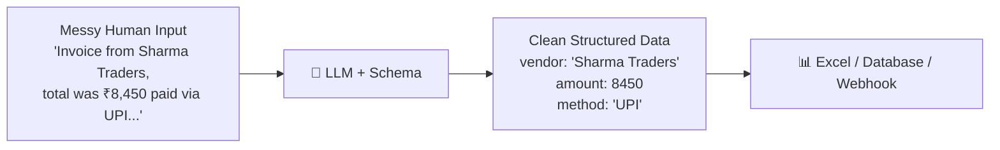

# 🧱 Module 06 — Structured Output: JSON, XML, Tables & Schemas

> 🔵 Stage 2 · Intermediate · ⏱️ ~2 hours

Have you ever filled out a paper visa application or bank form?

If you scribble your address across three different lines or write your birth date in words when it asks for numbers, the officer hands it back and tells you to start over. 

Computers are even pickier. If you are building an app, a spreadsheet, or an automated workflow, one missing comma, a misplaced quotation mark, or an unexpected introductory remark (*"Sure, here is your data!"*) will cause your computer script to crash.

When humans read text, "mostly right" is good enough. But when software reads text, it needs strict, predictable structure.

In this module, you will learn how to make AI models return data in clean, dependable formats: from copy-paste Excel tables for business teams to guaranteed, type-safe JSON for production code.

---

## 🎯 Learning Objectives

By the end of this module, you will be able to:
- Generate clean Markdown tables and CSV data that paste directly into Excel or Google Sheets.
- Climb the five levels of JSON reliability, from simple chat prompts to schema-constrained decoding.
- Design error-resistant data schemas using enums, nulls, and evidence-first fields.
- Use XML tags to extract specific sections of data cleanly.
- Validate and repair malformed AI responses in code with automated retries.

---

## 1. Why Structure Matters

Unstructured text is great for reading, but terrible for automation. 



> 👔 **Non-Tech Lens · Copy-Paste Tables for Excel & Google Sheets:**
> You do not need to write code to get the benefits of structured data. If you have messy meeting notes, receipts, or customer emails, tell your chat app:
> *"Extract this information into a Markdown table with columns: Date, Vendor, Category, Amount in ₹. Below the table, provide the exact same data as a raw CSV code block so I can copy and paste directly into Google Sheets."*

> 💻 **Tech Lens · Type-Safe Contracts & Constrained Sampling:**
> Relying on prompt instructions alone to produce valid JSON will fail under high token volumes. In production backends, use schema-constrained decoding (such as OpenAI's `response_format={"type": "json_schema"}` or Pydantic models with libraries like `Instructor` or `Outlines`). Constrained decoding modifies the token probability mask at each generation step, mathematically guaranteeing that the output conforms 100% to your schema.

---

## 2. The Five Levels of JSON Reliability

Depending on what you are building, you can choose how strictly to enforce structure:

| Level | Method | Reliability | Where to use it |
|---|---|---|---|
| **Level 1** | *"Respond in JSON"* | 😬 Low | Quick personal chat experiments |
| **Level 2** | Specify the exact schema + provide an example | 🙂 Moderate | Internal scripts and prototypes |
| **Level 3** | Level 2 + Prefill `{` and forbid conversational chatter | 😀 High | Standard API scripts |
| **Level 4** | Native Structured Outputs (JSON Schema constraint) | 🤩 Guaranteed | Production web applications |
| **Level 5** | Level 4 + Code validation (Pydantic) and auto-repair | 🏆 Enterprise | Mission-critical financial or medical pipelines |

### Level 2 & 3: The Production-Ready Prompt Template
If you are using a standard chat interface or an API without native schema enforcement, use this prompt structure:

```text
Extract the invoice details from the text below.

Return ONLY a valid JSON object matching this schema. Do not include markdown code fences, greetings, or conversational notes.

Schema:
{
  "vendor_name": string,
  "invoice_number": string,
  "invoice_date": "YYYY-MM-DD",
  "total_amount": number,            // Numeric value only, no currency symbols
  "currency": "INR" | "USD" | "EUR",
  "line_items": [
    {
      "description": string,
      "quantity": number,
      "unit_price": number
    }
  ]
}

If any value is missing from the source text, use null. Do not guess or invent data.

<invoice>
{{invoice_text}}
</invoice>
```

---

## 3. Level 4: Native Structured Outputs in Code

Most major providers now let you supply a formal JSON schema directly to their API. The model's decoding engine literally forbids any token that would break the schema.

### Example: Pydantic with OpenAI Structured Outputs
```python
from pydantic import BaseModel, Field
from openai import OpenAI
from typing import Literal, List, Optional

class LineItem(BaseModel):
    description: str
    quantity: int
    unit_price: float

class InvoiceData(BaseModel):
    vendor_name: str
    invoice_number: str
    total_amount: float
    currency: Literal["INR", "USD", "EUR"]
    line_items: List[LineItem]
    notes: Optional[str] = None

client = OpenAI()

# The API guarantees that completion matches InvoiceData perfectly
completion = client.beta.chat.completions.parse(
    model="gpt-4o-mini",
    messages=[
        {"role": "system", "content": "Extract invoice fields accurately."},
        {"role": "user", "content": f"Invoice text:\n{raw_invoice_text}"}
    ],
    response_format=InvoiceData,
)

invoice = completion.choices[0].message.parsed
print(f"Vendor: {invoice.vendor_name}, Total: {invoice.total_amount}")
```

> ⚠️ **Important Reality Check:** A schema-valid output is not necessarily factually correct. The model can output a perfectly formatted number that is completely wrong. Always evaluate factual accuracy separately from structural validity.

---

## 4. Level 5: Code Validation & Self-Repair

What happens if an API returns invalid JSON or violates a business rule? Write an automatic repair loop that feeds the error back to the model:

```python
import json
from pydantic import BaseModel, ValidationError

class UserProfile(BaseModel):
    full_name: str
    age: int
    city: str

def extract_profile_with_repair(text: str, max_retries: int = 2) -> UserProfile:
    prompt = f"Extract the user profile in JSON matching schema: {UserProfile.model_json_schema()}.\nText: {text}"
    
    for attempt in range(max_retries + 1):
        raw_response = call_llm(prompt)
        try:
            # 1. Parse JSON string
            data = json.loads(raw_response)
            # 2. Validate against Pydantic model
            return UserProfile.model_validate(data)
        except (json.JSONDecodeError, ValidationError) as err:
            if attempt == max_retries:
                raise RuntimeError(f"Failed to get valid profile after {max_retries} retries: {err}")
            # Feed the exact error back to the model to fix itself
            prompt += f"\n\nYour previous response was invalid with error: {err}. Return ONLY the corrected JSON."
```

---

## 5. Schema Design Tips: Make Your Data Bulletproof

1. **Use Enums for Fixed Categories:**
   Never write `"sentiment": string`. Write `"sentiment": "positive" | "neutral" | "negative"`. This prevents label drift like "Positive", "pos", or "very good".
2. **Put Evidence Fields BEFORE the Conclusion:**
   Models generate text sequentially. If you put `"evidence"` before `"classification"`, the model is forced to think through the source text first:
   ```json
   {
     "evidence_quote": "Customer states: 'The screen turned purple after the update'",
     "is_hardware_issue": false,
     "confidence_score": 0.95
   }
   ```
3. **Use Null Explicitly:**
   Instruct the model: *"If phone number is not mentioned, return null."* Without this, models love to guess placeholders like `"000-000-0000"` or `"N/A"`.
4. **Descriptive Key Names:**
   Keys act as instructions. `"total_price_in_inr"` works much better than `"p"`.

---

## 6. XML Tags: Organizing Inputs and Outputs

XML tags are remarkably easy to parse using simple regular expressions, and models like Claude follow them with precision:

```text
Extract customer feedback from the review below.
Put the primary customer emotion inside <emotion>...</emotion>.
Put specific product complaints inside <complaints>, with each item inside an <item> tag.
Put a 1-sentence recommended action inside <action>...</action>.

<review>
{{review_text}}
</review>
```

In your application code, parsing this is straightforward:

```python
import re

def parse_review(response_text: str):
    emotion = re.search(r"<emotion>(.*?)</emotion>", response_text, re.S)
    action = re.search(r"<action>(.*?)</action>", response_text, re.S)
    complaints = re.findall(r"<item>(.*?)</item>", response_text, re.S)
    
    return {
        "emotion": emotion.group(1).strip() if emotion else None,
        "action": action.group(1).strip() if action else None,
        "complaints": [c.strip() for c in complaints]
    }
```

---

## 💡 Common Mistakes & How to Spot Them

| Mistake | What goes wrong | The Fix |
|---|---|---|
| The Markdown Wrapper | The model outputs ` ```json { "name": "Vicky" } ``` ` and your `json.loads()` crashes. | Tell the model: *"Return only raw JSON. Do not wrap in markdown code blocks."* Or strip the code fences in code before parsing. |
| The Chit-Chat Trap | The model outputs: *"Here is your JSON object: {"status": 200}"*. | Add: *"Start your response directly with the opening curly brace `{`."* |
| Deeply Nested Objects | Generating 5 levels of nested JSON causes frequent syntax errors. | Flatten your schema into simple key-value pairs wherever possible. |

---

## 🧪 Try It Now

Open your chat app and paste this prompt on a messy text excerpt (like an email or receipt):

```text
Extract the key details from the note below into a clean Markdown table with columns:
Item | Category | Quantity | Unit Price (₹) | Total (₹)

Directly below the table, provide the exact same records as raw CSV inside a code box so I can copy it directly into Google Sheets.

Do not include greetings or concluding notes.

Note:
"Bought 3 packs of A4 paper for 250 each from Modern Stationers, 2 whiteboard markers at 45 rupees each, and a desk organizer for 650."
```

Notice how easy it is to copy the resulting table into a document or copy the CSV block straight into a spreadsheet.

---

## 🔑 Key Takeaways

- Structured output transforms an AI model from a conversational toy into a reliable software component.
- For business work, ask for Markdown tables and raw CSV blocks for easy spreadsheet imports.
- In production code, use native structured outputs and Pydantic validation to guarantee schema compliance.
- Order schema fields wisely: placing evidence fields *before* labels forces the model to think before classifying.
- Always include automated retry logic that passes validation errors back to the model for self-repair.

---

## 🏋️ Exercises

### Exercise 6.1: Design an E-Commerce Return Schema
Design a JSON schema and prompt to extract customer return requests. You need:
- Order number
- Return reason (must be one of: `damaged`, `wrong_size`, `defective`, `changed_mind`, `late_delivery`)
- Customer's preferred resolution (must be one of: `exchange`, `store_credit`, `original_payment_refund`)
- Quoted customer explanation

<details>
<summary>View Solution & Explanation</summary>

**A strong solution:**

```text
Extract customer return requests into JSON. 
Return ONLY a JSON object matching this schema. No markdown fences or commentary.

{
  "order_id": string,
  "quoted_reason": string,
  "return_category": "damaged" | "wrong_size" | "defective" | "changed_mind" | "late_delivery",
  "preferred_resolution": "exchange" | "store_credit" | "original_payment_refund",
  "additional_notes": string | null
}

If the preferred resolution is not stated, default to "store_credit".
If order_id is missing, set it to null.

<email>
{{customer_email}}
</email>
```

*Explanation:* Using enums prevents ambiguous categories like "size issue" or "broken", and setting explicit defaults handles missing user input cleanly.

</details>

### Exercise 6.2: Strip Markdown Code Fences in Python
Write a small Python function that safely extracts JSON from a model response, even if the model accidentally included ` ```json ` fences or introductory text.

<details>
<summary>View Solution & Explanation</summary>

```python
import json
import re

def clean_and_parse_json(raw_text: str) -> dict:
    # 1. Try direct parse
    try:
        return json.loads(raw_text.strip())
    except json.JSONDecodeError:
        pass
    
    # 2. Extract content between first { and last }
    match = re.search(r"(\{.*\})", raw_text, re.DOTALL)
    if match:
        try:
            return json.loads(match.group(1))
        except json.JSONDecodeError:
            pass
            
    # 3. Strip markdown code fences if present
    cleaned = re.sub(r"^```(?:json)?\s*|\s*```$", "", raw_text.strip(), flags=re.MULTILINE)
    return json.loads(cleaned)
```

</details>

---

## ✅ Quick Quiz

1. Why should you place an `"evidence"` or `"reasoning"` key before the `"verdict"` key in a JSON schema?
   - A) Because alphabetical order looks nicer.
   - B) Because autoregressive models generate tokens left to right; reasoning first conditions the verdict token.
   - C) Because JSON requires strings before booleans.
2. What does native structured output (schema-constrained decoding) guarantee?
   - A) That the extracted numbers are 100% factually accurate.
   - B) That the output strictly adheres to the requested JSON schema syntax without parsing errors.
   - C) That the model runs twice as fast.
3. If an input text does not contain a requested field, what should you instruct the model to do?
   - A) Invent a believable value.
   - B) Leave the JSON key out entirely.
   - C) Return `null` explicitly and do not guess.

<details>
<summary>View Answers</summary>

1. **B** — Writing evidence first acts as an in-schema chain of thought, improving the classification accuracy of subsequent fields.
2. **B** — Schema-constrained decoding guarantees syntactic validity, but not factual correctness.
3. **C** — Returning `null` explicitly prevents the model from hallucinating plausible filler data.

</details>

---

> Author: **Vicky** ([abvicky.in](https://abvicky.in)) · Platform built by [Manikarnika Technologies](https://www.manikarnikatechnologies.in/) · © 2026 All rights reserved.
> ⬅️ [Module 05](05-reasoning-techniques.md) · ➡️ [Module 07 — System Prompts & Conversation Design](07-system-prompts-and-conversation.md)
