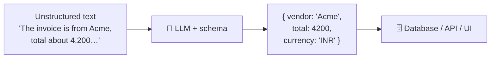

# 🧱 Module 06 — Structured Output: JSON, XML, Tables & Schemas

> 🔵 Stage 2 · Intermediate · ⏱️ ~2 hours

## 🎯 Learning Objectives

- Get **reliable JSON** from a model using prompts, schemas, and native structured-output features
- Use **XML tags** for both input organization and output parsing
- Produce tables, CSV, markdown, and templated documents on demand
- **Validate and repair** model output in code

---

## 1. Why Structure Matters

When a human reads the output, "mostly right" formatting is fine. When **code** reads it, one missing comma breaks your app. Structured output turns an LLM into a reliable component.

> 👔 **Non-Tech Lens · Copy-Paste Tables for Excel & Google Sheets:**
> You don't need to know JSON or programming to get structured data. In ChatGPT or Claude, prompt: *"Format the extracted data into a Markdown table with columns: Date, Vendor, Category, Amount. Underneath, output the exact same data in a raw CSV code block so I can copy and paste directly into Google Sheets or Excel."* This converts messy meeting transcripts, PDFs, or receipts into spreadsheets instantly.

> 💻 **Tech Lens · Type-Safe Contracts & Constrained Sampling:**
> Relying on prompt instructions alone to get valid JSON will fail in production at high token volumes. Use schema-constrained decoding (`response_format={"type": "json_schema", "json_schema": {...}}` or Pydantic with `Instructor`/`Outlines`). Constrained decoding modifies the logit mask at each generation step to forbid tokens that would violate the context-free grammar, guaranteeing 100% syntactic schema validity.



---

## 2. Five Levels of JSON Reliability

| Level | Method | Reliability |
|---|---|---|
| 1 | "Respond in JSON." | 😬 Often wraps in prose or code fences |
| 2 | + Give the exact schema & an example | 🙂 Good |
| 3 | + Prefill `{` / "Output only JSON, no markdown" | 😀 Very good |
| 4 | + **Native JSON mode / structured outputs** (schema-constrained decoding) | 🤩 Schema-valid by construction |
| 5 | + **Validate in code** and retry/repair on failure | 🏆 Production-grade |

### Level 2–3 prompt

```text
Extract the following fields from the invoice text.

Return ONLY a JSON object matching this schema — no prose, no code fences:
{
  "vendor": string,
  "invoice_number": string,
  "date": "YYYY-MM-DD",
  "total": number,              // numeric, no currency symbols
  "currency": "INR" | "USD" | "EUR" | "OTHER",
  "line_items": [{"description": string, "qty": number, "unit_price": number}]
}
If a field is missing, use null. Do not guess.

<invoice>
{{invoice_text}}
</invoice>
```

### Level 4 — native structured outputs

Most major providers now offer a way to constrain output to a JSON Schema — e.g., OpenAI "Structured Outputs" (`response_format` with a JSON schema), Google Gemini `response_schema`, and with Anthropic you can define a **tool with an input schema** and require it (and newer API versions also offer native structured outputs). Open-source stacks use **grammar-constrained decoding** (e.g., Outlines, llama.cpp grammars, vLLM guided decoding).

```python
# Pattern: using a tool schema to force structured output (Anthropic SDK)
import anthropic
client = anthropic.Anthropic()

invoice_tool = {
    "name": "record_invoice",
    "description": "Record the extracted invoice fields.",
    "input_schema": {
        "type": "object",
        "properties": {
            "vendor": {"type": "string"},
            "total": {"type": "number"},
            "currency": {"type": "string", "enum": ["INR", "USD", "EUR", "OTHER"]},
        },
        "required": ["vendor", "total", "currency"],
    },
}

resp = client.messages.create(
    model="claude-sonnet-5-5",
    max_tokens=500,
    tools=[invoice_tool],
    tool_choice={"type": "tool", "name": "record_invoice"},   # force this tool
    messages=[{"role": "user", "content": f"Extract fields:\n<invoice>{text}</invoice>"}],
)
data = next(b.input for b in resp.content if b.type == "tool_use")
```

```python
# Same idea with Pydantic + OpenAI structured outputs
from pydantic import BaseModel
from openai import OpenAI

class Invoice(BaseModel):
    vendor: str
    total: float
    currency: str

client = OpenAI()
completion = client.chat.completions.parse(   # helper name may differ by SDK version
    model="YOUR_MODEL",
    messages=[{"role": "user", "content": f"Extract fields: {text}"}],
    response_format=Invoice,
)
invoice = completion.choices[0].message.parsed
```

> ⚠️ Schema-valid ≠ correct. The model can still put the wrong number in a perfectly valid field. Evaluate content accuracy separately (Module 13).

### Level 5 — validate & repair

```python
import json
from pydantic import BaseModel, ValidationError

class Invoice(BaseModel):
    vendor: str
    total: float

def get_invoice(text, max_retries=2):
    prompt = build_prompt(text)
    for attempt in range(max_retries + 1):
        raw = call_llm(prompt)
        try:
            return Invoice.model_validate(json.loads(raw))
        except (json.JSONDecodeError, ValidationError) as err:
            # feed the error back so the model can fix it
            prompt = build_prompt(text) + f"\n\nYour previous output was invalid: {err}. Return corrected JSON only."
    raise RuntimeError("Could not get valid JSON")
```

---

## 3. Schema Design Tips

| Tip | Why |
|---|---|
| Use **enums** for categories | Prevents label drift ("Positive" vs "positive" vs "pos") |
| Use **null** for missing values and say so | Stops guessing |
| Add a `"reasoning"` or `"evidence"` field **before** the answer field | Gives CoT inside JSON; field order matters |
| Keep nesting shallow | Fewer structural errors |
| Use clear, descriptive key names | Keys act as instructions (`"price_in_inr"` > `"p"`) |
| Add `"confidence": "high" \| "medium" \| "low"` | Lets you route uncertain cases to humans |

```json
{
  "evidence": "Customer says 'charged twice' in sentence 2",
  "category": "billing",
  "urgency": "high",
  "confidence": "high"
}
```

---

## 4. XML Tags — Structure for Input *and* Output

XML-style tags are simple, readable, and easy to parse with a regex. Claude in particular is trained to pay close attention to them, and other models handle them well too.

```text
Analyze the contract clause.
Put the risks you identify in <risks>, each as <risk severity="high|medium|low">…</risk>.
Put a plain-English summary in <summary>.
```

```python
import re
summary = re.search(r"<summary>(.*?)</summary>", output, re.S).group(1).strip()
```

**Tag tips:**
- There are no "magic" tag names — use meaningful ones (`<contract>`, `<answer>`).
- Be consistent; reference tags by name in instructions.
- Nest for hierarchy: `<documents><document index="1"><source>…</source><content>…</content></document></documents>`.

---

## 5. Tables, CSV, Markdown & Templates

```text
Compare Python, JavaScript and Go for building a REST API.
Output a markdown table with columns: Language | Learning curve (1–5) |
Performance (1–5) | Ecosystem | Best for. Then one sentence of recommendation.
```

```text
Output as CSV with header row: name,email,company. Quote fields containing commas.
No other text.
```

**Template filling** — give the exact skeleton:

```text
Fill this template exactly. Keep the headings; replace the {{ }} parts.

## Incident Report: {{title}}
**Severity:** {{SEV1|SEV2|SEV3}}
**Timeline:**
- {{HH:MM}} — {{event}}
**Root cause:** {{one paragraph}}
**Action items:**
1. {{owner}} — {{action}} — {{due date}}
```

---

## 6. Controlling Length & Style Precisely

| Want | Say |
|---|---|
| Exact count | "Exactly 5 bullet points." |
| Length | "120–150 words." (Models count words approximately; for hard limits, truncate/validate in code) |
| No preamble | "Begin your response with the first bullet. No introduction." |
| No markdown | "Plain text only; no asterisks, hashes, or bullet symbols." |
| Reading level | "Grade 6 reading level." |

---

## 🔑 Key Takeaways

- For apps, **structured output is essential**; climb the five levels as reliability needs grow.
- Prefer **native structured-output / tool schemas** where available, and **always validate** in code.
- Design schemas with **enums, nulls, evidence-first fields, and clear keys**.
- **XML tags** organize inputs and make outputs easy to parse.

---

## 🏋️ Exercises

**6.1 — Extraction schema.** Design a JSON schema + prompt to extract job postings: title, company, location, remote (bool), salary range, required skills (array), years of experience.

<details>
<summary>✅ Sample solution</summary>

```text
Extract the job posting into JSON. Output only JSON matching:
{
  "title": string,
  "company": string,
  "location": string | null,
  "remote": "yes" | "no" | "hybrid" | null,
  "salary_min": number | null,
  "salary_max": number | null,
  "salary_currency": string | null,
  "salary_period": "year" | "month" | "hour" | null,
  "required_skills": string[],
  "min_years_experience": number | null
}
Use null for anything not stated. Do not infer salary from company size.
<posting>{{posting}}</posting>
```

Note: `remote` became an enum instead of a bool because "hybrid" is common — schema design is about reality, not just syntax.

</details>

**6.2 — Fix the parser-breaker.** The model returns: ` ```json {"a": 1} ``` Hope this helps!` — give two prompt fixes and one code fix.

<details>
<summary>✅ Solution</summary>

Prompt fixes: (1) "Output only raw JSON. No code fences, no text before or after." (2) Prefill the assistant turn with `{` or use native JSON/structured mode.
Code fix: extract the substring from the first `{` to the last `}` before `json.loads`, then validate with a schema and retry on failure.

</details>

**6.3 — Evidence-first.** Why put `"evidence"` before `"label"` in the JSON?

<details>
<summary>✅ Solution</summary>

Models generate left-to-right. Writing the evidence first acts as a mini chain-of-thought, so the label is conditioned on the evidence. If the label comes first, the evidence becomes a post-hoc justification.

</details>

---

## ✅ Quick Quiz

1. What's the most reliable way to get schema-valid JSON from a hosted model?
2. Does a schema-valid output guarantee correct values?
3. Why use enums?
4. How do you parse an XML-tagged section in Python?

<details>
<summary>Show answers</summary>

1. **Native structured outputs / JSON-schema mode or forced tool calls**, plus validation in code.
2. **No.** Validity ≠ accuracy.
3. To constrain categories to an exact set and prevent label drift.
4. A regex such as `re.search(r"<tag>(.*?)</tag>", text, re.S)` (or an XML parser if the output is well-formed).

</details>

---

> © 2026 **Vicky Prasad Mahato** · [abvicky.in](https://abvicky.in)
> ⬅️ [Module 05](05-reasoning-techniques.md) · ➡️ [Module 07 — System Prompts & Conversation Design](07-system-prompts-and-conversation.md)
