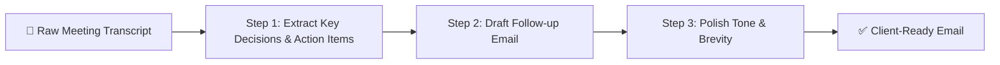
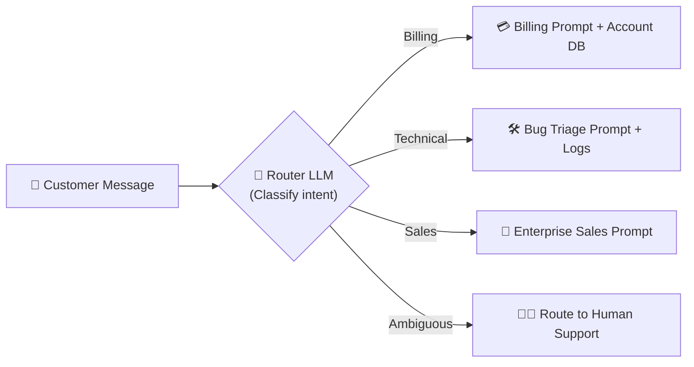
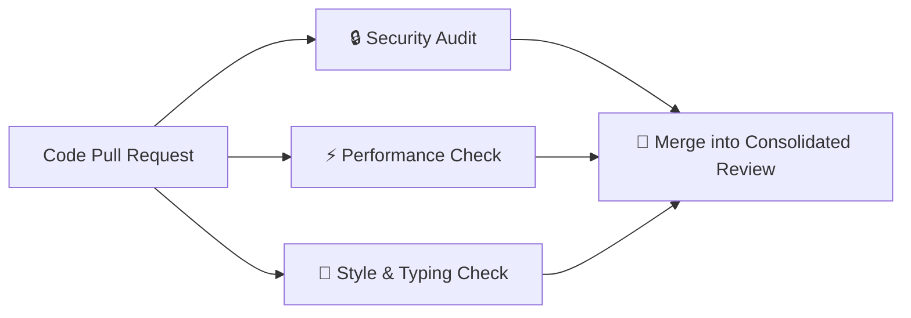
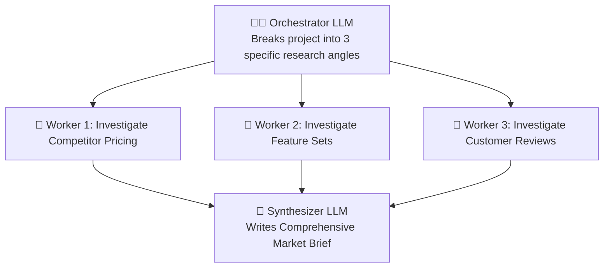
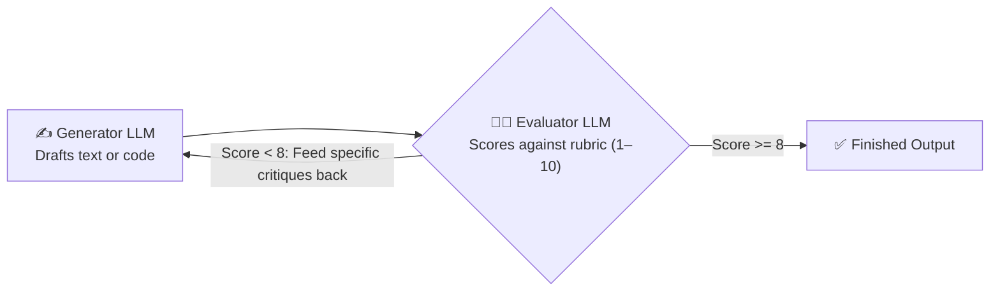
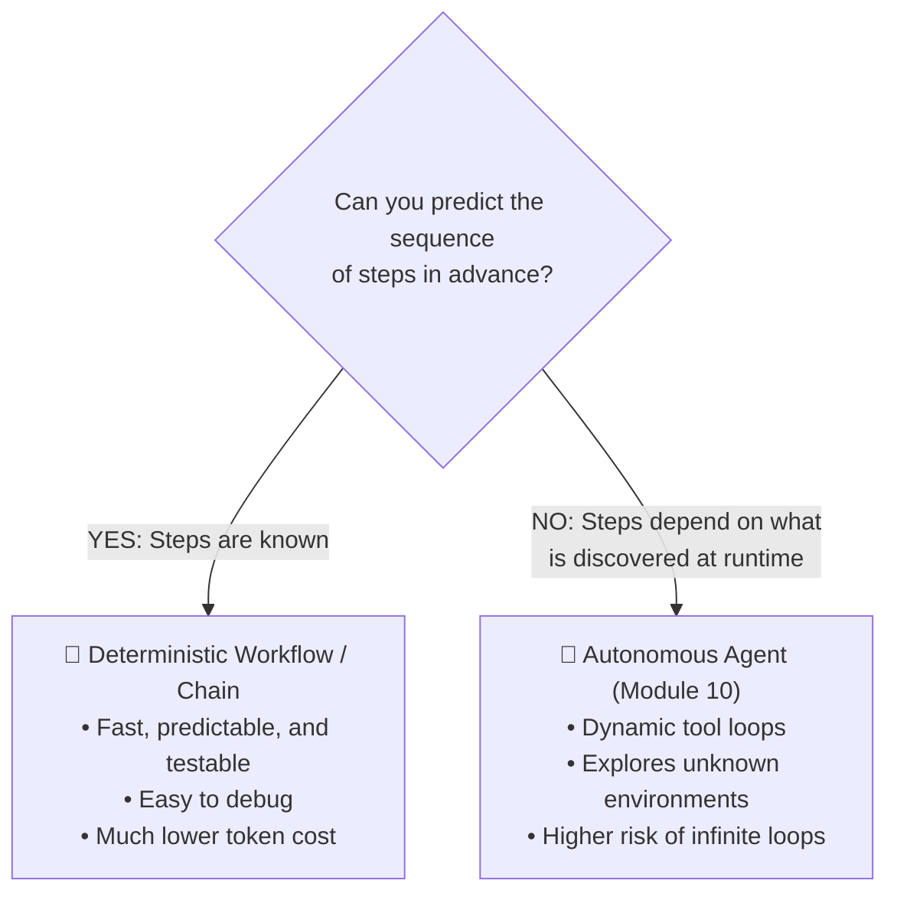

# 🔗 Module 08 — Prompt Chaining & Workflows

> 🔵 Stage 2 · Intermediate · ⏱️ ~2.5 hours

Imagine cooking a traditional feast—like a festive Hyderabadi biryani—for twenty guests.

You would never throw raw rice, whole onions, unmarinated meat, yogurt, and saffron into a single giant pot all at once, turn on the heat, and hope for a masterpiece. 

Instead, you break the recipe into distinct, orderly stages:
1. You marinate the meat with yogurt and spices so the flavors sink in.
2. You slice and fry the onions until golden.
3. You parboil the fragrant rice with whole spices until it is exactly 70% cooked.
4. You layer the meat, fried onions, herbs, and rice in a heavy pot.
5. You seal the lid with dough and cook on low heat (*dum*).

At every step, you can taste, check, and adjust. If the rice is undercooked in step 3, you fix it before it ever touches the meat.

Prompt chaining does the exact same thing for AI tasks. When you force a model to research, outline, write, fact-check, format, and translate an entire document in one single mega-prompt, it rushes through each step and produces mediocre results. 

When you chain prompts together, each step gets 100% of the model's focus, and you get complete control over the quality of the final output.

---

## 🎯 Learning Objectives

By the end of this module, you will be able to:
- Break complex multi-stage tasks into modular **prompt chains**.
- Master the five core workflow patterns: **Sequential, Routing, Parallelization, Orchestrator-Workers, and Evaluator-Optimizer**.
- Insert automated validation **gates** between steps to catch mistakes early.
- Know exactly when a deterministic workflow is better than an autonomous agent.
- Run multi-step chains interactively in free chat apps or automated with code.

---

## 1. Why Chaining Beats One Giant Prompt

| What happens in a "Do-Everything" Prompt | What happens in a Prompt Chain |
|---|---|
| The model tries to juggle 12 instructions at once and forgets half of them. | Each prompt has one clear, focused objective. |
| If the output is bad, you have to throw the whole thing out and restart. | You can see exactly which step failed and tweak only that prompt. |
| You must use your most expensive, powerful model for the whole task. | You can use fast, inexpensive models for easy steps and reserve frontier models for complex analysis. |
| You cannot inspect or edit intermediate data. | You can add code checks or human approval gates between steps. |

> 👔 **Non-Tech Lens · The 3-Step Interactive Chat Chain:**
> In ChatGPT or Claude, never paste a 10-page PDF and say: *"Analyze this and write a complete executive proposal with slides."* Instead, work in three conversational turns:
> 1. **Step 1 (Extract):** *"Read this document and list the 5 biggest operational bottlenecks mentioned."*
> 2. **Step 2 (Develop):** *"For each bottleneck, outline two practical solutions, estimating the required budget and timeline."*
> 3. **Step 3 (Format):** *"Turn those solutions into an executive presentation outline with slide titles and bullet points."*
> This interactive approach keeps you in the driver's seat and produces vastly superior work.

> 💻 **Tech Lens · Deterministic DAGs vs Fragile Prompts:**
> In production backends, represent multi-step workflows as Directed Acyclic Graphs (DAGs). Combine parallel branches using `asyncio.gather()`, route intents using lightweight classifier models (like Claude Haiku or GPT-4o mini), and gate state transitions with deterministic Pydantic schema validation. A deterministic pipeline delivers predictable latency, isolated error boundaries, and zero risk of infinite runaway loops.

---

## 2. Pattern 1 — The Sequential Chain

The sequential chain is the simplest and most common workflow: the output of Step 1 becomes the direct input for Step 2.



```python
# Sequential chain in Python
raw_transcript = load_transcript("quarterly_sync.txt")

# Step 1: Extract decisions
decisions = call_llm(
    f"Extract all decisions, action items, and owners from this meeting transcript:\n<transcript>{raw_transcript}</transcript>"
)

# Step 2: Draft email
draft = call_llm(
    f"Using these decisions and action items, write a 150-word follow-up email to the team:\n<decisions>{decisions}</decisions>"
)

# Step 3: Polish
final_email = call_llm(
    f"Edit this email to be encouraging, direct, and under 120 words:\n<draft>{draft}</draft>"
)
```

### Adding a Quality Gate
A **gate** is a programmatic check placed between steps. If the output fails the check, the pipeline halts or retries automatically before wasting tokens on subsequent steps:

```python
def validate_action_items(extracted_text: str) -> bool:
    # Verify that the model actually found owners and action items
    return "Owner:" in extracted_text and len(extracted_text.splitlines()) >= 3

if not validate_action_items(decisions):
    # Retry step 1 with a stricter prompt before drafting the email
    decisions = call_llm(stricter_extraction_prompt)
```

---

## 3. Pattern 2 — Routing

Instead of sending every request to the exact same prompt, a **router** classifies the user's intent and sends it down the most appropriate specialized path.



### Why Routing Saves Money and Improves Accuracy
- A billing question doesn't need to load your entire engineering documentation.
- You can route simple questions to a tiny, inexpensive model (costing fractions of a cent) and save your large flagship model for complex troubleshooting.

---

## 4. Pattern 3 — Parallelization (Sectioning and Voting)

When subtasks are independent of one another, running them simultaneously saves time and reduces latency.

### Sub-Pattern A: Sectioning
Split an input into three independent analytical tasks, run them at the exact same moment, and merge the results:



```python
import asyncio

async def run_review(diff: str):
    # Run all three specialized reviews in parallel
    security_task = call_llm_async(f"Audit this diff for security flaws:\n{diff}")
    perf_task     = call_llm_async(f"Check this diff for performance bottlenecks:\n{diff}")
    style_task    = call_llm_async(f"Review this diff for PEP 8 naming and type hints:\n{diff}")
    
    sec_report, perf_report, style_report = await asyncio.gather(
        security_task, perf_task, style_task
    )
    
    # Merge step
    final_review = call_llm(
        f"Merge these three reviews into a prioritized report grouped by severity:\n"
        f"<sec>{sec_report}</sec>\n<perf>{perf_report}</perf>\n<style>{style_report}</style>"
    )
    return final_review
```

### Sub-Pattern B: Voting
Run the exact same prompt through multiple distinct instances at temperature `0.7` and take the majority consensus (Self-Consistency, covered in Module 05).

---

## 5. Pattern 4 — Orchestrator-Workers

In a fixed sequential chain, you know all the steps in advance. But what if a task requires an unpredictable number of steps depending on the input?

In the **Orchestrator-Workers** pattern, a central planner model breaks a big task into dynamic subtasks, dispatches them to worker models, and synthesizes the results.



This pattern excels at market research, multi-file code refactoring, and complex data reconciliation.

---

## 6. Pattern 5 — Evaluator-Optimizer (The Feedback Loop)

In this pattern, one model acts as the **creator** and a second model acts as the **strict critic**. The loop continues until the output passes a defined rubric or hits a maximum number of attempts.



```python
def generate_polished_copy(topic: str, max_iterations: int = 3) -> str:
    draft = call_llm(f"Write a 100-word marketing headline and teaser for: {topic}")
    
    rubric = (
        "Rubric: (1) Under 100 words, (2) No empty hype words like 'revolutionary', "
        "(3) Must state the price in ₹, (4) Must include an explicit call-to-action."
    )
    
    for attempt in range(max_iterations):
        critique = call_llm(
            f"Review this draft against the rubric. Output JSON with fields 'score' (1-10) and 'fixes_needed' (list of strings).\n"
            f"<rubric>{rubric}</rubric>\n<draft>{draft}</draft>"
        )
        feedback = json.loads(critique)
        if feedback["score"] >= 8:
            return draft
            
        # Re-draft with targeted feedback
        draft = call_llm(
            f"Revise this draft to fix these specific issues:\n{feedback['fixes_needed']}\n"
            f"Original draft:\n{draft}"
        )
    return draft
```

---

## 7. Workflow vs. Agent: When to Choose Which

Many teams rush to build complex autonomous agents when a simple prompt chain would work better.



> 💡 **The Golden Rule:** Always start with a single prompt. If that fails, build a prompt chain. Only build an autonomous agent when the sequence of steps cannot be determined in advance.

---

## 💡 Common Mistakes & How to Spot Them

| Mistake | What goes wrong | How to fix it |
|---|---|---|
| Passing Everything Everywhere | Sending 20 pages of raw chat history into Step 4 when it only needs a 3-bullet summary. | Pass only the output of the immediately preceding step. Keep token payloads small. |
| The Blind Pipeline | Never checking intermediate data. Step 1 fails, and Steps 2 and 3 produce elaborate nonsense. | Insert programmatic gates or validation checks after critical steps. |
| Endless Evaluator Loops | An Evaluator-Optimizer loop that runs 40 times and drains your API budget. | Always enforce a strict `max_iterations = 3` cap in your code. |

---

## 🧪 Try It Now

Open your favorite chat app and test this manual 2-step chain on an article or email:

1. **Turn 1 (Extractor):**
   ```text
   Read this customer email and extract only the factual timeline of events as a numbered list:
   "I booked flight 6E-204 on August 10th for travel on September 1st. On August 28th, I received an SMS saying the flight was rescheduled from 10 AM to 6 PM. I replied requesting a cancellation within 2 hours as per your policy, but your agent charged me a ₹3,000 cancellation fee anyway."
   ```
2. **Turn 2 (Generator):**
   ```text
   Using ONLY the timeline above, draft a formal customer dispute letter to the airline citing passenger rights for schedule changes over 6 hours. Tone: Firm, polite, and factual.
   ```

Notice how clean the dispute letter is because the model wasn't distracted by emotional wording while extracting the timeline.

---

## 🔑 Key Takeaways

- Chaining divides complex tasks into focused, testable, and debuggable steps.
- The five foundational patterns are **Sequential, Routing, Parallelization, Orchestrator-Workers, and Evaluator-Optimizer**.
- Place validation **gates** between steps to catch hallucinations or schema errors before they spread down the pipeline.
- Pass only the necessary information to each step; avoid forwarding bloated conversation history.
- Prefer deterministic workflows over autonomous agents whenever the operational steps can be anticipated.

---

## 🏋️ Exercises

### Exercise 8.1: Design a Meeting Minutes Pipeline
Design a 3-step prompt chain that converts an unedited 45-minute audio transcript into:
1. A structured list of action items with owners and deadlines.
2. A short executive summary for department heads.
Include a quality gate between Step 1 and Step 2.

<details>
<summary>View Solution & Explanation</summary>

**Step 1 (Extraction Prompt):**
```text
Extract all tasks and commitments from the transcript below.
Output as JSON:
[
  {"task": string, "owner": string, "due_date": string | null, "context": string}
]
If an owner is not mentioned, set owner to "UNASSIGNED".
<transcript>{{raw_transcript}}</transcript>
```

**Quality Gate (Python code):**
```python
# Check that JSON parsed cleanly and at least one item was captured
items = json.loads(step1_output)
assert isinstance(items, list) and len(items) > 0
```

**Step 2 (Executive Summary Prompt):**
```text
Write a 3-paragraph executive summary of the meeting for department heads based on the extracted tasks and the meeting transcript:
Paragraph 1: Primary goal of the meeting.
Paragraph 2: Major decisions agreed upon.
Paragraph 3: Key blockers and immediate deadlines.
<tasks>{{step1_output}}</tasks>
```

</details>

---

## ✅ Quick Quiz

1. What is the primary advantage of breaking a complex prompt into a sequential chain?
   - A) It makes the prompt sound more academic.
   - B) Each step has a single focused task, making the system easier to test, debug, and optimize for cost.
   - C) It guarantees zero token usage.
2. What is a "gate" in a prompt workflow?
   - A) A password that unlocks the model.
   - B) A verification check between steps that halts or retries execution if quality criteria are not met.
   - C) A type of database index.
3. When should you choose an Evaluator-Optimizer pattern?
   - A) For simple, one-line classification tasks.
   - B) For high-value generation (like code or marketing copy) where outputs can be scored against a clear rubric and iteratively improved.
   - C) Whenever you want the fastest possible latency.

<details>
<summary>View Answers</summary>

1. **B** — Chaining isolates failure modes, enables targeted debugging, and allows pairing smaller models with simpler subtasks.
2. **B** — A gate inspects intermediate outputs and prevents errors from propagating down the workflow.
3. **B** — Evaluator-optimizer workflows shine when quality criteria are explicit and iterative critiques lead to measurable improvements.

</details>

---

> Author: **Vicky** ([abvicky.in](https://abvicky.in)) · Platform built by [Manikarnika Technologies](https://www.manikarnikatechnologies.in/) · © 2026 All rights reserved.
> ⬅️ [Module 07](07-system-prompts-and-conversation.md) · ➡️ [Module 09 — Context Engineering & RAG](09-context-engineering-rag.md)
