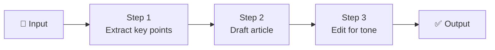
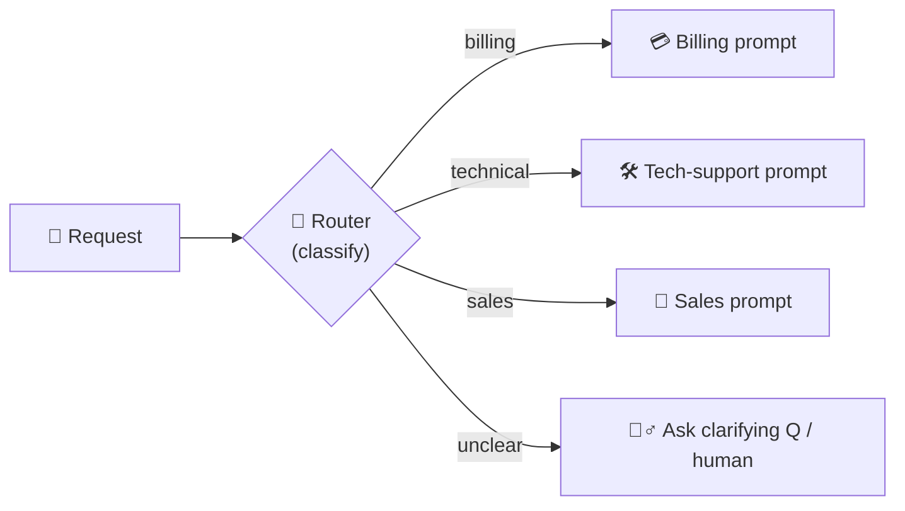
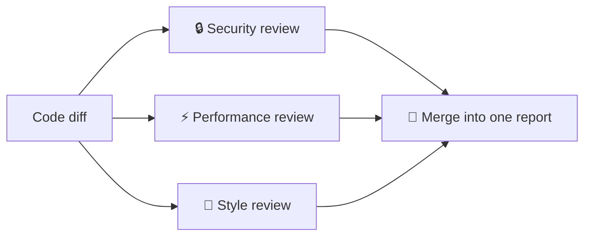
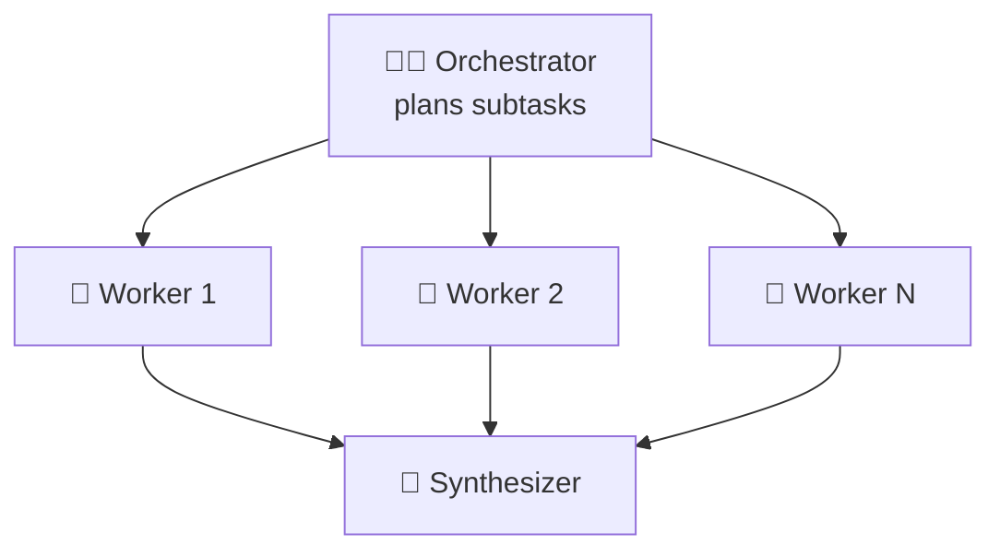
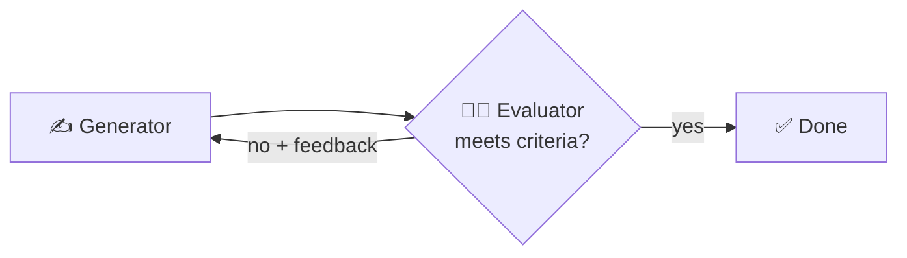
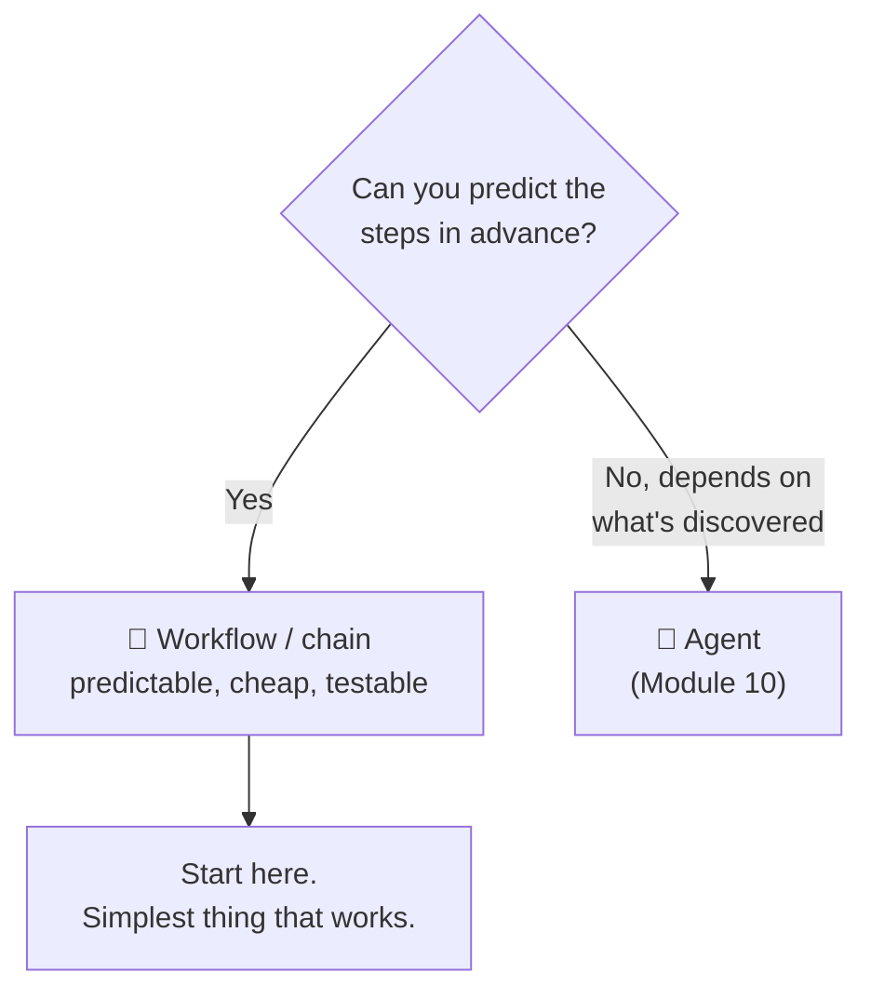

# 🔗 Module 08 — Prompt Chaining & Workflows

> 🔵 Stage 2 · Intermediate · ⏱️ ~2.5 hours

## 🎯 Learning Objectives

- Decompose complex tasks into **chains** of focused prompts
- Use the five core workflow patterns: **sequential, routing, parallelization, orchestrator-workers, evaluator-optimizer**
- Pass data between steps cleanly and add **gates/checks**
- Decide when a **workflow** is enough and when you need an **agent**

---

## 1. Why Chain?

A single "do everything" prompt is like asking one person to research, write, edit, fact-check and design a report in one breath. Chains give each step full attention.

| Benefit | Explanation |
|---|---|
| **Accuracy** | Each prompt does one thing well |
| **Debuggability** | You can see which step failed |
| **Control** | Insert validation, human review, or code between steps |
| **Cost** | Use cheap models for easy steps, strong ones for hard steps |
| **Reuse** | Steps become modular building blocks |

---

## 2. Pattern 1 — Sequential Chain



```python
points  = llm(f"List the 7 key points from this transcript:\n<transcript>{t}</transcript>")
draft   = llm(f"Write a 600-word blog post from these points:\n<points>{points}</points>")
final   = llm(f"Edit for a friendly tone and grade-8 readability. Keep facts unchanged.\n<draft>{draft}</draft>")
```

### Add a gate
Insert a check between steps; stop or retry if it fails:

```python
if not passes_check(points):            # e.g., at least 5 bullet points
    points = llm(retry_prompt)
```

---

## 3. Pattern 2 — Routing

Classify the input first, then send it to a specialized prompt (or a cheaper/stronger model).



```text
Router prompt:
Classify the request into one of: billing, technical, sales, unclear.
Output only the label.
<request>{{request}}</request>
```

---

## 4. Pattern 3 — Parallelization

Run independent sub-tasks at the same time, then combine.

- **Sectioning:** split a task into parts (e.g., review code for security, performance, style in three parallel calls).
- **Voting:** run the same task several times and aggregate (self-consistency, or multiple "judges").



```python
import asyncio
results = await asyncio.gather(
    allm(security_prompt), allm(perf_prompt), allm(style_prompt)
)
report = llm(f"Merge these reviews, remove duplicates, sort by severity:\n{results}")
```

---

## 5. Pattern 4 — Orchestrator-Workers

A planner LLM decides **dynamically** what sub-tasks are needed, dispatches them to worker calls, and synthesizes the results. Useful when you can't predict the sub-tasks in advance (e.g., "update every file affected by this change").



```text
Orchestrator prompt:
You are planning research for the question below. Output a JSON array of
3–6 independent sub-questions, each answerable on its own.
<question>{{question}}</question>
```

---

## 6. Pattern 5 — Evaluator-Optimizer

One prompt generates; another critiques against criteria; loop until it passes or a max-iteration limit is hit.



```python
draft = llm(gen_prompt)
for _ in range(3):
    review = llm(f"Score this 1-10 against the rubric and list fixes. Output JSON.\n<rubric>{rubric}</rubric>\n<draft>{draft}</draft>")
    if json.loads(review)["score"] >= 8:
        break
    draft = llm(f"Revise the draft using this feedback:\n{review}\n<draft>{draft}</draft>")
```

Great for translation, writing, code that must pass tests.

---

## 7. Passing Data Between Steps

- **Wrap outputs in tags** when inserting them into the next prompt (`<step1_output>…</step1_output>`).
- Prefer **structured outputs** (JSON) between steps so code can inspect them.
- Pass **only what's needed** — don't forward the whole history if step 3 needs only the summary.
- **Log every step's input and output** (essential for debugging, Module 15).

---

## 8. Workflow vs Agent — Choosing



> 🔑 **Start simple.** A single good prompt → a chain → an agent. Only add complexity when measurements show you need it.

---

## 9. Low-Code Options

You can build chains without heavy code using tools such as n8n, Zapier/Make AI steps, Flowise, Langflow, or frameworks like LangChain / LlamaIndex / DSPy (for code). Learn the patterns first; tools come and go.

---

## 🔑 Key Takeaways

- Chains trade one complex prompt for several **focused, testable** prompts.
- Five patterns: **sequential, routing, parallelization, orchestrator-workers, evaluator-optimizer.**
- Pass data with **tags/JSON**, add **gates**, **log everything**.
- Use workflows when steps are predictable; agents when they're not.

---

## 🏋️ Exercises

**8.1 — Design a chain** that turns a 1-hour meeting transcript into (a) action items and (b) a follow-up email.

<details>
<summary>✅ Sample solution</summary>

1. **Extract** (JSON): decisions, action items `{owner, task, due}`, open questions.
2. **Gate (code):** every action item has an owner; if not, mark "UNASSIGNED".
3. **Write email:** from the JSON only, 150 words, friendly-professional, action items as a table.
4. **Check:** a cheap model verifies every action item from step 1 appears in the email; if not, regenerate.

</details>

**8.2 — Pick the pattern.** Which pattern fits: (a) customer emails in 6 languages to the right team; (b) a marketing slogan improved until it scores ≥ 8; (c) summarizing 40 independent PDFs?

<details>
<summary>✅ Solution</summary>

(a) **Routing** · (b) **Evaluator-optimizer** · (c) **Parallelization (sectioning)**, followed by a merge step.

</details>

---

## ✅ Quick Quiz

1. Give three benefits of chaining.
2. What is a "gate"?
3. When is orchestrator-workers better than a fixed parallel chain?
4. What's the recommended order of complexity?

<details>
<summary>Show answers</summary>

1. Any three: accuracy, debuggability, control, cost optimization, reuse.
2. A programmatic or LLM check between steps that decides whether to continue, retry, or stop.
3. When the sub-tasks can't be known in advance and depend on the input.
4. Single prompt → chain/workflow → agent.

</details>

---

> © 2026 **Vicky Prasad Mahato** · [abvicky.in](https://abvicky.in)
> ⬅️ [Module 07](07-system-prompts-and-conversation.md) · ➡️ [Module 09 — Context Engineering & RAG](09-context-engineering-rag.md)
