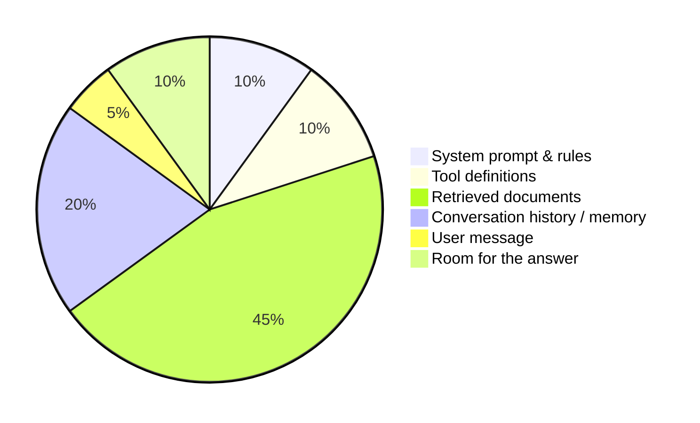
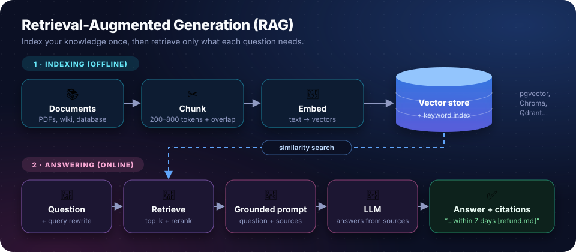

# 📚 Module 09 — Context Engineering & Retrieval-Augmented Generation (RAG)

> 🔵 Stage 2 · Intermediate · ⏱️ ~3 hours

## 🎯 Learning Objectives

- Understand **context engineering**: deciding *what* goes into the context window, in *what order*, and *how much*
- Prompt effectively with **long documents** (placement, quoting, citations)
- Build the mental model and a minimal implementation of **RAG**
- Write **grounded** prompts that cite sources and refuse when information is missing

---

## 1. From Prompt Engineering to Context Engineering

As apps grow, the hard question shifts from *"how do I phrase this?"* to *"what information should the model see right now?"* — that's **context engineering**.

**What fills a typical production context window (illustrative %):**



Principles:
1. **Relevant > more.** Irrelevant context distracts and costs money.
2. **Fresh > stale.** Inject current data (dates, prices, user profile).
3. **Structured > dumped.** Label each piece with tags and metadata.
4. **Order deliberately.** Long documents first, instructions & question last.
5. **Budget tokens.** Leave room for the answer (and thinking).

---

## 2. Long-Context Prompting

Modern models accept very long inputs (hundreds of thousands of tokens or more), but quality still depends on how you present it.

### ✅ Best practices

```xml
<documents>
  <document index="1">
    <source>annual_report_2025.pdf</source>
    <content>
      ...
    </content>
  </document>
  <document index="2">
    <source>board_minutes_q3.docx</source>
    <content>
      ...
    </content>
  </document>
</documents>

First, find the quotes from the documents most relevant to the question and
put them in <quotes> tags with the document index.
Then answer the question in <answer> tags, using only those quotes.
If the documents don't contain the answer, say so.

Question: What were the three main risks the board discussed regarding expansion?
```

| Practice | Why |
|---|---|
| Put long documents **at the top**, question **at the end** | Often noticeably improves answer quality on long inputs |
| Wrap each document with **source metadata** | Enables citations and disambiguation |
| **Quote-then-answer** | Forces the model to locate evidence, reducing hallucination |
| Ask for **citations** like `[doc 2]` | Lets users verify |
| Keep instructions **outside** the data tags | Prevents confusion & injection |

### "Lost in the middle"
Research (Liu et al., 2023) found models used information at the start and end of long contexts better than in the middle. Newer models are much better, but the habits above still help: put key instructions at the end, and retrieve only relevant chunks.

---

## 3. RAG — Retrieval-Augmented Generation

When your knowledge base is too large (or changes too often) to paste into every prompt, **retrieve** only the relevant pieces at query time.



### The two phases

**Indexing (offline)**
1. **Load** documents (PDF, HTML, DB rows).
2. **Chunk** them into passages (≈ 200–800 tokens, with some overlap; split on headings/paragraphs when possible).
3. **Embed** each chunk into a vector using an embedding model.
4. **Store** vectors + text + metadata in a vector database (pgvector, Chroma, Qdrant, Pinecone, Weaviate, FAISS…).

**Retrieval & generation (online)**
1. Embed the user's question.
2. Find the top-k most similar chunks (often combined with keyword/BM25 search = **hybrid search**).
3. Optionally **rerank** the results with a reranker model.
4. Insert the chunks into a **grounded prompt**.
5. Generate an answer with citations.

### Minimal RAG in Python (concept demo)

```python
# pip install anthropic chromadb
import chromadb, anthropic

docs = {
    "refund.md":   "Refunds are available within 7 days if less than 20% of the course is watched.",
    "certs.md":    "Certificates are issued after 100% completion and passing the final quiz.",
    "pricing.md":  "The Pro plan costs ₹999/month and includes all courses.",
}

db = chromadb.Client()
col = db.create_collection("kb")                       # uses a default embedding model
col.add(ids=list(docs), documents=list(docs.values()), metadatas=[{"source": k} for k in docs])

def answer(question: str) -> str:
    hits = col.query(query_texts=[question], n_results=2)
    context = "\n".join(
        f'<doc source="{m["source"]}">{d}</doc>'
        for d, m in zip(hits["documents"][0], hits["metadatas"][0])
    )
    prompt = f"""Answer the question using ONLY the documents below.
Cite the source in brackets, e.g. [refund.md].
If the documents don't contain the answer, reply: "I don't have that information."

<documents>
{context}
</documents>

Question: {question}"""
    resp = anthropic.Anthropic().messages.create(
        model="claude-sonnet-5-5", max_tokens=300,
        messages=[{"role": "user", "content": prompt}],
    )
    return resp.content[0].text

print(answer("Can I get a refund after 5 days if I watched 10%?"))
```

### The grounded-answer prompt template

```text
You are a support assistant. Answer using ONLY the information in <documents>.

Rules:
1. Cite sources for every claim using [source].
2. If the documents don't fully answer the question, say what's missing.
3. If documents conflict, mention both and prefer the most recent.
4. Never use outside knowledge for facts about our products.

<documents>
{{retrieved_chunks}}
</documents>

<question>{{question}}</question>
```

---

## 4. Improving RAG Quality

Most RAG failures are **retrieval** failures, not generation failures.

| Problem | Fix |
|---|---|
| Right chunk not retrieved | Better chunking; hybrid search; increase k; **query rewriting** |
| Chunk lacks context ("It costs ₹999" — what does?) | **Contextual chunking**: prepend a short summary of the source document/section to each chunk before embedding |
| Too many irrelevant chunks | **Reranking**; metadata filters (date, product, language) |
| User question vague | Ask the LLM to **rewrite the query** or generate multiple queries; **HyDE** (embed a hypothetical answer) |
| Multi-hop questions | Iterative retrieval / agentic RAG (retrieve → reason → retrieve again) |
| Answer ignores sources | Quote-then-answer; stricter grounding rules; lower temperature |
| Stale data | Re-index on change; store timestamps; prefer newest |

### Query rewriting prompt

```text
Rewrite the user's question into 3 search queries that would find relevant
passages in a company knowledge base. Expand abbreviations, include synonyms.
Output a JSON array of strings.
Conversation so far: {{history}}
Latest question: {{question}}
```

---

## 5. RAG vs Long Context vs Fine-Tuning

| Approach | Best when | Weakness |
|---|---|---|
| **Paste into prompt (long context)** | Knowledge fits in the window (<~100–200 pages) and changes often | Cost/latency per call (mitigate with prompt caching) |
| **RAG** | Large or frequently updated knowledge; need citations | Retrieval engineering; can miss info |
| **Fine-tuning** | Teach a *style, format, or narrow behavior* at scale; reduce prompt length | Poor for adding facts; costly to update; needs data |
| **Prompting alone** | Model already knows the domain | No private knowledge |

> 🔑 **Rule of thumb:** prompting first → add context/RAG for knowledge → fine-tune only for behavior that prompting can't achieve reliably.

---

## 6. Prompt Caching (context cost saver)

Many providers can **cache** a long, unchanging prompt prefix (system prompt, documents, tool definitions) so repeated calls are cheaper and faster. Design for it:

- Put **static content first** (instructions, documents), **dynamic content last** (user question).
- Don't insert timestamps or random IDs at the top of a cached prefix — any change breaks the cache.

---

## 🔑 Key Takeaways

- **Context engineering** = choosing the right information, structure, order and size.
- Long docs: **docs first, question last, tags + metadata, quote-then-answer, citations**.
- **RAG** = index (chunk → embed → store) + retrieve (search → rerank → grounded prompt).
- Most RAG bugs are **retrieval** bugs; fix chunking, search, and query rewriting.
- Prompting → RAG → fine-tuning, in that order.

---

## 🏋️ Exercises

**9.1 — Grounded prompt.** Write a prompt for answering HR policy questions from a 40-page handbook, with citations and a refusal rule.

<details>
<summary>✅ Sample solution</summary>

```xml
<handbook>
{{handbook_text_with_section_numbers}}
</handbook>

You answer employee questions about company policy.
1. Find the relevant passages and copy them into <quotes>, each with its section number.
2. Answer in <answer> in plain language, citing sections like (§4.2).
3. If the handbook doesn't cover it, say: "The handbook doesn't cover this —
   please contact hr@company.example." Do not guess.

Question: {{question}}
```

</details>

**9.2 — Debug RAG.** Users ask "How much is Pro?" and the bot says it doesn't know, although pricing.md says "The Pro plan costs ₹999/month." Suggest 3 causes.

<details>
<summary>✅ Solution</summary>

1. The chunk wasn't retrieved (embedding mismatch "how much" ↔ "costs"; try hybrid/keyword search or query rewriting).
2. k too small and other chunks ranked higher (increase k / add a reranker).
3. Chunking split "Pro plan" and the price into separate chunks, or the prompt's refusal rule is too strict. Inspect the retrieved chunks — always log them.

</details>

**9.3 — Choose an approach.** A law firm wants answers from 50,000 case files updated daily, with citations. Which approach?

<details>
<summary>✅ Solution</summary>

**RAG** (with hybrid search, metadata filters by jurisdiction/date, reranking, and mandatory citations). Long context can't hold 50k files, and fine-tuning is unsuitable for daily-changing facts and citations.

</details>

---

## ✅ Quick Quiz

1. Where should a long document go relative to the question?
2. Name the four steps of RAG indexing.
3. What is hybrid search?
4. Why is fine-tuning a poor way to add frequently changing facts?
5. How do you design prompts to benefit from caching?

<details>
<summary>Show answers</summary>

1. Document **first**, question/instructions **last**.
2. Load → chunk → embed → store.
3. Combining semantic (vector) search with keyword (e.g., BM25) search.
4. It's costly and slow to retrain, it doesn't reliably store facts, and it can't cite sources.
5. Put static content at the beginning and dynamic content at the end; keep the prefix byte-identical.

</details>

---

> © 2026 **Vicky Prasad Mahato** · [abvicky.in](https://abvicky.in)
> ⬅️ [Module 08](08-prompt-chaining-workflows.md) · ➡️ [Module 10 — Tool Use, Function Calling & Agents](10-tool-use-and-agents.md)
