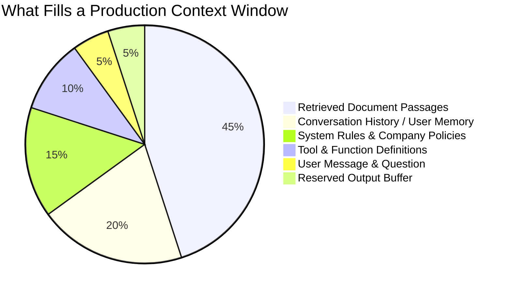

# 📚 Module 09 — Context Engineering & Retrieval-Augmented Generation (RAG)

> 🔵 Stage 2 · Intermediate · ⏱️ ~3 hours

Think back to your school or college days. Remember the difference between a closed-book exam and an open-book exam?

In a closed-book exam, you had to memorize hundreds of dates, formulas, and facts. If your memory drew a blank during the test, you had two choices: leave the page empty, or make up an educated guess.

In an open-book exam, you didn't have to memorize every single footnote. Instead, you kept your textbook right on your desk. When a question came up about contract law or thermodynamics, you flipped open the index, turned straight to Chapter 4, read the exact paragraph, and cited the author.

Prompt engineering began as a closed-book exam: you relied on whatever the model memorized during its training. 

**Retrieval-Augmented Generation (RAG)** turns the AI into an open-book researcher. Instead of expecting the model to remember your company's proprietary product manual or yesterday's pricing update, you search your documents for the exact paragraphs needed, place them on the model's digital desk, and ask it to answer using only that evidence.

In this module, you will learn the art of **context engineering** and how to ground AI answers in verified source documents.

---

## 🎯 Learning Objectives

By the end of this module, you will be able to:
- Understand the core principles of **context engineering**: what enters the context window, in what order, and with what metadata.
- Prompt effectively with massive documents without suffering from the "lost in the middle" attention drop.
- Master the two phases of **RAG**: offline indexing (chunk, embed, store) and online retrieval (search, rerank, ground).
- Use **quote-then-answer** prompt patterns to eliminate hallucinations.
- Choose accurately between long-context prompting, RAG, and model fine-tuning.

---

## 1. From Prompt Engineering to Context Engineering

When people first start using AI, they focus entirely on phrasing: *"Should I say please? Should I tell it to act as an expert?"*

In professional applications, phrasing is only 20% of the battle. The other 80% is **context engineering**: *What exact information should the model see right now, in what order, and what should be left out?*



### The 5 Golden Rules of Context Engineering
1. **Relevance over volume:** Shoving 50 irrelevant pages into the prompt increases latency, drives up costs, and distracts the model's attention.
2. **Freshness:** Inject real-time variables like today's date, current stock levels, and user account status.
3. **Structured labeling:** Wrap each document in clean XML tags with source metadata so the model can cite its work.
4. **Deliberate ordering:** Place reference documents at the beginning and specific questions/instructions at the very end.
5. **Budgeting:** Always leave enough tokens in the context window for the model's answer and internal reasoning.

> 👔 **Non-Tech Lens · Auditable Document Q&A in Chat Tools:**
> When uploading a vendor contract, policy handbook, or financial report into ChatGPT or Claude:
> - **The Grounding Rule:** *"Answer using ONLY facts directly stated in the attached document. If the document does not explicitly contain the answer, reply: 'Information not found in the provided document.' Never guess."*
> - **The Citation Rule:** *"For every claim in your answer, quote the exact sentence from the document and mention the section heading or page number."*
> This single prompt pattern eliminates 95% of hallucinations and makes the answer immediately verifiable for your team.

> 💻 **Tech Lens · Production RAG Architecture:**
> Even with 1-million-token context windows, production systems rely on RAG because reading 1M tokens on every API call is prohibitively slow and expensive. A modern production RAG pipeline uses:
> 1. **Hybrid Retrieval:** Dense vector search (captures semantic intent) combined with sparse BM25 keyword search (captures exact IDs, part numbers, and names) merged via Reciprocal Rank Fusion (RRF).
> 2. **Cross-Encoder Reranking:** Filter the top-30 retrieved candidate chunks down to the top-5 most relevant passages using a reranker model (like Cohere Rerank or BGE Reranker).
> 3. **Structured Grounding:** Feed the reranked chunks into XML tags with strict refusal thresholds.

---

## 2. Long-Context Prompting: Taming the 100-Page Document

When you paste an entire 50-page employee manual or legal brief into a prompt, models can suffer from an attention phenomenon known as **"Lost in the Middle"**: they recall facts at the very beginning and very end of the prompt far better than facts buried on page 27.

Here is the most reliable way to structure a long-context prompt:

```xml
<documents>
  <document id="1" source="leave_policy_2026.pdf">
    Employees are entitled to 18 days of earned leave per calendar year. Unused leave up to 10 days can be carried forward to the next year.
  </document>
  <document id="2" source="parental_policy_2026.pdf">
    Primary caregivers are eligible for 26 weeks of paid maternity leave. Secondary caregivers receive 4 weeks of paid paternity leave.
  </document>
</documents>

Follow this exact procedure:
1. Locate the exact sentences in the documents that address the user's question.
2. Quote them inside <quotes> tags, mentioning the document id.
3. Answer the question inside <answer> tags using ONLY those quoted sentences.
4. If the documents do not cover the question, state: "The provided documents do not contain this information."

Question: Can an employee carry forward 15 days of unused earned leave into next year?
```

### Why "Quote-Then-Answer" Works
Because language models generate text sequentially, forcing the model to reproduce the verbatim quote *first* ensures that its attention layers focus directly on the verified source text while formulating the answer.

---

## 3. How RAG Works: Indexing and Retrieval

When your company has 10,000 documents, you cannot paste them all into one prompt. You need RAG.


RAG operates in two distinct phases:

### Phase 1: Indexing (Done Offline)
1. **Load:** Read PDFs, Word documents, Notion pages, or customer tickets.
2. **Chunk:** Chop long text into small, self-contained paragraphs (typically 300 to 600 tokens).
3. **Embed:** Convert each text chunk into a list of numbers (a vector) using an embedding model. Similar concepts end up with similar numbers.
4. **Store:** Save the chunks, vectors, and source metadata into a **Vector Database** (like Chroma, pgvector, Qdrant, or Pinecone).

### Phase 2: Retrieval & Generation (Done When a User Asks a Question)
1. Convert the user's question into an embedding vector.
2. Search the vector database for the top 3–5 chunks most semantically similar to the question.
3. Paste those 3–5 chunks into a grounded prompt template.
4. Send the prompt to the LLM to generate an answer with citations.

---

## 4. Minimal Working RAG in Python

Here is a self-contained RAG script in Python using `chromadb`:

```python
import chromadb

# 1. Sample company knowledge base
knowledge_base = {
    "doc_wifi": "Guest Wi-Fi network is 'IndiraGuest' with password 'Welcome2026!'. Speeds are capped at 50 Mbps.",
    "doc_expense": "Meal expenses up to ₹1,500 per day are reimbursable on official domestic travel without prior approval.",
    "doc_holidays": "The office will remain closed on Diwali, Independence Day, and Republic Day.",
}

# 2. Initialize in-memory vector database
client = chromadb.Client()
collection = client.create_collection("office_kb")

# 3. Index documents (automatically creates embeddings)
collection.add(
    ids=list(knowledge_base.keys()),
    documents=list(knowledge_base.values()),
    metadatas=[{"source": k} for k in knowledge_base.keys()]
)

# 4. Search and Grounding function
def answer_query(user_question: str) -> str:
    # Retrieve top 2 most relevant chunks
    results = collection.query(query_texts=[user_question], n_results=2)
    
    retrieved_chunks = "\n".join(
        f'<doc id="{meta["source"]}">{text}</doc>'
        for text, meta in zip(results["documents"][0], results["metadatas"][0])
    )
    
    prompt = f"""You are a helpful office assistant. Answer the question using ONLY the documents below.
Always cite your source in brackets like [doc_id]. If the answer is not in the documents, reply: "I do not have information on that."

<documents>
{retrieved_chunks}
</documents>

Question: {user_question}"""
    
    return prompt

# Test query
print(answer_query("How much can I spend on food when traveling for work?"))
```

---

## 5. RAG vs. Long Context vs. Fine-Tuning

When you need an AI to know your company's data, which approach should you pick?

| Approach | When it is the best choice | Main drawback |
|---|---|---|
| **Long Context (Paste into chat)** | When you have 1 to 5 documents (< 100 pages) that change with every new task. | Higher token cost per prompt; slower first-token latency. |
| **RAG (Search & Retrieve)** | When you have thousands of documents, manuals, or customer tickets that update frequently and require citations. | Requires engineering to build search, chunking, and embedding pipelines. |
| **Fine-Tuning (Model Training)** | When you need to teach a model a specific writing style, unique programming syntax, or narrow output format at scale. | **Terrible for factual recall.** Expensive to update, prone to hallucination, and cannot cite specific source pages. |

> 🔑 **The Industry Rule of Thumb:** 
> Start with prompt engineering. Add **RAG** when the model needs private, changing factual knowledge. Use **fine-tuning** only to change behavior, tone, or formatting—never to teach factual knowledge.

---

## 💡 Common Mistakes & How to Spot Them

| Mistake | What goes wrong | How to fix it |
|---|---|---|
| The Blind Keyword Mismatch | A user asks: *"What is the cost of the subscription?"* but the document says *"Annual fee is ₹4,999"*. Keyword search finds nothing. | Use **hybrid search** (vectors + keywords) or prompt an LLM to rewrite the user's query into synonyms first. |
| Homeless Chunks | Chunking text into tiny sentences so that a chunk says: *"It costs ₹500"* without mentioning what "it" is. | Use **Contextual Chunking**: prepend the document title or section heading to each chunk before embedding. |
| The Over-Confident Hallucination | The model's retrieved chunks don't answer the question, but it answers anyway from memory. | Enforce a strict refusal rule: *"If the answer cannot be proven using the text inside `<documents>`, write: 'Not mentioned in sources.'"* |

---

## 🧪 Try It Now

Upload any multi-page PDF (a lease agreement, a credit card statement, or an insurance policy) into ChatGPT or Claude and test this prompt:

```text
Act as a strict compliance auditor.

Answer this question using ONLY facts explicitly written in the uploaded document:
"What are all conditions under which a claim can be rejected?"

Procedure:
1. First, quote the exact clauses and page numbers in <evidence>.
2. Then, summarize the rejection conditions in plain English as a bulleted list in <summary>.
3. If any detail is not explicitly mentioned in the text, write: "Not covered in the provided document." Do not guess or extrapolate.
```

Notice how the `<evidence>` step forces the model to verify facts before writing its summary.

---

## 🔑 Key Takeaways

- **Context engineering** is about curating the right information, order, and structure for the model's working memory.
- For long documents, place source materials at the top and questions/instructions at the end.
- Use **quote-then-answer** prompt patterns to eliminate hallucinations on document Q&A.
- **RAG** indexes documents offline (chunk, embed, store) and retrieves relevant passages at runtime to ground the model's answer.
- Prompting first, RAG for private knowledge, fine-tuning for style.

---

## 🏋️ Exercises

### Exercise 9.1: Write a Grounded HR Policy Prompt
Write a grounded prompt for an internal HR assistant that answers employee questions about sick leave using an attached company policy excerpt. 
Requirements:
- Must cite section numbers.
- Must refuse to answer questions outside the handbook.
- Must highlight any requirement for a medical certificate.

<details>
<summary>View Solution & Explanation</summary>

**A strong prompt:**

```xml
<handbook>
{{handbook_text_with_sections}}
</handbook>

You are the internal HR assistant for Acme Corp India. Answer the employee's inquiry below.

Rules:
1. Base your answer ONLY on the text inside <handbook>.
2. For each rule you cite, include the section number in brackets (e.g., [§3.2]).
3. If an illness lasts more than 2 consecutive working days, explicitly mention the requirement to submit a registered medical practitioner's certificate.
4. If the handbook does not cover the employee's specific situation, state: "Our handbook does not address this specific situation. Please reach out to hr-support@acme.example for guidance."

Employee Question: {{employee_question}}
```

</details>

### Exercise 9.2: Diagnose a RAG Failure
An e-commerce company launches a RAG bot. When a customer asks: *"Can I return my mixer grinder after 10 days?"*, the bot replies: *"I do not have that information"*, even though their returns document clearly says: *"Small kitchen appliances can be returned within 14 days of delivery."*

List three potential causes in the RAG pipeline that caused this failure.

<details>
<summary>View Solution & Explanation</summary>

**Three common root causes:**
1. **Vocabulary Mismatch in Search:** The customer searched for "mixer grinder", but the document used the term "small kitchen appliances". A pure keyword search would miss this (fixed by semantic vector embeddings or query expansion).
2. **Chunk Size Too Small:** The chunking algorithm separated the category "Small kitchen appliances" from the 14-day rule into two different chunks, so the retrieved snippet lacked context.
3. **Low Retrieval Top-K:** The vector search only retrieved the top 2 chunks, and chunks about general clothing returns outranked the appliance chunk. Increasing $k$ to 5 or adding a reranker solves this.

</details>

---

## ✅ Quick Quiz

1. Where should reference documents be placed relative to your instructions in a long prompt?
   - A) At the very end of the prompt.
   - B) At the beginning, with your instructions and specific question placed at the end.
   - C) In the middle of your sentences.
2. What are the four core steps of RAG offline indexing?
   - A) Prompt, Chat, Repeat, Save.
   - B) Load, Chunk, Embed, Store in a vector database.
   - C) Write, Format, Test, Publish.
3. Why is fine-tuning generally a poor choice for teaching an AI your company's daily product pricing?
   - A) Because fine-tuning is too easy.
   - B) Because fine-tuning models cannot reliably memorize exact changing numbers, cannot cite source pages, and is expensive to retrain daily.
   - C) Because fine-tuning only works for image models.

<details>
<summary>View Answers</summary>

1. **B** — Placing long documents first and instructions last counters the "lost in the middle" attention drop.
2. **B** — Offline indexing loads documents, splits them into chunks, embeds them into vectors, and stores them in a vector database.
3. **B** — Fine-tuning adapts style and format, but is brittle for fast-changing factual knowledge. RAG is the industry standard for factual retrieval.

</details>

---

> Author: **Vicky** ([abvicky.in](https://abvicky.in)) · Platform built by [Manikarnika Technologies](https://www.manikarnikatechnologies.in/) · © 2026 All rights reserved.
> ⬅️ [Module 08](08-prompt-chaining-workflows.md) · ➡️ [Module 10 — Tool Use, Function Calling & Agents](10-tool-use-and-agents.md)
