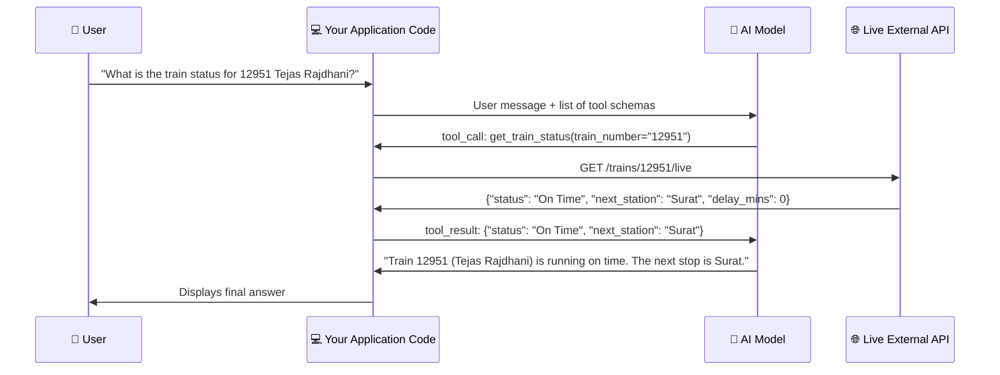
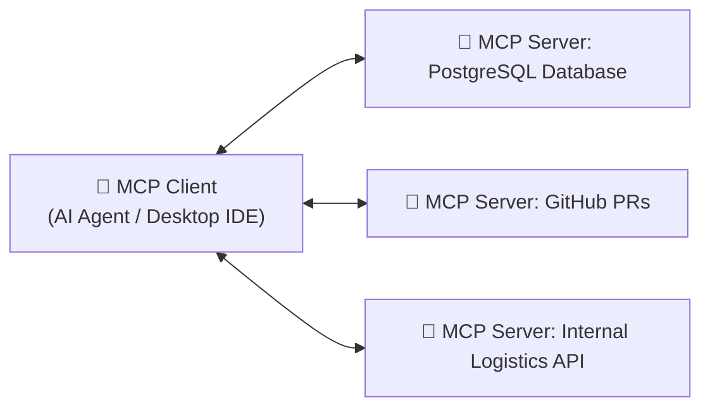

# 🤖 Module 10 — Tool Use, Function Calling & Agents

> 🟣 Stage 3 · Advanced · ⏱️ ~3.5 hours

Imagine hiring a brilliant research scientist, but locking them inside a soundproof room with no windows, no internet, and no phone.

They have read millions of books, so they can explain quantum physics or analyze Shakespeare with incredible depth. But if you ask them: *"What is the weather in Mumbai right now?"* or *"Can you book a meeting room for 3:00 PM?"*, they are completely helpless. They have no eyes and no hands.

Up until now, that is how we have used language models: as brains locked in a box.

**Tool use** (also called **function calling**) hands that brilliant scientist a smartphone, a calculator, and a keyboard. The model doesn't run the computer or execute the code itself; instead, it writes a structured request: *"Please look up the weather for Mumbai"* or *"Calculate 14,295 × 83 on the calculator"*. Your software runs the action and hands the answer back.

When an AI model uses tools repeatedly in a loop to accomplish a larger mission, it becomes an **autonomous agent**.

In this module, you will learn how tool use works, how to write tool descriptions that never confuse the model, and how to build safe agent loops with guardrails.

---

## 🎯 Learning Objectives

By the end of this module, you will be able to:
- Explain the complete lifecycle of a tool call from prompt to execution to final response.
- Write precise **tool definitions** (names, descriptions, and JSON schemas) that models call accurately.
- Build a Python **ReAct agent loop** with strict step limits and error handling.
- Understand the **Model Context Protocol (MCP)** and why it is becoming the universal standard for AI tools.
- Implement safety guardrails (like **human-in-the-loop** approvals) to prevent runaway costs or destructive actions.

---

## 1. What Is Tool Use?

An LLM cannot directly query your PostgreSQL database, ping an external API, or send an email. It can only generate text.

**Tool use is an agreement between the model and your application:**
1. You give the model a list of available tools with instructions on what each tool does.
2. If the user asks a question that requires live data or an action, the model pauses and responds with a structured JSON request naming the tool and its arguments.
3. Your application executes the real action (calling the API or database).
4. Your application returns the raw result to the model.
5. The model reads the result and composes a natural, human-friendly answer.



> 🔑 **The Critical Rule:** The model never touches the outside world directly. It only *requests* tools. **Your code** is the gatekeeper that decides whether to run the action, reject it, or ask a human for approval.

> 👔 **Non-Tech Lens · Tools in Everyday Chat Apps:**
> When you use ChatGPT to browse the web, create images with DALL-E, or analyze an Excel sheet with Python, you are using tool calling. The model didn't learn your spreadsheet during training; it wrote a snippet of Python, sent it to an internal code sandbox, read the numbers returned, and wrote a summary for you.

> 💻 **Tech Lens · ReAct Loops & Token Budgets:**
> Agents operate via the **ReAct (Reason + Act)** cycle: Thought → Tool Selection → Tool Execution → Observation → Repeat. Because autonomous loops can loop indefinitely when encountering unexpected errors, you must always enforce:
> 1. A hard `max_steps` cap (usually 5 to 10 steps).
> 2. A total token budget ceiling for the run.
> 3. Standardized tool integration via **Model Context Protocol (MCP)**.

---

## 2. Anatomy of a Great Tool Definition

A tool definition is simply a prompt written in JSON. The model reads your description to decide *whether* to pick the tool and *what* values to fill into its parameters.

```json
{
  "name": "lookup_customer_orders",
  "description": "Look up recent orders for a verified customer. Use this whenever the user asks about delivery dates, tracking links, or past purchases. Do NOT use this tool for processing refunds or canceling items; use 'request_order_cancellation' instead. Returns up to 5 orders sorted newest first.",
  "parameters": {
    "type": "object",
    "properties": {
      "customer_id": {
        "type": "string",
        "description": "The unique internal customer ID (e.g. 'CUST-84920'). Never guess this; it must come from verified session context."
      },
      "order_status": {
        "type": "string",
        "enum": ["all", "shipped", "delivered", "returned"],
        "description": "Filter by order status. Default is 'all'."
      }
    },
    "required": ["customer_id"]
  }
}
```

### The 6 Rules of Tool Authoring
1. **Clear Action Names:** Use `verb_noun` formatting like `get_weather`, `cancel_subscription`, or `search_kb`.
2. **Explicit "When to Use" and "When NOT to Use":** State the exact scenarios where the tool applies, and steer the model toward alternative tools for neighboring tasks.
3. **Specify Formats in Descriptions:** If a date is required, write `"Format: YYYY-MM-DD"`. If a phone number is needed, write `"Include country code, e.g., +91"`.
4. **Use Enums for Fixed Choices:** Don't let the model invent parameter strings. Provide an explicit list like `["low", "medium", "high"]`.
5. **Keep Return Payloads Compact:** When your Python function runs, return only the fields the model needs. Do not dump a 5,000-line raw database row into the context window.
6. **Return Actionable Errors:** If an API call fails, return `{"error": "Order #481 not found. Ask user to verify order number."}`. This gives the model the exact context it needs to ask a helpful follow-up question.

---

## 3. Building an Agent Loop in Python

An agent is simply a model that keeps going round this loop until the job is done: it thinks about what to do next, calls a tool, looks at what came back, and decides whether it's finished. The guardrails on the right are what keep that loop safe.


Here is a clean, minimal agent loop using Python and the Anthropic SDK:

```python
import anthropic
import json

client = anthropic.Anthropic()

# 1. Define the real Python function
def check_pincode_delivery(pincode: str) -> dict:
    available_pincodes = {"560001": 24, "560038": 48, "110001": 24}
    hours = available_pincodes.get(pincode)
    if hours:
        return {"deliverable": True, "delivery_time_hours": hours}
    return {"deliverable": False, "reason": "Pincode not currently serviceable."}

# 2. Tool definition schema
tools = [{
    "name": "check_pincode_delivery",
    "description": "Check if express delivery is available for a given 6-digit Indian postal pincode.",
    "input_schema": {
        "type": "object",
        "properties": {
            "pincode": {"type": "string", "description": "6-digit Indian postal code, e.g. '560038'"}
        },
        "required": ["pincode"]
    }
}]

tool_registry = {"check_pincode_delivery": check_pincode_delivery}

# 3. The Autonomous ReAct Loop
def run_customer_agent(user_message: str, max_steps: int = 5) -> str:
    messages = [{"role": "user", "content": user_message}]
    
    for step in range(max_steps):
        response = client.messages.create(
            model="claude-sonnet-5-5",
            max_tokens=1000,
            system="You are a helpful logistics assistant for an Indian retail brand. Use tools when needed.",
            tools=tools,
            messages=messages
        )
        
        # Save assistant message to conversational history
        messages.append({"role": "assistant", "content": response.content})
        
        # If the model didn't request a tool, it is done!
        if response.stop_reason != "tool_use":
            for block in response.content:
                if block.type == "text":
                    return block.text
                    
        # Otherwise, find and execute each requested tool
        tool_results = []
        for block in response.content:
            if block.type == "tool_use":
                func = tool_registry.get(block.name)
                try:
                    result = func(**block.input)
                except Exception as e:
                    result = {"error": str(e)}
                    
                tool_results.append({
                    "type": "tool_result",
                    "tool_use_id": block.id,
                    "content": json.dumps(result)
                })
                
        # Send tool output back to the model
        messages.append({"role": "user", "content": tool_results})
        
    return "I reached my maximum reasoning steps without finding a solution. Let me connect you with a human."

# Run test
print(run_customer_agent("Can you deliver a package to Indiranagar pincode 560038 today?"))
```

---

## 4. Model Context Protocol (MCP): The Universal USB for AI

Until recently, every company built custom wrappers to connect their database or GitHub repository to AI models. 

**Model Context Protocol (MCP)**, launched as an open standard by Anthropic in late 2024, is like **USB-C for AI tools**.

Instead of writing a custom integration for every tool, a developer writes one **MCP Server** (for example, an MCP server for PostgreSQL, a Google Drive MCP server, or a Slack MCP server). Any MCP-compatible client (like Claude Desktop, Cursor, or your backend agent) connects to that server instantly over a standard JSON-RPC protocol.



> 💡 **Prompting in the Age of MCP:** Because MCP standardizes tool protocols, **the descriptions you write for your MCP tools are the prompts** that dictate how every agent navigates your software. Clear descriptions matter more than ever.

---

## 5. Agent Safety & Guardrails

When you give an AI the ability to run tools, bugs stop being just ugly text; they can delete customer records, send unintended emails, or trigger unauthorized payments.

Always implement these four safety layers:

| Risk | The Guardrail | How to implement it |
|---|---|---|
| **Infinite Loops** | Hard step counter | Enforce `max_steps = 6`. If the model hasn't solved the task in 6 turns, halt execution. |
| **Runaway Costs** | Token and spend ceiling | Track cumulative input/output tokens per session; abort if spending exceeds ₹50 ($0.60). |
| **Destructive Actions** | **Human-in-the-Loop Approval** | Read-only actions (searching, fetching) run automatically. Irreversible actions (issuing refunds, deleting accounts, sending emails) require an explicit human confirmation click. |
| **Prompt Injection via Tool Results** | Delimit and sanitize data | Treat text returned from external websites or customer reviews as raw data inside `<untrusted_content>` tags. Never let read tools trigger write tools without validation. |

---

## 💡 Common Mistakes & How to Spot Them

| Mistake | What goes wrong | The Fix |
|---|---|---|
| The Vague Tool Name | Naming a tool `fetch_data`. The model calls it for everything or ignores it completely. | Name it `fetch_user_billing_history` and explain its exact use case. |
| The Over-Parameterized Tool | A tool with 14 optional parameters. The model gets confused and passes invalid combinations. | Split into two simpler tools or provide strong default values. |
| Unsupervised Write Permissions | Giving an agent direct API keys to delete database rows or charge credit cards. | Put an approval modal in front of every destructive endpoint. |

---

## 🧪 Try It Now

Open ChatGPT (with Advanced Data Analysis enabled) or Claude (with Analysis tool enabled) and try this:

```text
Create a sample dataset of monthly sales for 5 Indian cities (Mumbai, Delhi, Bengaluru, Hyderabad, Chennai) over the last 6 months.

Use your internal Python tool to calculate:
1. The city with the highest average monthly growth rate.
2. The total revenue across all cities.

Display the numbers and plot a quick bar chart comparing total revenue by city.
```

Watch the model pause, write Python code, execute it in its background sandbox, and inspect the output before presenting the chart. That is tool use in action.

---

## 🔑 Key Takeaways

- Tool use allows language models to request external actions; your application code performs the real execution.
- Tool descriptions are prompts. A clear description specifying when to use the tool and what parameters to pass is critical.
- Agents run tools in a **ReAct loop** (Reason + Act + Observe).
- The **Model Context Protocol (MCP)** standardizes how applications expose tools and data to AI models.
- Always enforce **human-in-the-loop approvals** for any destructive or financial action, and cap the maximum loop iterations.

---

## 🏋️ Exercises

### Exercise 10.1: Design an E-Commerce Refund Tool Schema
Design the JSON schema for a customer refund tool. 
Requirements:
- `order_id` (string)
- `refund_amount_inr` (number)
- `reason` (must be an enum of: `item_damaged`, `wrong_item_delivered`, `order_cancelled_prior_shipping`)
- `requires_manager_approval` (boolean: true if amount > ₹5,000)

<details>
<summary>View Solution & Explanation</summary>

```json
{
  "name": "process_order_refund",
  "description": "Issue a financial refund to a customer's original payment method. Only call this after verifying eligibility in order history. Never guess order IDs.",
  "parameters": {
    "type": "object",
    "properties": {
      "order_id": {
        "type": "string",
        "description": "Order reference code, e.g. 'ORD-98214'."
      },
      "refund_amount_inr": {
        "type": "number",
        "description": "Total amount in Indian Rupees (₹) to refund."
      },
      "reason": {
        "type": "string",
        "enum": ["item_damaged", "wrong_item_delivered", "order_cancelled_prior_shipping"],
        "description": "Pre-approved company refund reason."
      },
      "requires_manager_approval": {
        "type": "boolean",
        "description": "Must be set to true if refund_amount_inr is strictly greater than 5000."
      }
    },
    "required": ["order_id", "refund_amount_inr", "reason", "requires_manager_approval"]
  }
}
```

</details>

---

## ✅ Quick Quiz

1. Who actually runs the external code or API during a tool call?
   - A) The neural network weights inside the LLM.
   - B) The browser's JavaScript engine automatically.
   - C) Your application backend.
2. What happens if you do not enforce a `max_steps` limit on an agent loop?
   - A) An unexpected API error could cause the model to loop repeatedly, consuming your token budget and freezing your app.
   - B) The agent becomes smarter.
   - C) Nothing, agents automatically stop after 2 steps.
3. What is the Model Context Protocol (MCP)?
   - A) A new programming language for data scientists.
   - B) An open standard that normalizes how tools, databases, and resources connect to AI models.
   - C) A type of GPU processor.

<details>
<summary>View Answers</summary>

1. **C** — The LLM outputs a structured request string; your application code inspects, validates, and executes the real action.
2. **A** — Without a hard step counter, an agent can get stuck in a reasoning loop and rapidly drain your API quota.
3. **B** — MCP acts as the universal standard for exposing data and functions to AI agents.

</details>

---

> Author: **Vicky** ([abvicky.in](https://abvicky.in)) · Platform built by [Manikarnika Technologies](https://www.manikarnikatechnologies.in/) · © 2026 All rights reserved.
> ⬅️ [Module 09](09-context-engineering-rag.md) · ➡️ [Module 11 — Multimodal & Image Prompting](11-multimodal-and-image-prompting.md)
