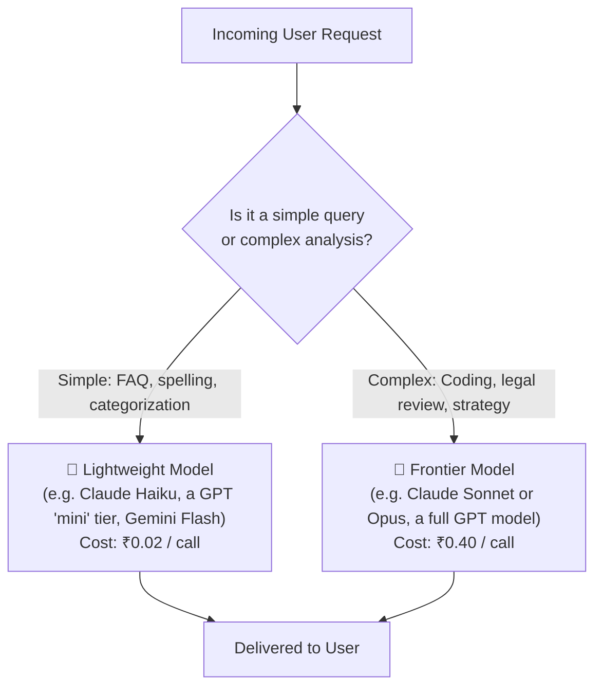

# ⚙️ Module 12 — Model Parameters, APIs & Cost

> 🟣 Stage 3 · Advanced · ⏱️ ~2.5 hours

Imagine you need to run to the corner kirana store to buy a carton of milk.

You wouldn't hire a luxury stretch limousine with a private chauffeur just to drive three blocks. You would walk, ride a bicycle, or hop on a scooter. 

Yet every single day, businesses make this exact mistake with artificial intelligence. They use their largest, most expensive flagship model to check spelling or classify a three-word subject line, burning through cash and waiting three seconds per response.

Understanding model parameters, APIs, and token economics is what separates casual tinkerers from real professionals. 

In this module, you will learn the levers that control model randomness and length, how to call major AI APIs with clean code, and how to calculate and cut your costs by 70% to 90% without sacrificing quality.

---

## 🎯 Learning Objectives

By the end of this module, you will be able to:
- Explain what an **API** is in plain language, even if you are not a programmer.
- Master the essential generation settings: **Temperature, Top-p, Max Tokens, and Stop Sequences**.
- Calculate exact token costs in both US Dollars ($) and Indian Rupees (₹).
- Apply cost-saving techniques: **model routing, prompt caching, and batch processing**.
- Handle API errors (like 429 rate limits) with exponential backoff and protect your secret keys.

---

## 1. What Is an API? (The Gentle On-Ramp)

If you have only used ChatGPT, Claude, or Gemini in your web browser, you have been using the **Consumer Interface**. You type into a box, and the company's servers send words back to your screen.

An **API** (Application Programming Interface) is simply a way for computer programs to talk to that same AI model directly behind the scenes.

Think of a restaurant:
- **The Chat Website:** You walk into the dining room, sit at a table, chat with the waiter, and eat your meal.
- **The API:** The restaurant's kitchen loading dock. Delivery drivers pull up with order tickets, food is packed into standardized crates, and trucks roll out every few seconds.

With an API, you pay only for the exact number of words (tokens) you send and receive. You don't pay a flat monthly consumer subscription.

> 👔 **Non-Tech Lens · What to Take From This Module:**
> You can skip the code samples here and still get the important parts. Read the parameter table in Section 2, because chat apps and "playground" screens use the same dials (temperature, maximum length). Read the cost math in Section 5, because it helps you judge quotes from vendors and decide whether an AI idea is affordable at your company's scale. When a developer on your team says "we'll use a smaller model for this step", Section 6 explains why that saves money.

> 💻 **Tech Lens · Same Concepts, Different Field Names:**
> Every provider's SDK takes the same ingredients: a model ID, system instructions, a list of messages, sampling parameters, a token limit, and optional tools. Learn one SDK well and the rest is mostly renaming. Treat every model ID in the samples as a placeholder, and check the provider's model list before you ship.

---

## 2. The Core Parameter Levers

Whenever you send a message to an AI through an API or developer playground, you can adjust several dials:

| Setting | What does it do? | Recommended Range | When to use it |
|---|---|---|---|
| **Temperature** | Controls randomness and creativity. | `0.0 – 0.2`: Strict & factual<br>`0.7 – 1.0`: Creative & varied | Use near `0` for JSON, classification, and code. Use higher values for brainstorming. |
| **Top-P (Nucleus)** | Restricts the pool of candidate words to the top cumulative probability $p$. | `0.9 – 1.0` (Leave default) | Alternative to temperature. Adjust either temperature or Top-p, never both at once. |
| **Max Tokens** | The hard ceiling on the number of tokens the model can generate in its reply. | Task-dependent | Protects your budget against runaway loops. If your output cuts off mid-sentence, increase this. |
| **Stop Sequences** | Specific text strings that immediately halt generation. | `["</answer>", "\n\nUser:"]` | Guarantees clean cutoff boundaries without trailing commentary. |
| **Frequency Penalty** | Penalizes words that have already appeared frequently in the text. | `0.0 – 0.4` | Stops models from getting stuck in repetitive loops during long prose. |

> ⚠️ **Reasoning Model Note:** Reasoning ("thinking") models often lock or ignore temperature. Instead, you control their depth of thought using a **thinking budget** or **reasoning effort** parameter (such as `low`, `medium`, or `high`).

---

## 3. The Same API Call in Four Ecosystems

No matter which provider you choose, the underlying concept is identical: you pass a **model name**, a **system instruction**, a list of **messages**, and your **parameters**.

### 1. Anthropic Claude (Python)
```python
import anthropic

client = anthropic.Anthropic()
response = client.messages.create(
    model="claude-sonnet-5-5",
    max_tokens=300,
    temperature=0.2,
    system="You are a concise business analyst.",
    messages=[{"role": "user", "content": "Explain unit economics in 2 sentences."}]
)
print(response.content[0].text)
```

### 2. OpenAI (Python)
```python
from openai import OpenAI

client = OpenAI()
response = client.chat.completions.create(
    model="YOUR_OPENAI_MODEL",  # pick a current model from OpenAI's model list
    max_tokens=300,
    temperature=0.2,
    messages=[
        {"role": "system", "content": "You are a concise business analyst."},
        {"role": "user", "content": "Explain unit economics in 2 sentences."}
    ]
)
print(response.choices[0].message.content)
```

### 3. Google Gemini (Python)
```python
from google import genai

client = genai.Client()
response = client.models.generate_content(
    model="YOUR_GEMINI_MODEL",  # pick a current model from Google's model list
    contents="Explain unit economics in 2 sentences.",
    config={"system_instruction": "You are a concise business analyst.", "temperature": 0.2}
)
print(response.text)
```

### 4. Local Open-Source Model (Ollama on your own laptop)
```python
from openai import OpenAI

# Connects to your local machine at zero cost
client = OpenAI(base_url="http://localhost:11434/v1", api_key="ollama")
response = client.chat.completions.create(
    model="llama3.1",
    messages=[{"role": "user", "content": "Explain unit economics in 2 sentences."}]
)
print(response.choices[0].message.content)
```

---

## 4. Streaming: Why Real-Time Typing Matters

When an AI generates 400 words, waiting for the entire paragraph to finish can take 4 to 6 seconds. To a human user staring at a loading spinner, that feels like an eternity.

**Streaming** uses Server-Sent Events (SSE) to deliver tokens the microsecond they are generated:

```python
# Streaming example in Python
with client.messages.stream(
    model="claude-sonnet-5-5",
    max_tokens=300,
    messages=[{"role": "user", "content": "Write a short poem about monsoons in Mumbai."}]
) as stream:
    for text in stream.text_stream:
        print(text, end="", flush=True)
```

The total generation time is the same, but the **Time to First Token (TTFT)** drops to under 500 milliseconds. Your application feels instant and responsive.

---

## 5. Token Math: How to Calculate Real Costs

AI providers bill per one million (1M) tokens. Output tokens almost always cost **3 to 4 times more** than input tokens because generating text requires memory bandwidth, while reading text can be parallelized.

### The Cost Formula
$$\text{Cost per Call} = \frac{(\text{Input Tokens} \times \text{Input Price}) + (\text{Output Tokens} \times \text{Output Price})}{1,000,000}$$

### Worked Example: Customer Support Bot
Suppose your company runs a support bot that handles 5,000 inquiries every day:
- Average input per conversation: 1,200 tokens (including system prompt and user query).
- Average output per conversation: 200 tokens.
- Flagship Model Pricing: \$3.00 per 1M input / \$15.00 per 1M output.

**Calculation:**
- Daily Input Cost: $(5,000 \times 1,200 \times \$3.00) / 1,000,000 = \$18.00$
- Daily Output Cost: $(5,000 \times 200 \times \$15.00) / 1,000,000 = \$15.00$
- Total Daily Cost: $\$33.00$ (approx ₹2,750)
- **Monthly Spend:** $\$33.00 \times 30 = \$990$ per month (approx ₹82,500)

Now look at what happens if you route simple tickets to a lightweight model (\$0.15 input / \$0.60 output):
- Total Monthly Spend drops to **\$49.50 per month (approx ₹4,100)**. 
- You save over **95% of your budget** while maintaining high quality.

---

## 6. Practical Levers to Slash Costs



1. **Model Routing (Cascades):** Send routine classifications and summaries to fast, cheap models. Escalate to your flagship model only when a confidence score is low.
2. **Prompt Caching:** Place your static documentation and system rules at the very start of the prompt. Providers discount cached input tokens by 50% to 90%.
3. **Batch APIs:** If a task does not need immediate real-time answers (for example, grading homework, tagging 5,000 blog posts, or running evals), use provider Batch endpoints for an automatic **50% discount**.
4. **Trim Verbosity:** Output tokens are the most expensive tokens you buy. Instruct the model: *"Be concise. Answer in under 3 bullet points."*

---

## 7. Error Handling and API Key Hygiene

When running prompts in code, your software must handle common HTTP status codes gracefully:

| Status Code | What it means | How your code should handle it |
|---|---|---|
| **400 Bad Request** | Your prompt exceeded the context window or had invalid JSON parameters. | Fix your prompt payload. Do not retry blindly. |
| **401 Unauthorized** | Your API key is expired, invalid, or missing. | Check your environment variables. |
| **429 Rate Limit** | You sent too many requests per minute. | Wait and retry using **Exponential Backoff with Jitter** (pause 1s, then 2s, then 4s with random microsecond variation). |
| **500 / 503 Overloaded** | The AI provider's servers are temporarily overwhelmed. | Retry after a brief pause, or fall back to an alternate provider. |

### API Key Security Rules
- 🔒 **Never hardcode API keys:** Always store them in a `.env` file or secret manager.
- 🚫 **Never push keys to GitHub:** Add `.env` to your `.gitignore` file immediately.
- 💻 **Never call AI APIs directly from client-side JavaScript:** If you put an API key in a React or mobile app, any user can inspect network traffic, steal your key, and drain your credit card. Always call the API from your secure backend server.

---

## 💡 Common Mistakes & How to Spot Them

| Mistake | What goes wrong | The Fix |
|---|---|---|
| The Mid-Sentence Cutoff | Answers stop abruptly in the middle of a thought. | Check `stop_reason`. If it equals `max_tokens`, increase your `max_tokens` limit or ask for a shorter format. |
| Tuning Both Temperature and Top-P | You adjust both knobs at once and get wild, unpredictable results. | Keep `top_p = 1.0` and adjust `temperature`, or vice versa. |
| The Uncapped Loop | An automated retry loop hits an invalid prompt and burns \$50 in 3 minutes. | Set a hard cap: `max_retries = 3`. |

---

## 🧪 Try It Now

Open your provider's developer playground (like the Anthropic Console, OpenAI Playground, or Google AI Studio):

1. Set **Temperature to 0.0**. Ask: *"Give me a 1-word name for an electric scooter startup."* Run it 3 times. Notice the answer is identical every time.
2. Now set **Temperature to 1.0**. Ask the exact same question 3 times. Notice the sudden burst of variety and creativity.

---

## 🔑 Key Takeaways

- An API is simply a programmatic doorway to the model that charges strictly for the tokens you consume.
- Use low temperature (`0.0 – 0.2`) for factual tasks, data extraction, and code. Use higher temperature (`0.7 – 1.0`) for creative writing.
- Output tokens are 3 to 4 times more expensive than input tokens. Keep outputs concise.
- Use **model routing** and **batch APIs** to cut enterprise AI bills by up to 90%.
- Always store API keys in backend environment variables, never in client-side code.

---

## 🏋️ Exercises

### Exercise 12.1: Calculate Monthly Architecture Costs
A legal tech startup in Delhi runs a contract analyzer. 
- Volume: 800 contracts per business day (22 days per month).
- Input per contract: 8,000 tokens of contract text + 1,000 tokens of system instructions.
- Output per contract: 600 tokens of risk analysis.
- Pricing: Input = \$2.50 / 1M tokens. Output = \$10.00 / 1M tokens.

Calculate the monthly cost in USD and INR (assume \$1 = ₹85).

<details>
<summary>View Solution & Explanation</summary>

**Step 1: Tokens per contract**
- Input: $8,000 + 1,000 = 9,000$ tokens
- Output: $600$ tokens

**Step 2: Cost per contract**
- Input Cost: $(9,000 \times \$2.50) / 1,000,000 = \$0.0225$
- Output Cost: $(600 \times \$10.00) / 1,000,000 = \$0.0060$
- Total per contract: $\$0.0285$

**Step 3: Monthly Total**
- Total contracts per month: $800 \times 22 = 17,600$ contracts
- Total Monthly Cost (USD): $17,600 \times \$0.0285 = \mathbf{\$501.60}$
- Total Monthly Cost (INR): $\$501.60 \times 85 \approx \mathbf{₹42,636}$

*Pro-tip:* If the startup uses Prompt Caching on the 1,000-token system prompt, they will save another ~10% on input costs!

</details>

---

## ✅ Quick Quiz

1. Why are output tokens generally more expensive than input tokens?
   - A) Because the AI company wants to discourage long answers.
   - B) Because generating tokens requires sequential memory bandwidth, while input tokens can be processed in parallel.
   - C) Because output tokens use more electricity on the user's laptop.
2. What does an HTTP 429 status code indicate?
   - A) Your prompt contained a spelling error.
   - B) The server has permanently deleted your account.
   - C) You exceeded the API's rate limit for requests or tokens per minute.
3. Where should your API key be stored in a production application?
   - A) Inside secure backend environment variables or a secrets manager.
   - B) In your public HTML header.
   - C) In the user's browser local storage.

<details>
<summary>View Answers</summary>

1. **B** — Autoregressive decoding is memory-bandwidth bound and occurs one step at a time, making it far more compute-intensive than parallel prefill.
2. **C** — A 429 response means you are sending requests faster than your account tier allows.
3. **A** — API keys must remain strictly on the backend to prevent theft and unauthorized use.

</details>

---

> Author: **Vicky** ([abvicky.in](https://abvicky.in)) · Platform built by [Manikarnika Technologies](https://www.manikarnikatechnologies.in/) · © 2026 All rights reserved.
> ⬅️ [Module 11](11-multimodal-and-image-prompting.md) · ➡️ [Module 13 — Evaluation & Testing](13-evaluation-and-testing.md)
