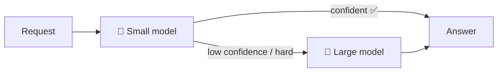

# ⚙️ Module 12 — Model Parameters, APIs & Cost

> 🟣 Stage 3 · Advanced · ⏱️ ~2.5 hours

## 🎯 Learning Objectives

- Use every common **generation parameter** deliberately
- Call the major LLM APIs (Anthropic, OpenAI, Google, open-source) with the same mental model
- Use **streaming, batching, caching** and **model routing** to manage cost and latency
- Estimate and reduce the **cost** of a prompt-powered feature
- Handle **errors, rate limits, retries**

---

## 1. Parameter Reference

| Parameter | Effect | Recommended |
|---|---|---|
| `temperature` | Randomness of sampling | 0–0.3 extraction/code/classification · 0.5–0.8 general writing · 0.8–1.0 brainstorming |
| `top_p` | Nucleus sampling cutoff | Leave default (≈1) unless tuning; don't tune together with temperature |
| `top_k` | Limit to k likeliest tokens | Rarely needed |
| `max_tokens` / `max_output_tokens` | Hard cap on output length | Set realistically; if output is cut off, check `stop_reason` = `max_tokens` |
| `stop` / `stop_sequences` | End generation at a string | e.g., `"</answer>"` |
| `frequency_penalty` / `presence_penalty` | Discourage repetition / encourage new topics (OpenAI-style APIs) | 0–0.5 for long creative text |
| `seed` | Best-effort reproducibility (some APIs) | Testing & debugging |
| `response_format` / schema | Structured output | Module 06 |
| `tools` / `tool_choice` | Enable tools / force a tool | Module 10 |
| thinking / reasoning effort | Budget for internal reasoning (reasoning models) | Higher for hard problems; lower for speed |
| `stream` | Receive tokens as generated | Chat UIs, perceived latency |

> ⚠️ Parameter names, ranges and availability differ by provider and model. Reasoning modes may ignore or restrict temperature. Always check the docs for the model you use.

> 👔 **Non-Tech Lens · Model Tiers & Budgeting for Your Team:**
> You don't need the most expensive model for every task:
> - **Lightweight Tier (GPT-4o mini, Claude Haiku, Gemini Flash):** 10x faster and 20x cheaper. Perfect for daily tasks like summarizing emails, reformatting notes, translating, or generating social drafts.
> - **Flagship Tier (Claude 3.7 Sonnet, GPT-4o):** Best for executive ghostwriting, deep document synthesis, contract analysis, and strategic problem-solving.
> Matching the right tier to each job keeps your monthly AI spend lean while maximizing quality.

> 💻 **Tech Lens · Token Economics, Streaming & Batch Optimization:**
> Production cost and latency require deliberate system architecture:
> 1. **Server-Sent Events (SSE) Streaming:** Always stream tokens to client UIs to minimize Time To First Token (TTFT < 800ms) and eliminate client-side timeout risks.
> 2. **Batch API:** Process background tasks (dataset labeling, periodic report generation, batch evals) using provider Batch endpoints for an automatic 50% discount and higher rate limits.
> 3. **Semantic Caching:** Cache deterministic query embeddings in Redis/vector store; identical or near-identical queries return cached completions in < 15ms at $0 token cost.

---

## 2. The Same Call in Four Ecosystems

**Anthropic (Python)**
```python
import anthropic
client = anthropic.Anthropic()
r = client.messages.create(
    model="claude-sonnet-5-5",
    max_tokens=500,
    temperature=0.2,
    system="You are a concise assistant.",
    messages=[{"role": "user", "content": "Explain recursion in 2 sentences."}],
)
print(r.content[0].text, r.usage)          # usage = input/output token counts
```

**OpenAI (Python)**
```python
from openai import OpenAI
client = OpenAI()
r = client.chat.completions.create(
    model="YOUR_MODEL",
    temperature=0.2,
    messages=[
        {"role": "system", "content": "You are a concise assistant."},
        {"role": "user", "content": "Explain recursion in 2 sentences."},
    ],
)
print(r.choices[0].message.content)
```

**Google Gemini (Python, google-genai)**
```python
from google import genai
client = genai.Client()
r = client.models.generate_content(
    model="YOUR_GEMINI_MODEL",
    contents="Explain recursion in 2 sentences.",
    config={"system_instruction": "You are a concise assistant.", "temperature": 0.2},
)
print(r.text)
```

**Local open model (Ollama, OpenAI-compatible endpoint)**
```python
from openai import OpenAI
client = OpenAI(base_url="http://localhost:11434/v1", api_key="ollama")
r = client.chat.completions.create(model="llama3.1", messages=[{"role": "user", "content": "Explain recursion in 2 sentences."}])
print(r.choices[0].message.content)
```

> 💡 Same concepts everywhere: **model, system instructions, messages, sampling params, max tokens, tools, usage**. Learn one deeply; the rest is syntax. SDK method names evolve — check current docs.

**cURL (raw HTTP)**
```bash
curl https://api.anthropic.com/v1/messages \
  -H "x-api-key: $ANTHROPIC_API_KEY" \
  -H "anthropic-version: 2023-06-01" \
  -H "content-type: application/json" \
  -d '{"model":"claude-sonnet-5-5","max_tokens":200,"messages":[{"role":"user","content":"Hi!"}]}'
```

---

## 3. Streaming

Stream tokens to show output as it's generated — the total time is the same, but **time-to-first-token** drops and the UI feels fast.

```python
with client.messages.stream(model="claude-sonnet-5-5", max_tokens=500,
        messages=[{"role": "user", "content": "Write a haiku about code."}]) as s:
    for text in s.text_stream:
        print(text, end="", flush=True)
```

---

## 4. Cost: Estimate, Then Reduce

### Formula

```text
cost per call = (input_tokens × input_price + output_tokens × output_price) / 1,000,000
monthly cost  = cost per call × calls per day × 30
```

**Example** (illustrative prices — check the current pricing page):
- Input $3 / M tokens, output $15 / M tokens
- Prompt 2,000 tokens, answer 500 tokens → (2,000×3 + 500×15) / 1M = **$0.0135 per call**
- 10,000 calls/day → **$135/day ≈ $4,050/month**

> Output tokens usually cost **3–5× more** than input tokens, and reasoning/thinking tokens are billed as output.

### Cost & latency levers

| Lever | Typical saving | How |
|---|---|---|
| **Smaller model** for easy tasks | 5–20× | Route classification/extraction to small models |
| **Model routing / cascades** | 2–10× | Try cheap model; escalate to strong model when confidence is low |
| **Prompt caching** | Large discount on cached input + faster | Static prefix first (Module 09) |
| **Batch APIs** | Often ~50% | Non-urgent jobs (overnight processing) |
| **Shorter prompts** | Proportional | Remove redundant instructions; fewer/shorter examples |
| **Shorter outputs** | Proportional (expensive tokens!) | Ask for concise formats; set `max_tokens` |
| **Avoid re-sending history** | Big for chatbots | Summarize old turns |
| **Lower reasoning effort** | Large on reasoning models | Only think hard when needed |
| **Cache answers** | 100% on hits | Cache identical/semantically similar queries |



---

## 5. Latency Levers

- Streaming (perceived latency)
- Smaller/faster model; lower reasoning effort
- Shorter outputs (generation time ≈ proportional to output tokens)
- Parallelize independent calls (Module 08)
- Prompt caching (faster prefill)
- Keep servers close to the API region; reuse HTTP connections

---

## 6. Errors, Rate Limits & Retries

| Error | Meaning | Handling |
|---|---|---|
| 400 | Bad request (invalid params, too long) | Fix the request; don't retry blindly |
| 401/403 | Auth/permission | Check key & permissions |
| 429 | Rate limit | **Exponential backoff with jitter**; respect `retry-after` |
| 500/503/529 | Server/overloaded | Retry with backoff; fall back to another model/provider |
| Timeout | Long generation | Stream; raise timeout; reduce output |

```python
import random, time
def with_retries(fn, max_tries=5):
    for i in range(max_tries):
        try:
            return fn()
        except RateLimitOrServerError:
            time.sleep(min(60, 2 ** i + random.random()))
    raise RuntimeError("Gave up after retries")
```

(Official SDKs already retry common errors automatically — configure `max_retries` rather than writing your own when possible.)

---

## 7. API Key Hygiene 🔐

- Store keys in environment variables / secret managers — never in code, prompts, or front-end apps.
- Add `.env` to `.gitignore`.
- Use separate keys per environment; set spend limits; rotate if leaked.
- Call LLM APIs **from your backend**, not directly from the browser.

---

## 🔑 Key Takeaways

- Parameters are levers: **temperature** for randomness, **max_tokens** for length, **stop** for clean endings, **schema/tools** for structure.
- All major APIs share one mental model.
- Cost = tokens × price; **output tokens dominate** — route, cache, batch, shorten.
- Stream for UX; back off on 429s; protect API keys.

---

## 🏋️ Exercises

**12.1 — Cost estimate.** A support bot gets 3,000 chats/day, averaging 4 turns. Each turn sends ~1,500 input tokens and returns ~250 output tokens. Prices: $1/M input, $5/M output. Monthly cost?

<details>
<summary>✅ Solution</summary>

Per turn: 1,500×1 + 250×5 = 1,500 + 1,250 = 2,750 → $0.00275.
Per chat: × 4 = $0.011. Per day: × 3,000 = $33. Per month: × 30 ≈ **$990**.
With prompt caching on the ~1,000-token static system prompt, input cost could drop substantially.

</details>

**12.2 — Truncated answers.** Users report answers cut off mid-sentence. What do you check?

<details>
<summary>✅ Solution</summary>

Check `stop_reason`/`finish_reason`: if it's `max_tokens`/`length`, raise `max_tokens` or ask for shorter answers. Also check for accidental `stop` sequences matching normal text, and client-side timeouts.

</details>

---

## ✅ Quick Quiz

1. Which costs more per token, input or output (usually)?
2. What does a 429 error mean and how do you handle it?
3. Name three ways to cut LLM cost.
4. Does streaming reduce total generation time?

<details>
<summary>Show answers</summary>

1. **Output**, usually several times more.
2. Rate limit — retry with exponential backoff and jitter; respect `retry-after`.
3. Any three: smaller model, routing, caching, batching, shorter prompts/outputs, summarizing history, lower reasoning effort.
4. **No**, it reduces *perceived* latency (time to first token).

</details>

---

> Author: **Vicky** ([abvicky.in](https://abvicky.in)) · Platform built by [Manikarnika Technologies](https://www.manikarnikatechnologies.in/) · © 2026 All rights reserved.
> ⬅️ [Module 11](11-multimodal-and-image-prompting.md) · ➡️ [Module 13 — Evaluation & Testing](13-evaluation-and-testing.md)
