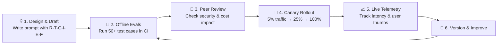
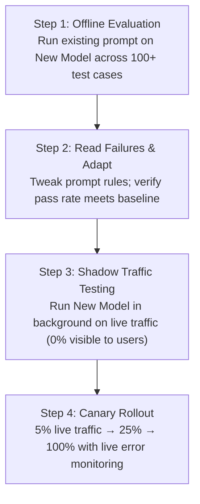

# 🏭 Module 15 — Production Prompt Engineering (PromptOps)

> 🌟 Stage 4 · Pro · ⏱️ ~3 hours

Think about the difference between making a cup of tea for yourself at home versus operating an industrial kitchen that brews 5,000 cups of chai for an airline flight every morning.

At home, you eyeball the sugar, toss in a crushed cardamom pod, taste it from the spoon, and call it done. 

In a commercial airline kitchen, you cannot afford guesswork. Ingredients are measured to the milligram, water temperature is logged on digital sensors, allergens are tracked, batch numbers are stamped on every container, and there is a documented procedure if a milk shipment arrives late.

Most people treat prompt engineering like making tea at home: they type a prompt into a web browser, like the response, and copy-paste it into an application.

**Production PromptOps** is running your prompts like that industrial kitchen. It is the discipline of treating prompts as versioned, tested, monitored, and dependable software assets that survive model upgrades, traffic spikes, and real-world edge cases.

In this module, you will learn how to organize prompts in code repositories, trace every token in production, manage model migrations without outages, and build reliability guardrails that keep your systems running smoothly.

---

## 🎯 Learning Objectives

By the end of this module, you will be able to:
- Manage prompts as **versioned software assets** stored in Git with clear changelogs.
- Render dynamic prompt templates safely using tools like Jinja2 with strict variable validation.
- Set up **telemetry and tracing** to monitor token spend, latency, and failure rates in real time.
- Execute zero-downtime **model migrations** using offline evals, shadow testing, and canary rollouts.
- Apply production reliability patterns like circuit breakers, fallbacks, and feature kill switches.

---

## 1. The Prompt Lifecycle

In a professional organization, a prompt moves through six distinct phases:



> 👔 **Non-Tech Lens · Building a Shared Team Prompt Library:**
> Without organization, team members waste hours rewriting prompts from scratch or getting inconsistent outputs for identical jobs. Build a shared "Prompt Playbook" in your company wiki (Notion, Google Docs, or Confluence):
> - Document the approved 5-part prompt brief, tested examples, and model recommendations.
> - Add a simple change log: *"March 2026 update: Added rule to format pricing in local currency."*
> - Designate an internal "AI Champion" to review and approve prompt templates for team-wide use.

> 💻 **Tech Lens · Production PromptOps Infrastructure:**
> In engineering organizations, prompts are version-controlled code assets. Follow three core rules:
> 1. **Decoupled Architecture:** Store prompts as versioned Markdown or Jinja templates in Git; never hardcode prompts inside application source files.
> 2. **Telemetry & Tracing:** Instrument all LLM calls with tracing tools (such as Langfuse, Arize Phoenix, or OpenTelemetry) to track latency (TTFT), token consumption, model IDs, and downstream errors.
> 3. **Canary Rollouts:** Gradually shift traffic from `prompt:v1` to `prompt:v2` using feature flags, monitoring user thumbs-up/down ratings and error rates in real time.

---

## 2. Prompts as Code: Folder Structure & Versioning

Never bury prompt text inside Python or TypeScript functions. Separate prompts into their own dedicated directory:

```text
my-project/
├── prompts/
│   ├── customer_support/
│   │   ├── system.v2.md
│   │   ├── system.v3.md          ← Current production version
│   │   ├── config.yaml           ← Model parameters & thresholds
│   │   └── CHANGELOG.md          ← Why changes were made
│   └── document_summarizer/
│       ├── summarize.v1.jinja
│       └── summarize.v2.jinja
└── evals/
    ├── customer_support.jsonl
    └── document_summarizer.jsonl
```

### The Configuration Contract (`config.yaml`)
Tie the prompt text directly to its model version and evaluation benchmarks:

```yaml
id: customer_support_triage
version: 3
model: claude-sonnet-5-5
fallback_model: claude-haiku-5-5
temperature: 0.2
max_tokens: 500
prompt_file: system.v3.md
eval_dataset: ../evals/customer_support.jsonl
minimum_eval_pass_rate: 0.94
owner: vicky@company.example
```

### The Rules of Versioning
1. **Never mutate an existing version:** When you change a single word, create `system.v4.md`. Never edit `system.v3.md` in place.
2. **Pin Prompt and Model Together:** A prompt tuned for one model can behave differently on another, even a newer version from the same provider. Always pin the model ID inside the configuration file.
3. **Mandatory Changelogs:** Every update must state: *What changed*, *Why it changed*, and *Evaluation results on the golden test set*.

---

## 3. Safe Templating with Jinja2

Building prompts by slapping strings together with Python `f-strings` is dangerous: missing variables fail silently, and unescaped customer text can accidentally break XML delimiters.

Use a dedicated templating engine like **Jinja2** with strict variable checks:

```python
from jinja2 import Environment, StrictUndefined

# 1. Enforce strict variable checking (fails loudly if a variable is missing)
env = Environment(undefined=StrictUndefined)

template_str = """
You are an executive assistant for {{ company_name }}.
Summarize the document below in at most {{ max_words }} words for a {{ audience }} audience.

<document>
{{ document_text | trim }}
</document>
"""

template = env.from_string(template_str)

# 2. Render safely
try:
    rendered_prompt = template.render(
        company_name="FreshHarvest India",
        max_words=100,
        audience="department head",
        document_text="Q3 revenue grew by 14% across Mumbai and Pune..."
    )
except Exception as e:
    print(f"Template rendering failed: {e}")
```

> 💡 **Input Sanitization:** Before injecting user text into `{{ document_text }}`, sanitize it: strip any accidental `</document>` closing tags that could trick the model's delimiter parser.

---

## 4. Observability: Tracing Every Token

In traditional software, you log database query execution times and HTTP status codes. In AI applications, you must log **traces**:

| Field to Record | Why it matters |
|---|---|
| **Trace ID & Session ID** | Allows you to reconstruct the entire multi-turn conversation. |
| **Prompt Version & Model ID** | Guarantees exact reproducibility when investigating bugs. |
| **Input Tokens & Output Tokens** | Tracks token spend per user and flags unexpected cost spikes. |
| **Time to First Token (TTFT)** | Measures user-perceived responsiveness. |
| **Stop Reason** | Alerts you if responses are getting truncated by `max_tokens`. |
| **Raw Input & Output (Sanitized)** | Essential for post-incident debugging and expanding your golden test set. |

> 🛠️ **Modern Tracing Tools:** Production teams use tools like **Langfuse**, **Arize Phoenix**, **LangSmith**, and **Helicone** to capture trace spans and visualize conversational latencies.

---

## 5. Production Reliability Patterns

| Pattern | How it protects your system |
|---|---|
| **Exponential Backoff with Jitter** | Retries 429 rate limits after 1s, 2s, 4s with random microsecond variation to avoid thundering-herd spikes. |
| **Fallback Models** | If your primary model encounters an outage or returns a 503 error, automatically route the request to a secondary provider (e.g. falling back from one provider's model to another's). |
| **Circuit Breakers** | If an API dependency fails 5 times in 60 seconds, pause all calls for 30 seconds and return cached answers rather than stalling user threads. |
| **Validation & Self-Repair** | Validate JSON outputs with Pydantic; if validation fails, send the error back to the model for an immediate one-turn correction. |
| **Feature Flags / Kill Switches** | A remote toggle that lets you disable an AI feature in under 5 seconds without redeploying backend code. |

---

## 6. The Model Migration Playbook

Providers release upgraded foundation models every few months. Upgrading your application blindly is a recipe for disaster: newer models follow instructions more literally, format lists differently, and may drop subtle conversational traits.

Follow this 4-step migration playbook:



1. **Offline Evaluation:** Run your existing prompt on the new model across your entire golden evaluation dataset. Compare pass rates, cost, and latency side by side.
2. **Read Failures & Adapt:** Inspect where the new model struggled. Often, newer models don't need workarounds you wrote for older models. Simplify the prompt and re-run evals.
3. **Shadow Testing:** Run the new model silently in the background on live production requests. Do not show the new model's output to real users; compare its responses against the current production model.
4. **Canary Rollout:** Shift 5% of real user traffic to the new model. If error rates remain flat and user ratings stay positive for 24 hours, increase to 25%, then 100%.

---

## 💡 Common Mistakes & How to Spot Them

| Mistake | What goes wrong | The Fix |
|---|---|---|
| Hardcoding Prompts | Embedding prompt text deep inside Python code. Updating a prompt requires a full code deployment. | Move prompts into separate `.md` or `.jinja` files loaded at runtime. |
| Blind Upgrades | Switching your production model to a newer version overnight. Formatting breaks for 10% of users. | Follow the 4-step migration playbook: Evals → Shadow → Canary → Rollout. |
| Missing Spend Caps | A crawler hits your AI endpoint and runs 50,000 queries, billing you \$2,000 in one night. | Enforce per-user rate limits and set hard monthly spend ceilings in your provider billing dashboard. |

---

## 🧪 Try It Now

Create a mock **Prompt Version Card** in your notebook for a prompt you use regularly at work:

```markdown
# Prompt Card: Executive Meeting Summarizer
- **Version:** v1.2 (2026-11-20)
- **Primary Model:** claude-sonnet-5-5 | **Fallback:** claude-haiku-5-5
- **Purpose:** Converts messy call transcripts into 3 action bullets with owners.
- **Recent Change:** Added rule requiring deadlines in DD-MMM format.
- **Eval Score:** 28/30 test cases passing (93.3%).
- **Owner:** [Your Name]
```

Notice how documenting your prompt changes makes your workflow disciplined and team-ready.

---

## 🔑 Key Takeaways

- Treat prompts as **version-controlled code**: store them in Git, write changelogs, and pin model IDs.
- Use safe templating engines like **Jinja2** with strict variable definitions to prevent silent failures.
- **Trace every token**: log prompt versions, latencies, token counts, and error codes for total visibility.
- Build production reliability: retries with jitter, fallback models, and feature kill switches.
- Never upgrade models blindly. Always use **evals, shadow testing, and canary rollouts**.

---

## 🏋️ Exercises

### Exercise 15.1: Write a Production Prompt CHANGELOG
Write a clean `CHANGELOG.md` entry for an e-commerce support prompt updating from `v2` to `v3`.
The change: Added a rule requiring all refund amounts to be formatted in Indian Rupees (₹) with commas, fixing an issue where users were confused by unformatted numbers.

<details>
<summary>View Solution & Explanation</summary>

```markdown
## [v3] — 2026-11-20
### Added
- Explicit currency formatting rule: "Always format monetary amounts with the ₹ symbol and standard Indian commas (e.g. ₹12,500, not 12500 INR)."

### Fixed
- Fixed issue where 14% of customer chats showed unformatted numbers, causing confusion regarding currency units (Support Ticket #619).

### Evaluation Results
- Golden Test Suite (`support_evals.jsonl`): 48/50 passing (96.0%, up from 92.0% in v2).
- Zero formatting regressions on billing and order status test categories.
- Average latency: 1.4s (no change).

### Metadata
- Target Model: `claude-sonnet-5-5`
- Owner: Vicky Prasad Mahato
```

</details>

---

## ✅ Quick Quiz

1. Why should you store prompts in separate files rather than hardcoding them inside application source code?
   - A) Because Python cannot store text longer than 100 characters.
   - B) To decouple prompt iteration and versioning from software code deployments.
   - C) Because Git cannot track strings inside code.
2. What is "shadow testing" in model migration?
   - A) Running the AI model late at night in dark mode.
   - B) Hiding the model behind an encrypted password.
   - C) Running a new prompt or model on live traffic in the background without showing the results to users, allowing side-by-side performance comparisons.
3. What does Jinja2's `StrictUndefined` setting do?
   - A) Raises an immediate error if a template variable is missing, preventing half-empty prompts from reaching the model.
   - B) Automatically translates prompts into Spanish.
   - C) Deletes unused files.

<details>
<summary>View Answers</summary>

1. **B** — Decoupling prompts allows prompt engineers to iterate, version, and evaluate prompts without requiring full application rebuilds.
2. **C** — Shadow testing provides real-world production validation without exposing users to potential regressions.
3. **A** — StrictUndefined prevents silent failures by ensuring all required variables are supplied before prompt execution.

</details>

---

> Author: **Vicky** ([abvicky.in](https://abvicky.in)) · Platform built by [Manikarnika Technologies](https://www.manikarnikatechnologies.in/) · © 2026 All rights reserved.
> ⬅️ [Module 14](14-safety-security-ethics.md) · ➡️ [Module 16 — Domain Playbooks](16-domain-playbooks.md)
