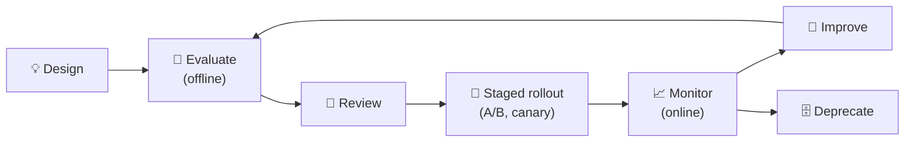
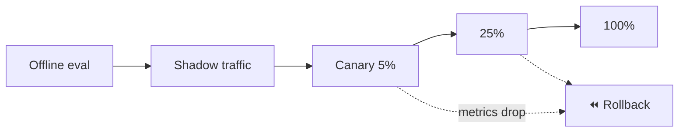

# 🏭 Module 15 — Production Prompt Engineering (PromptOps)

> 🌟 Stage 4 · Pro · ⏱️ ~3 hours

## 🎯 Learning Objectives

- Manage prompts as **versioned, reviewed, tested artifacts**
- Build **prompt templates** with variables safely
- Set up **observability**: logging, tracing, metrics, alerts
- Plan **model migrations** and **fallbacks**
- Run the full **prompt lifecycle** from idea to deprecation

---

## 1. The Prompt Lifecycle



> 👔 **Non-Tech Lens · Building a Shared Team Prompt Wiki:**
> Without organization, team members waste hours rewriting prompts or getting inconsistent outputs for the same job. Build a shared "Prompt Library" in Notion or Google Workspace:
> - Document the 5-part brief, tested examples, and model recommendations.
> - Add a simple change log: *"March 2026 update: Added rule to format pricing in local currency."*
> - Designate an internal "AI Lead" to review and approve prompt templates for team-wide use.

> 💻 **Tech Lens · Production PromptOps Infrastructure & Telemetry:**
> In engineering organizations, prompts are version-controlled assets. Practice modern PromptOps:
> 1. **Decoupled Architecture:** Store prompts as versioned Markdown or Jinja templates in Git; never hardcode prompts inside application source files.
> 2. **Telemetry & Tracing:** Instrument all LLM calls with tracing tools (Langfuse, Arize Phoenix, or OpenTelemetry) to track latency (TTFT), token consumption, model IDs, and downstream errors.
> 3. **Canary Rollouts:** Gradually shift traffic from `prompt:v1` to `prompt:v2` using feature flags, monitoring user thumbs-up/down ratings and error rates in real time.

---

## 2. Prompts as Code

### Store prompts separately from logic

```text
prompts/
├── support_bot/
│   ├── system.v3.md
│   ├── system.v4.md          ← current
│   └── CHANGELOG.md
├── summarizer/
│   └── summarize.v2.jinja
└── evals/
    ├── support_bot.jsonl
    └── summarizer.jsonl
```

```yaml
# prompts/support_bot/config.yaml
id: support_bot
version: 4
model: claude-sonnet-5-5
fallback_model: claude-haiku-5-5
temperature: 0.3
max_tokens: 600
system_prompt_file: system.v4.md
eval_set: ../evals/support_bot.jsonl
min_eval_score: 0.92
owner: vicky
```

### Versioning rules
- **Every change = new version**, with a changelog entry: what changed, why, eval results.
- Pin the **model version** together with the prompt version — a prompt tuned for one model may behave differently on another.
- Use **pull requests** with eval results attached; require review for production prompts.
- Keep old versions for instant **rollback**.

Prompt-management platforms (e.g., Langfuse, LangSmith, PromptLayer, Humanloop-style tools, or your provider console) can store versions, labels (`production`, `staging`) and link them to traces.

---

## 3. Safe Templating

```python
from jinja2 import Environment, StrictUndefined

env = Environment(undefined=StrictUndefined, autoescape=False)
template = env.from_string(open("prompts/summarizer/summarize.v2.jinja").read())

prompt = template.render(
    audience="executives",
    max_words=120,
    document=sanitize(user_document),        # escape tag-like text, trim length
)
```

```jinja
Summarize the document for {{ audience }} in at most {{ max_words }} words.

<document>
{{ document }}
</document>
```

Templating rules:
- **StrictUndefined** — fail loudly on missing variables rather than sending `{{ name }}` to the model.
- **Sanitize** user content: strip/escape your delimiter tags (e.g., a user typing `</document>`), enforce length limits.
- Keep **static parts first** for prompt caching.
- Don't build prompts by ad-hoc string concatenation scattered across the codebase.

---

## 4. Observability

Log every LLM call as a **trace**:

| Field | Why |
|---|---|
| Request ID, user/session ID (pseudonymous) | Debugging, joins |
| Prompt version, model, parameters | Reproducibility |
| Full input & output (redacted) | Failure analysis |
| Tool calls & results | Agent debugging |
| Tokens in/out, cost | Budgeting |
| Latency (TTFT, total) | Performance |
| Stop reason, errors, retries | Reliability |
| User feedback | Quality signal |

### Dashboards & alerts
- Cost per day/feature, tokens per request
- Latency p50/p95/p99
- Error & retry rates; fallback usage
- Quality: thumbs-down rate, judge scores on sampled traffic
- Safety: flagged inputs/outputs, injection attempts

> Tools: OpenTelemetry-based tracing, Langfuse, LangSmith, Arize Phoenix, Helicone, Datadog/New Relic LLM observability, or your own logging + dashboard.

---

## 5. Reliability Patterns

| Pattern | Description |
|---|---|
| **Retries with backoff** | For 429/5xx (Module 12) |
| **Fallback model/provider** | If primary fails or is overloaded |
| **Timeouts** | Avoid hanging requests; stream long outputs |
| **Validation + repair** | Schema check → retry with error message (Module 06) |
| **Circuit breaker** | Stop calling a failing dependency for a cooldown period |
| **Graceful degradation** | Show cached/simple answer or "try again" rather than crash |
| **Idempotency** | Don't repeat side effects (payments, emails) on retries |
| **Kill switch / feature flag** | Disable an AI feature instantly |

---

## 6. Model Migration Playbook

New models arrive constantly. Upgrading blindly can break things.

1. **Run your full eval suite** on the new model with the current prompt.
2. **Compare** quality, cost, latency side by side.
3. **Read failures** — newer models often follow instructions more literally, or have different default verbosity/format.
4. **Adapt the prompt** (remove workarounds that are no longer needed; add explicit format guidance).
5. **Shadow test** — run the new model on live traffic without showing results; compare.
6. **Canary rollout** — 5% → 25% → 100% with monitoring.
7. Keep the **old version available** for rollback.



---

## 7. Team Practices

- **Prompt style guide** for your org (tags, sections, tone, forbidden patterns).
- **Shared prompt library** of approved templates (see Appendix B).
- **Review checklist** for prompt PRs: clarity, injection safety, eval results, cost impact.
- **Ownership** — each production prompt has an owner.
- **Documentation** — why each rule exists (future you will want to delete it).
- **Privacy review** for prompts that handle personal data.

### Prompt PR checklist

- [ ] Changelog entry with rationale
- [ ] Eval suite run: score ≥ threshold, no new safety failures
- [ ] Cost & latency impact estimated
- [ ] Untrusted inputs delimited and sanitized
- [ ] No secrets or PII in the prompt
- [ ] Rollback plan

---

## 8. When to Fine-Tune Instead

Consider fine-tuning (or distillation into a smaller model) when:
- You have **thousands** of high-quality examples of the desired behavior.
- Prompting reaches a quality plateau or prompts become very long/costly at scale.
- You need a **specific style/format** consistently at high volume or lower latency.

Don't fine-tune to inject frequently changing knowledge (use RAG) or before exhausting prompt engineering and evaluation.

---

## 🔑 Key Takeaways

- Treat prompts as **code**: versioned, reviewed, tested, owned, documented.
- Use **strict templates** and sanitize inputs.
- **Trace everything**; dashboard cost, latency, errors, quality, safety.
- Build **fallbacks, validation, timeouts, kill switches**.
- Migrate models with **evals → shadow → canary → rollout**.

---

## 🏋️ Exercises

**15.1 — Write a CHANGELOG entry** for a prompt change that fixes the bot answering in English when users write Hindi.

<details>
<summary>✅ Sample solution</summary>

```markdown
## v5 — 2026-11-20
**Change:** Added rule "Reply in the same language/script the user writes in
(Hindi, Hinglish, English). If mixed, mirror the user's dominant language."
**Why:** 7% of Hindi-language chats received English replies (ticket #482).
**Evals:** support_bot.jsonl 0.93 → 0.95; new language cases 12/12 pass;
no regressions in safety set (40/40).
**Cost impact:** +18 tokens per request (negligible).
**Owner:** Vicky
```

</details>

**15.2 — Observability.** Which 5 fields would you log first for a RAG chatbot, and why?

<details>
<summary>✅ Solution</summary>

1. User question; 2. **retrieved chunk IDs & scores** (most RAG bugs are retrieval bugs); 3. final prompt version/model; 4. answer + citations; 5. tokens/latency/cost. Plus user feedback when available.

</details>

---

## ✅ Quick Quiz

1. Why pin the model version together with the prompt version?
2. What does StrictUndefined protect against?
3. List the steps of a safe model migration.
4. Name three reliability patterns.

<details>
<summary>Show answers</summary>

1. A prompt's behavior depends on the model; changing either can change results.
2. Silently sending unfilled template variables to the model.
3. Offline eval → compare → read failures/adapt prompt → shadow → canary → full rollout (with rollback ready).
4. Any three: retries/backoff, fallback model, timeouts, validation+repair, circuit breaker, graceful degradation, idempotency, kill switch.

</details>

---

> © 2026 [Manikarnika Technologies](https://www.manikarnikatechnologies.in/) · All rights reserved.
> ⬅️ [Module 14](14-safety-security-ethics.md) · ➡️ [Module 16 — Domain Playbooks](16-domain-playbooks.md)
