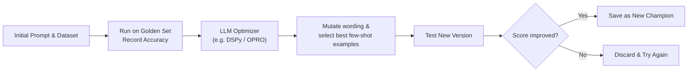
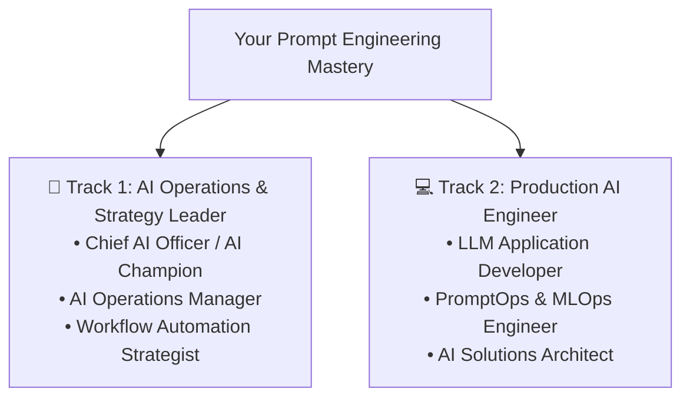

# 🌟 Module 17 — Becoming a Pro: Meta-Prompting, Optimization & Career

> 🌟 Stage 4 · Pro · ⏱️ ~2.5 hours

Think about learning to drive a car.

Almost anyone can learn to steer, press the accelerator, and stop at a red light after two weeks of driving school. That is enough to get you to the grocery store.

A professional rally driver, however, operates on a completely different level. They understand vehicle weight transfer, tire friction on wet gravel, how to brake without locking the wheels, and how to navigate hairpin mountain turns at speed without flinching.

You have now completed the core curriculum of prompt engineering. You understand tokens, prompt anatomy, few-shot examples, reasoning models, structured schemas, RAG pipelines, agents, and security guardrails.

Becoming a true pro is not about memorizing more "hacks" or copying so-called "magic prompts" from social media. It is about cultivating the disciplined instincts, meta-prompting skills, and rigorous habits of an empirical engineer.

In this final module, you will learn how to make AI write and optimize prompts for you, build an impressive portfolio that proves your expertise, prepare for high-paying AI roles, and map out your next 30 days of mastery.

---

## 🎯 Learning Objectives

By the end of this module, you will be able to:
- Use **meta-prompting** to make LLMs draft, critique, and debug your prompts.
- Understand **automatic prompt optimization** frameworks like DSPy and OPRO.
- Adopt the **10 daily habits** of top-tier prompt engineers.
- Build a compelling, metrics-driven **portfolio** for either a Non-Tech or Tech career track.
- Master answers to the top 12 AI engineering and prompt design interview questions.
- Execute a practical **30-day mastery roadmap** after completing this course.

---

## 1. Meta-Prompting: Prompts That Write Prompts

One of the best-kept secrets of senior prompt engineers is that they rarely write long prompts from a blank page. They use **meta-prompts** to make the model write its own instructions.

### The Production Prompt Generator
Copy and paste this into any frontier model to generate a structured prompt for a new task:

```text
You are an expert prompt engineer. I will describe a task, and you will write a complete, production-grade prompt for it.

Your generated prompt must follow these architectural rules:
1. Role & Mission: Specific expertise, target audience, and primary goal.
2. Context & Input: Place dynamic inputs inside clear XML tags (e.g. <document>{{text}}</document>).
3. Explicit Rules: Numbered constraints with brief rationales explaining why they exist.
4. Output Format: Exact visual shape, length limits, and negative boundaries (what to omit).
5. Error / Edge Case Handling: Instructions on how to handle ambiguous, missing, or contradictory input.

After presenting the prompt, provide:
- 3 representative test inputs.
- 2 tricky edge-case inputs to verify that the prompt doesn't break.

Task description: {{describe what you need the AI to do}}
```

### The Failure-Driven Prompt Debugger
When your prompt fails in testing, do not guess what went wrong. Hand the failure to the model:

```text
You are a senior prompt optimization specialist.

Below is an existing prompt, an input that produced an error, the bad output the model generated, and my ideal expected output.

<existing_prompt>
{{current_prompt_text}}
</existing_prompt>

<test_input>
{{input_text}}
</test_input>

<bad_output>
{{actual_bad_output}}
</bad_output>

<expected_output>
{{what_it_should_have_said}}
</expected_output>

Task:
1. Diagnose the root cause: Why did the prompt's instructions allow the model to produce this bad output?
2. Propose the minimal surgical edits to the prompt that fix this failure without over-constraining the model or breaking other general inputs.
3. Output the complete revised prompt.
```

---

## 2. Automatic Prompt Optimization (DSPy & APE)

Why tune prompt wording by hand when code can search for optimal prompts automatically?



- **APE (Automatic Prompt Engineer):** An LLM generates 20 candidate prompt variations, tests each across an evaluation set, and picks the highest-scoring candidate.
- **DSPy (Declarative Self-improving Python):** A framework created by Stanford researchers that replaces fragile string prompts with programmatic modules and optimizers. DSPy automatically compiles and tunes instructions and selects the best few-shot examples against a metric you define.

> ⚠️ **Watch for Overfitting:** Automated optimizers can easily overfit to small test sets (finding bizarre prompt phrases that work on your 15 test cases but fail on real users). Always validate the winning prompt on a **held-out test set** and verify that the instructions make logical sense to a human reader.

---

## 3. The 10 Habits of Expert Prompt Engineers

1. **Read the raw outputs:** Review hundreds of actual generation traces. Patterns and edge cases only reveal themselves at volume.
2. **Think from the model's perspective:** Ask yourself: *"Given ONLY the text inside this prompt, what is the most statistically probable continuation?"*
3. **Simplify relentlessly:** Every extra sentence of instructions increases attention competition. If an instruction isn't fixing a measured failure, remove it.
4. **Keep a Prompt Journal:** Document every prompt breakthrough and failure, noting the exact model ID and date.
5. **Test edge cases first:** Test empty inputs, massive inputs, Hinglish, emojis, and adversarial injection attempts before celebrating success.
6. **Separate concerns:** Give each prompt one clear job. Use prompt chains for multi-step tasks.
7. **Measure before claiming victory:** "It looks better to me" is an opinion. A 12% jump on your evaluation dataset is an achievement.
8. **Stay model-agnostic:** Do not build your entire architecture around temporary quirks of one specific model version. Anchor your work in timeless principles.
9. **Use delimiters religiously:** Separate data from instructions using XML tags like `<context>` and `<instructions>`.
10. **Ask the model for feedback:** When stuck, ask: *"Read this prompt and list 3 ambiguities that could cause you to misunderstand my intent."*

---

## 4. Career Pathways: Two Paths to Pro

Prompt engineering is rarely a standalone title anymore. It is a high-impact capability that supercharges two distinct career paths:



### 👔 Track 1: The AI Operations & Strategy Leader (Non-Tech Track)
- **Who it is for:** Managers, writers, operations heads, founders, domain consultants.
- **Your superpower:** Bridging messy business operations and AI tools. You turn chaotic 5-hour human workflows into automated custom assistants that save hundreds of team hours every month.
- **Your portfolio:** Case studies showing business ROI: *"Redesigned customer email triage with Claude Projects, cutting response time from 4 hours to 12 minutes while maintaining a 96% customer satisfaction score."*

### 💻 Track 2: The Production AI Engineer (Tech Track)
- **Who it is for:** Software developers, data scientists, full-stack engineers.
- **Your superpower:** Building type-safe, scalable, secure software powered by LLM APIs. You write Pydantic schemas, connect external databases with MCP, build hybrid RAG pipelines, and maintain CI/CD automated eval suites.
- **Your portfolio:** Public GitHub repositories with clean code, unit tests, architectural diagrams, and quantitative before-and-after eval benchmarks.

---

## 5. Building a Standout Portfolio

Clients and hiring managers do not care how many chat screenshots you have saved. They look for **evidence of rigorous problem-solving**.

Build **3 to 5 capstone projects** (see **[Appendix E — Capstone Projects](../appendix/E-capstone-projects.md)**). For each project, write a crisp 1-page case study following this structure:

1. **The Business Problem:** Who is this for, and why does it matter?
2. **The Architecture:** Diagram showing how data moves from user to model to database.
3. **The Prompts & Evolutions:** Show Prompt V1, the failures it caused, and how Prompt V2 solved them.
4. **The Evaluation Scorecard:** Hard numbers showing before-and-after metrics:
   ```text
   Baseline Prompt V1: 68.0% pass rate (failed on regional addresses and date formats)
   Refined Prompt V4:  94.5% pass rate on 100-case golden dataset
   Latency: Reduced from 3.8s to 1.2s via prompt caching
   ```
5. **Security & Guardrails:** What prompt injections did you test, and how did your defense-in-depth shield hold up?
6. **Lessons Learned:** What failed during development, and what did you learn about the model?

---

## 6. Interview Preparation: Master the Tough Questions

Practice answering these core interview questions aloud:

### 1. "How do you handle a model that hallucinates facts?"
*Model Answer Structure:* 
"First, I identify whether the model lacks the data or is merely guessing. If it lacks data, I connect a grounded RAG retrieval pipeline or API tool call. In the prompt, I enforce a quote-then-answer pattern and explicitly give the model permission to say 'Information not found'. Finally, I validate the generated answer against the source text using an automated faithfulness grader and lower the temperature to 0.0."

### 2. "How would you cut the cost of our production LLM system by 50% without hurting quality?"
*Model Answer Structure:*
"I implement a three-tiered approach:
1. **Model Routing:** I classify incoming queries with a fast classifier, sending routine tasks to lightweight models (like GPT-4o mini or Claude Haiku) and reserving frontier models for complex edge cases.
2. **Prompt Caching:** I place static system prompts, schemas, and reference documents at the very start of the prompt prefix to take advantage of provider cache discounts.
3. **Output Brevity:** Since output tokens cost 3 to 4 times more than input tokens, I tighten output formatting instructions to eliminate conversational filler."

---

## 7. Your 30-Day Pro Action Plan

| Week | Focus | Action Milestones |
|---|---|---|
| **Week 1** | **Personal Toolkit** | Build your personal prompt library (Appendix B) tailored to your day job. Set up Custom Instructions / Projects in your daily chat tool. |
| **Week 2** | **Capstone Project 1** | Build and evaluate Capstone Project 1 or 2 (Appendix E). Create a 50-case golden evaluation dataset. |
| **Week 3** | **Advanced Systems** | Build a RAG workflow, tool-using agent, or structured extraction pipeline. Red-team it with 10 adversarial injection tests. |
| **Week 4** | **Public Proof** | Publish your case study on GitHub or LinkedIn. Take the **[Final Exam](../appendix/D-final-exam.md)** to verify your mastery. |

---

## 💡 Common Mistakes & How to Spot Them

| Mistake | What goes wrong | The Fix |
|---|---|---|
| Chasing "Magic Words" | Believing there is a secret phrase that makes models 10x smarter. | Focus on fundamentals: clarity, context, clean data, and systematic evals. |
| The Unmeasured Portfolio | Showing impressive-looking demo videos without a single test metric. | Always include an evaluation table showing pass rates and error reductions. |
| Drowning in AI News | Spending 3 hours a day reading social media hype and never building anything. | Read provider release notes and landmark research papers; spend 80% of your time running prompts on real data. |

---

## 🧪 Try It Now

Open your chat app right now and test the **Prompt Critic** meta-prompt from Section 1 on one of your existing work prompts:

```text
Critique this prompt as a senior prompt optimization engineer. 
Score it from 1 to 5 on: Clarity, Specificity, Context, Structure, and Output Format.
For any score below 5, explain the exact flaw and provide an improved drop-in revision.

<prompt>
{{paste your work prompt here}}
</prompt>
```

Notice how the model identifies blind spots and ambiguities that you overlooked.

---

## 🔑 Key Takeaways

- Meta-prompting uses AI models to draft, critique, and debug your prompts, saving hours of manual trial-and-error.
- Expert prompt engineers read real outputs, simplify instructions, and test edge cases before declaring success.
- A standout portfolio features **measured before-and-after improvements** and transparent failure analyses.
- Stay current by reading primary sources (official provider documentation and research papers) and testing new models on your personal evaluation dataset.

---

## 🏋️ Exercises

### Exercise 17.1: Build Your 30-Day Commitment Card
Write down your personal 30-day prompt engineering roadmap:
1. Which track are you prioritizing? (👔 Non-Tech Track or 💻 Tech Track?)
2. What specific real-world problem at work will you solve with AI in the next 14 days?
3. Which Capstone Project from Appendix E will you build and publish?

<details>
<summary>View Sample Completed Commitment Card</summary>

```markdown
# 30-Day Prompt Engineering Commitment
- **Selected Track:** 💻 Tech Track (Production AI Engineering)
- **Workplace Project:** Building an automated customer feedback triage pipeline for our Indian retail app using FastAPI, Claude 3.5 Haiku, and Pydantic.
- **Capstone Project:** Project 2 (Document Q&A Assistant with Hybrid RAG and Citation Verification).
- **Target Completion Date:** 30 days from today.
```

</details>

---

## ✅ Quick Quiz

1. What is the primary benefit of meta-prompting?
   - A) It eliminates the need to learn prompt engineering.
   - B) It uses the model's pattern recognition to generate, critique, and optimize prompt structures faster than manual drafting.
   - C) It makes API calls completely free.
2. In an AI engineering job interview, what carries more weight with hiring managers?
   - A) Showing a video of a flashy prototype with no test data.
   - B) Showing an evaluation table detailing baseline pass rates, specific failure analyses, and measured accuracy improvements on a golden dataset.
   - C) Memorizing model release dates.
3. Why should you always test automatically optimized prompts on a held-out test set?
   - A) Because optimizers can easily overfit to small training sets, performing well on known examples but failing on new real-world queries.
   - B) Because held-out sets reduce latency.
   - C) Because DSPy requires two computers.

<details>
<summary>View Answers</summary>

1. **B** — Meta-prompting uses the LLM as an expert assistant to identify ambiguities and draft standardized prompt components.
2. **B** — Empirical evaluation and clear debugging methodology prove genuine engineering competence.
3. **A** — Automated prompt optimizers risk overfitting to specific test inputs; held-out evaluation guarantees real-world generalization.

</details>

---

## 🎓 Congratulations!

You have completed all 18 modules of **Prompt Engineering: Zero to Pro**!

You now possess the foundational theory, intermediate patterns, advanced architectures, and operational practices required to build world-class AI systems.

### Your Next Steps:
1. Test your mastery by taking the **[Final Exam (Appendix D)](../appendix/D-final-exam.md)**.
2. Build a portfolio-grade capstone with **[Capstone Projects (Appendix E)](../appendix/E-capstone-projects.md)**.
3. Bookmark the **[Cheat Sheet (Appendix A)](../appendix/A-cheat-sheet.md)** and **[Prompt Library (Appendix B)](../appendix/B-prompt-library.md)** for daily reference.

---

> Author: **Vicky** ([abvicky.in](https://abvicky.in)) · Platform built by [Manikarnika Technologies](https://www.manikarnikatechnologies.in/) · © 2026 All rights reserved.
> ⬅️ [Module 16](16-domain-playbooks.md) · ➡️ [Appendix A — Cheat Sheet](../appendix/A-cheat-sheet.md)
