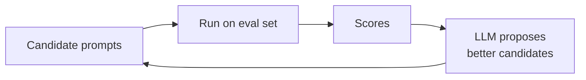
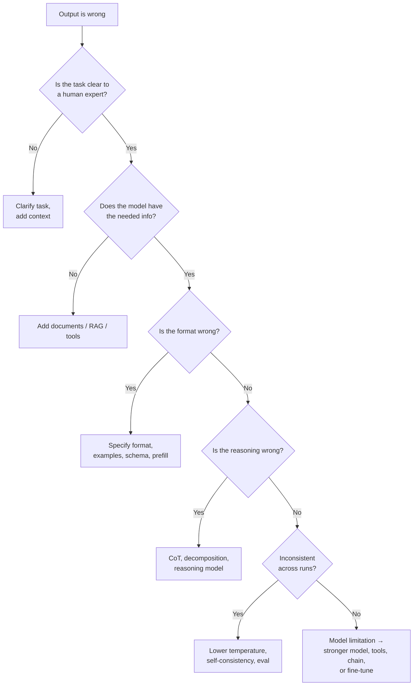
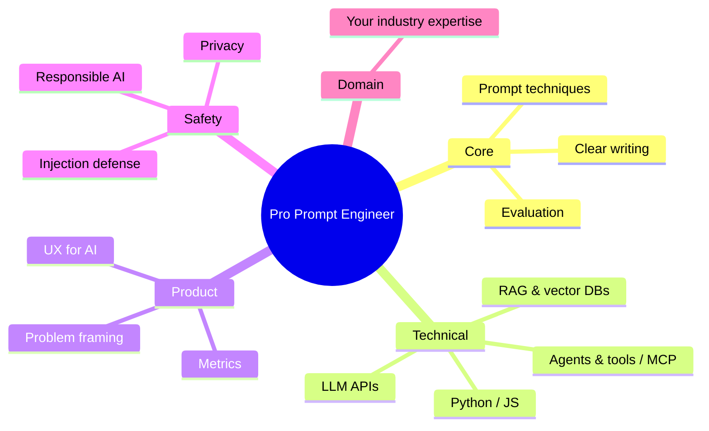

# 🌟 Module 17 — Becoming a Pro: Meta-Prompting, Optimization & Career

> 🌟 Stage 4 · Pro · ⏱️ ~2.5 hours

## 🎯 Learning Objectives

- Use **meta-prompting**: LLMs that write, critique and improve prompts
- Understand **automatic prompt optimization** (APE, OPRO, DSPy-style approaches)
- Develop the **habits** of expert prompt engineers
- Build a **portfolio**, prepare for **interviews**, and plan your **career** path
- Stay current without chasing hype

---

## 1. Meta-Prompting — Prompts That Write Prompts

### Prompt generator

```text
You are an expert prompt engineer. I'll describe a task; you write a
production-quality prompt for it.

Your prompt must include: role, task, context, input placeholders in
{{double_braces}}, constraints with reasons, output format, and handling for
missing/ambiguous input. Use XML tags for sections. After the prompt, list 5
test inputs (including 2 edge cases) I should try it on.

Task description: {{what you want}}
```

### Prompt critic

```text
Critique this prompt as a senior prompt engineer. Score 1–5 on: clarity,
specificity, context, structure, output format, robustness to edge cases,
injection safety. For each score below 5, give the specific fix.
Then output an improved version.
<prompt>{{prompt}}</prompt>
```

### Failure-driven improvement

```text
Here is a prompt and examples where it failed (input, bad output, expected).
Diagnose the root cause of each failure, group them, and propose the minimal
prompt edits that would fix them without breaking the passing cases.
<prompt>…</prompt>
<failures>…</failures>
```

> 💡 Provider consoles often include prompt generators/improvers. Use them as a starting draft — then evaluate like any other prompt.

---

## 2. Automatic Prompt Optimization

When you have an eval set (Module 13), you can let algorithms search for better prompts.

| Approach | Idea |
|---|---|
| **APE** (Automatic Prompt Engineer, Zhou et al., 2022) | LLM proposes many candidate instructions; keep the best-scoring |
| **OPRO** (Yang et al., 2023) | LLM sees past prompts + scores and proposes better ones iteratively |
| **DSPy** (Stanford) | Write the program as modules with signatures; optimizers tune instructions & few-shot examples against a metric |
| **Evolutionary / TextGrad-style** | Mutate and select prompts, or use LLM "textual gradients" (critiques) to update them |



⚠️ Optimizers overfit to small eval sets. Use a held-out set and read the winning prompt — it should make sense to a human.

---

## 3. The Habits of Expert Prompt Engineers

1. **Read the outputs.** Lots of them. Patterns appear only in volume.
2. **Think like the model.** "Given only this text, what would a smart reader do?"
3. **Simplify relentlessly.** Remove instructions and check if anything breaks.
4. **Keep a prompt journal** — what worked, what didn't, per model.
5. **Test edge cases first** — empty, huge, foreign-language, adversarial.
6. **Separate concerns** — one prompt, one job.
7. **Measure** before claiming improvement.
8. **Respect the model's strengths** — don't over-constrain capable models; give them goals and context.
9. **Stay model-agnostic** — principles over tricks.
10. **Collaborate with the model** — ask it what's unclear in your prompt: *"Before answering, list any ambiguities in my instructions."*

### The prompt-debugging decision tree



---

## 4. Careers in Prompt Engineering

Pure "Prompt Engineer" job titles exist, but the skill is more often part of broader roles:

| Role | How prompt engineering is used |
|---|---|
| **AI / LLM Engineer** | Builds LLM apps: RAG, agents, evals, production |
| **AI Product Manager** | Specs AI features, defines success metrics, reviews outputs |
| **Applied AI / Solutions Engineer** | Helps customers design prompts & systems |
| **Conversation / AI UX Designer** | Designs assistant personas, flows, tone |
| **AI Content Strategist / Writer** | Scales content with quality control |
| **AI Trainer / Data Specialist** | Writes examples, evaluates outputs, red-teams |
| **AI Safety / Red-Teamer** | Finds failure modes and vulnerabilities |
| **Automation Consultant / Freelancer** | Builds AI workflows for businesses |
| **Domain expert + AI** (doctor, lawyer, teacher, marketer…) | Uses AI to multiply output in their field |

### Skill stack for 2026+



---

## 5. Building Your Portfolio & Career Pathways

> 👔 **Non-Tech Career Path · The AI Operations & Strategy Leader:**
> - **Job Titles:** AI Champion, AI Workflow Strategist, Prompt Architect (Content & Operations), Executive AI Specialist.
> - **Core Value:** Translating messy human business processes into repeatable prompt templates and custom assistants. You build team prompt wikis, create company custom GPTs/Projects, and coach non-technical colleagues to reclaim 10+ hours a week.
> - **Portfolio Focus:** Case studies showing business impact (e.g. "Automated customer email classification from 4 hours/day to 15 mins with 94% accuracy").

> 💻 **Tech Career Path · The Production AI Engineer:**
> - **Job Titles:** AI Engineer, LLM Application Architect, PromptOps / MLOps Engineer, GenAI Software Developer.
> - **Core Value:** Architecting scalable, secure, type-safe software powered by LLMs. You implement function calling, MCP servers, hybrid RAG with vector databases, streaming API backends, automated CI/CD eval gates, and prompt injection defenses.
> - **Portfolio Focus:** GitHub repositories with full code, Pydantic schemas, unit test eval suites, and architectural diagrams.

Employers and clients want **evidence**. Build 3–5 projects that each show a different skill (see **Appendix E — Capstone Projects**).

For each project, publish (GitHub / personal site / blog):
1. **Problem** — who it's for, why it matters
2. **Approach** — prompt design, architecture diagram
3. **Prompts** — versions and what changed
4. **Evaluation** — test set, metrics, before/after numbers
5. **Safety** — threats considered, mitigations
6. **Demo** — screenshots, video, or live link
7. **Lessons** — what failed and what you learned

> A project with an eval table showing "v1: 71% → v4: 94%" is far more impressive than a flashy demo with no measurement.

---

## 6. Interview Preparation

### Common questions (practice answering aloud)

1. Explain how an LLM generates text to a non-technical stakeholder.
2. What's the difference between zero-shot, few-shot and chain-of-thought prompting? When would you use each?
3. How would you get reliable JSON output from an LLM in production?
4. A model hallucinates product prices. Walk me through how you'd fix it.
5. How do you evaluate a summarization feature?
6. What is prompt injection and how do you defend an agent against it?
7. RAG vs fine-tuning — how do you decide?
8. How would you reduce the cost of an LLM feature by 50% without hurting quality?
9. Describe a prompt you improved. How did you know it was better?
10. How do you migrate a product to a new model safely?
11. Design a customer-support bot for an e-commerce company end to end.
12. How do you handle a conversation that exceeds the context window?

<details>
<summary>✅ Model answer outline for Q4 (hallucinated prices)</summary>

1. **Diagnose:** does the model have the price data at all? Log a few failures.
2. **Ground:** retrieve prices from the product DB via RAG or a `get_price` tool — never from model memory.
3. **Prompt:** "Only state prices returned by the tool; if unavailable, say so."
4. **Validate:** code checks that every price in the answer matches the tool result.
5. **Evaluate:** a test set of price questions; measure price-accuracy before/after.
6. **Monitor:** alert if price mismatches appear in production.

</details>

<details>
<summary>✅ Model answer outline for Q11 (support bot design)</summary>

- **Requirements & metrics:** resolution rate, CSAT, escalation rate, latency, cost, safety.
- **Architecture:** router (intent/urgency) → RAG over help center & policies → tools (order lookup, return initiation) with least privilege → human handoff.
- **Prompts:** system prompt with identity, policies, tone, escalation; grounded-answer template; tool descriptions.
- **Safety:** injection defenses, no PII leakage, approval for refunds above a threshold.
- **Eval:** golden set of 200 real tickets (typical/edge/adversarial), LLM-judge calibrated with humans.
- **Ops:** prompt versioning, tracing, dashboards, canary releases, feedback loop.

</details>

### Practical take-home tasks you may get
- Improve a provided prompt and show eval results
- Build a small RAG or extraction pipeline
- Red-team a chatbot and report vulnerabilities
- Write a system prompt for a given persona and edge cases

---

## 7. Freelancing & Consulting

Services businesses pay for:
- Custom GPTs/assistants & internal chatbots over company docs
- Workflow automation (email triage, lead qualification, report generation)
- Prompt libraries & team training workshops
- Content pipelines with quality control
- AI audits: evaluate and secure existing AI features

Package them with **clear scope, measurable outcomes, and a maintenance plan**.

---

## 8. Staying Current (without drowning)

- **Primary sources first:** official docs, prompt engineering guides and cookbooks from model providers (Anthropic, OpenAI, Google), model release notes.
- **Research:** skim abstracts on arXiv for topics you use; read deeply only what's relevant.
- **Practice:** when a new model ships, re-run your personal eval set on it — you'll learn more than from any blog post.
- **Community:** open-source repos, conference talks, and practitioners' write-ups — favor those with measurements.
- **Rule:** if a "magic prompt trick" claims huge gains without evaluation, test it yourself before believing it.

---

## 9. Your 30-Day Pro Plan (after this course)

| Days | Goal |
|---|---|
| 1–5 | Build your personal **prompt library** (Appendix B) adapted to your field |
| 6–12 | Capstone project 1 with full eval (Appendix E) |
| 13–18 | Capstone project 2 involving RAG or agents |
| 19–22 | Red-team both projects; write up mitigations |
| 23–26 | Publish write-ups + demos; update résumé/LinkedIn |
| 27–30 | Mock interviews using Section 6; take the Final Exam (Appendix D) again |

---

## 🔑 Key Takeaways

- Use LLMs to **generate, critique and optimize prompts** — then evaluate.
- Expert habits: read outputs, simplify, measure, test edge cases, stay model-agnostic.
- Careers combine prompt skill with **engineering, product, safety, or domain expertise**.
- A portfolio with **measured improvements** beats flashy demos.
- Stay current through **primary sources and your own evals**.

---

## 🎓 Congratulations!

You've completed all 18 modules. Next steps:
1. Take the **[Final Exam](../appendix/D-final-exam.md)**
2. Build a **[Capstone Project](../appendix/E-capstone-projects.md)**
3. Keep the **[Cheat Sheet](../appendix/A-cheat-sheet.md)** and **[Prompt Library](../appendix/B-prompt-library.md)** handy

---

> © 2026 [Manikarnika Technologies](https://www.manikarnikatechnologies.in/) · All rights reserved.
> ⬅️ [Module 16](16-domain-playbooks.md) · ➡️ [Appendix A — Cheat Sheet](../appendix/A-cheat-sheet.md)
